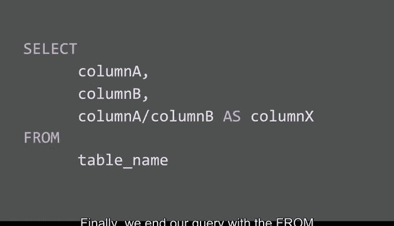
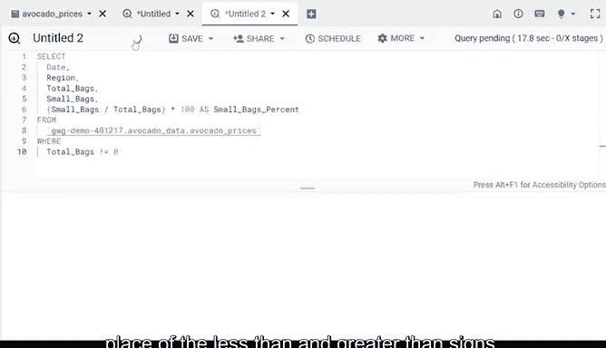

# 谷歌数据分析师第五课《通过数据分析回答问题》analyze-data（中英双字） - P35：35_04_04_在SQL中嵌入简单计算.zh_en - GPT中英字幕课程资源 - BV1q14y1o7Yj

Hi again， Earl， we showed you how to complete calculations in SQL。

 While there's a few different ways， embedding them in queries is a very useful one。😊。

When you include a calculation and a query with other commands， you can do more work faster。

Here's a basic query syntax that we talked about。We start with select and then the names of the columns we want to use in our calculations。

 Then we add in calculation details， including an operator， like a forward slash for division。Next。

 we type as followed by the new columns name to label the column with the calculated values。 Finally。

 we end our query with the from command and the name of the table that we're pulling data from。😊。

Now let's take it to the next level with some embedded calculations that use a syntax like this one。

Even better， we'll do this with some data about avocados。

 Sorry to those of you who aren't avocado lovers like me。Okay， let's get started。

 Feel free to continue watching as we show you the steps using BigQury。😊，If you're joining us。

 open up your tool of choice for using SQL。 Be sure to look through the instructions in the reading right before this video to help you get started。

 Okay， data is already loaded， so we can jump right in。

 Our goal is to find out the total number of bags of avocados sold on each date at each location using this data。

 There's already a column that shows us the total， but we want to make sure we understand how that total is calculated。

😊，We want to make sure that the total column is just small。

 large and extra large bags added together。 So we'll add the values in those three columns together in our query and then compare them to the total bags column in the data set。

 We'll start with the select command， which will use to pull certain columns from the table。

We are selecting several columns， so we'll press enter after select and after the comma after each column name。

Next， we'll type those column names。Date， region。Small， underscore bags。Large underscore bags。

Extra large underscore bags。In total， underscore bags。

Underscores are the lines used to underline words and connect text characters。

 Uing spaces can confuse certain servers and applications。

 So using underscores instead helps avoid potential issues while keeping the names readable。 Now。

 we'll add the calculation to the query using the names of the three columns with plus signs between them。

 Small bags plus large bags。Plus， extra large bags。Since we want this calculation in a new column。

 we'll use the as command to name the column total underscore bags， underscore Cc。

We've added the word Celc so we can compare the columns to each other after we calculate our results。

 Now， we'll finish our query with from and the name of the data set and subset we're pulling from avocado underscore data dot avocado underscore prices。

Okay， let's run the query。In the total bags count column。

 the data shows the sum of each date for the number of small。

 large and extra large bags of avocados that were sold at each location。

 If we quickly compare the two columns showing the total number of bags。

 we learn that the values are the same。This lets us know that the data we want to use is the right data。

 Now that we have verified the total number of bags， we can use those values in another query。

 We need to find what percent of the total number of bags were small bags。

Finding this out might help stakeholders make decisions on how to package avocados or which size bag to run a sale on。

Our job is to get that information to the stakeholders。 so we'll set up a new query。

We'll select the date， region， total bags and small bag columns for this query。Next。

 we'll set up a new column starting with our calculation to find the percentage of small bags。

 We need to first divide the number of small bags by the number of total bags using a slash as the operator。

We'll put this part of the calculation in parentheses to let the server know that this calculation should be performed first。

Then we'll multiply this total by 100 using an asterisk as our operator。

Multiply by 100 gives us a value。 That's a percentage instead of a decimal。

 percentagecentages usually make it easier for people to understand quickly when you share results with them。

 We'll use the as command to name this new column， small bags per。

Then we'll add from and the name of the set we're pulling from。And we'll run our query。 Oops。

 we got an error in our results。 It says that we can't divide by 0。 since we're finding percentages。

 dividing by 0 won't work。 This means that somewhere in the data set。

 there is a total bags equal to 0。 We'll have to fix this in our query。

We can fix this using the where command， where lets us add a condition to our calculation。

So after we type where， we'll type total underscore bags followed by a less than sign and then a greater than sign。

These symbols tell the server that the values we're calculating should not be equal to the value we specify。

 In this case， that values 0。 So we'll add a 0 to our query。Now， when we run the query。

 you'll notice our new column shows the percent of small bags and the total bags count。

We'd get the same results if we use an exclamation mark followed by an equal sign in place of the less than and greater than signs。

Note that this is one way for doing it， but there are functions such as safe divide that also allow you to avoid this error。

Those are just a couple of examples to get you started。 But with SQL。

 you can complete just about any calculation you want during your analysis and embedding the calculations in your queries will help you keep your analysis organized while getting your results。

 The calculation methods we showed you here are just the beginning。 So look for more coming up。

 See you soon。😊。

