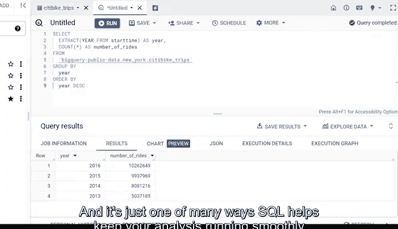

# 谷歌数据分析师第五课《通过数据分析回答问题》analyze-data（中英双字） - P36：36_04_05_与其他语句结合的计算.zh_en - GPT中英字幕课程资源 - BV1q14y1o7Yj

Hey， good to see you。 As a data analyst， you'll find that your calculations come in all shapes and sizes。

 Earlier， we showed you how to do some of the more basic calculations in SQL。

 While basic calculations are great。 Sometimes you'll need to group data before completing calculations。

 the group by and order by commands help you do this。😊。

These commands are usually paired with aggregate functions like sum or count。

 We'll show you how you can use these commands and functions to calculate and summarize data from groups of rows in a table。

😊，Let's explore the group by command first。 Group by is a command that groups rows that have the same values from a table into summary rows。

The group by command is used with select statements in a basic select from or select from where query group by comes at the end of the query。

All right， let's try using Group by。 We'll work with a database with data from a bike sharing system。

 We want to find out how many rides people took on these bikes per year。

This data has several columns， but for this task， we only need the start time column since this data set isn't organized by date and the start time column isn't organized by year。

 We'll need to include steps in our code to organize it。

 We also want a total number of rides each year。 So we'll need to include a calculation in our query for this。

 And depending on the questions we've been tasked with answering。

 This might be the first step of many in our analysis。We'll start our query with the select command。

We'll then add extract to our query。The extract command lets us pull one part of a given date to use。

 We'll extract the year from the start time column To do this。

 we'll add an open parentheses followed by year， which lets the server know the part of the date we need。

 Then we'll add the from command and start time。 So we can get the year from all of the start times in that column。

😊，We'll close the parentheses and then use as and the word year to name the column we're creating。

On the next line of the query， we'll use the aggregate function count。

 followed by an asterisk and parentheses。 This will count the bike rides in the start time column。

Using the asterisk， make sure that all the start times are counted in the data。

 Then we'll name our column number of rides with underscores between each word， instead of spaces。

We'll add from in the database we're pulling on the next line。 In this case， that's BigQuery。

 dashash， public dash data do new underscore York do city bikeike underscore trip。

And here's our group by command。 We'll use this to group the data by year。

 civil type group by followed by year。We can further organize our results by using the order by command。

 adding this after group by orders the results。😊，We'll add year to order the data by year。

It's good to note that by default， order by sort data and asc sendingending order。😊。

Now we can run our query to get the results。The years are ordered starting with 2013 and ending with 2016。

If we want to change this to descending order， we can add the keyword D ESC to the end of the query and run it again。

But whichever order you use， the group by and order by commands are great for helping us complete and organize a calculation for our analysis。

 This is one way to include calculations when aggregating data。

 And it's just one of many ways that SQL helps keep your analysis running smoothly and moving forward。

 There's still more to come on calculations in SQL。 Com up， We'll learn more about data validation。

 See you soon。😊。

