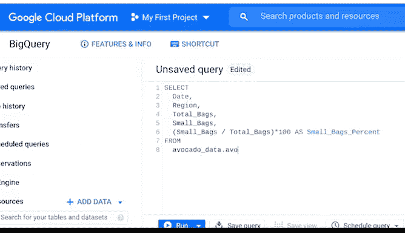
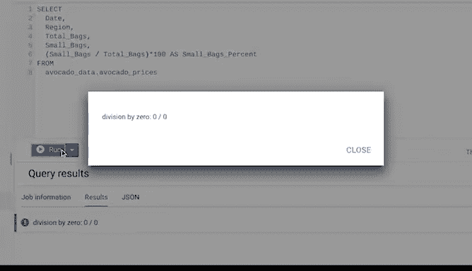
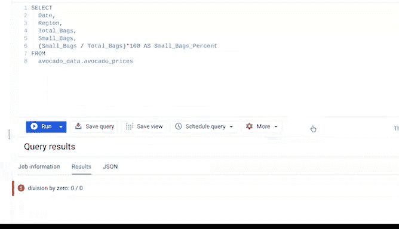

# 谷歌数据分析师第五课《通过数据分析回答问题》analyze-data（中英双字） - P37：37_04_01_反复检查与验证.zh_en - GPT中英字幕课程资源 - BV1q14y1o7Yj

Hi again， earlier we covered data validation， a spreadsheet function that adds drop down lists to cells using data validation lets you control what can and can't be entered into your worksheet。

One of its uses is protecting structured data and formulas in your spreadsheets。

But as useful as it is， the data validation function is just one part of a larger data validation process。

 This process involves checking and recheing the quality of your data so that it is complete。

 accurate， secure and consistent。While the data validation process is a form of data cleaning。

 you should use it throughout your analysis。 If this all sounds familiar to you， that's good。

 En you have good data is super important。And in my opinion。

 it's kind of fun because you can pair your knowledge of the business with your technical skills。

This will help you understand your data， check that it's clean and make sure you're aligning with your business objectives。

In other words， it's what you do to make sure your data makes sense。Keep in mind。

 you'll build your business knowledge with time and experience。 and here's a pro tip。

 asking as many questions as possible whenever you need to will make this much easier。😡，Okay。

Let's say we're analyzing some data for a furniture retailer。

 We want to check that the values in the purchase price column are always equal to the number of items sold times the product price。

So we'll add a formula and a new column to recalculate the purchase prices using a multiplication formula。

Now， comparing the totals， there's at least one value that doesn't match the value in the purchase price column。

 We need to find an answer to help us move forward with our analysis。

By doing some research and asking questions， we find that there is a discount of 30% when customers buy five or more certain items。

If we hadn't run this check， we could have missed this completely。You've learned that as an analyst。

 calculations are a big part of your job。 so it's important that whenever you do calculations。

 you always check to make sure you've done them in the right way。

Sometimes you'll run data validation checks that are common sense checks。 For example。

 let's say you're working on an analysis to figure out the effectiveness of in store promotions for a business that's only open on weekdays。

You check to make sure that there's no sales data for Saturday and Sundays。

 If your data does show sales on weekends， it might not be a problem with the data itself。

 It might not even be a problem at all。 There might be a good reason。

 like maybe your business host special events on Saturdays and Sundays。

 then you would have sales for those weekends。 You still might want to leave out the weekend sales and your analysis if your objective is only to look at the weekenddays。

But doing the state of validation might save you from miscalculations and other errors in your analysis。

You should always do data validation no matter what analysis tool you're using。 In an earlier video。

 we use SQL to analyze some data about avocados。 One of the queries was a check to make sure the data showing the total number of bags was the sum of small。

 large and extra large bags by running this query。 we were able to determine that the total number column was accurate。

 And that LED us to continue our analysis。😊。

But when we tried to find what percent of the total number of bags was small。

 we ran into a small problem。We received an error message about dividing by zero。

We fix that error by adjusting our query。

If we had linked that query to a presentation that went to our stakeholders。

 they'd show us the divide by zero error instead of the figures we wanted。

By building in these types of checks as part of your data validation process。

 you can avoid errors in your analysis and complete your business objectives to make everyone happy。

 And trust me， it's a great filling when you do。😊，And another great feeling is knowing that you've made it through another video and learned something new。

 And we have more where that came from coming soon。 See ya。😊。

