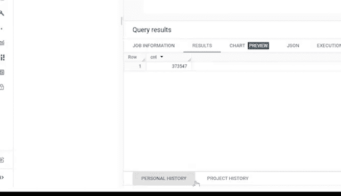

# 谷歌数据分析师第五课《通过数据分析回答问题》analyze-data（中英双字） - P38：38_04_01_临时表.zh_en - GPT中英字幕课程资源 - BV1q14y1o7Yj

Hello again。 Now， if you're like me， you always have sticky notes available near by to write a reminder or figure out a quick math problem。

 Sticky notes are useful and important， but they're also disposable。

 since you usually only need them for a short time before you recycle them。

 Data analysts have their own version of sticky notes when they're working in SQL。

 They're called temporary tables。 and we're here to find out what they're all about。

 A temporary table is a database table that is created and exists temporarily on a database server。😊。

Tim tables， as we call them， store subsets of data from standard data tables for a certain period of time。

 Then they're automatically deleted when you end your SQL database session。

Since temp tables aren't stored permanently， they're useful when you only need a table for a short time to complete analysis tasks like calculations。

For example， you might have a lot of tables you're performing calculations on at the same time。

 If you have a query that needs to join 7 or 8 of them， you could join the two or three tables。

 having the fewest number of rows and store their output in a temp table。

 You could then join this temp table to one of the other bigger tables。

Another example is when you have lots of different databases you're running queries on。

 you can run these initial queries in each separate database and then use a temp table to collect the results of all of these queries。

 The final report query would then run on the temporary table。

 You might not be able to make use of this reporting structure without temporary tables。

 They' are also useful。 if you've got a large number of records in a table。

 and you need to work with a small subset of those records repeatedly to complete some calculations or other analysis。

😊，So instead of filtering the data over and over to return the subset。

 you can filter the data once and store it in a temporary table。

 Then you can run your queries using the temporary table you've created。

Imagine that you've been asked to analyze data about the bike sharing system we looked at earlier。

 You only need to analyze the data for bike trips that were over 60 minutes or longer。

 but you have several questions to answer about the specific data。

Using a temporary table will let you run several queries about this data without having to keep filtering it。

There's different ways to create temporary tables in SQL。

 depending on the relational database management system you're using。

 We'll explore some of these options soon。For this scenario， we'll use BigQu。

 We'll apply a width clause to our query。 The with clause is a type of temporary table that you can query from multiple times。

 though with clause approximates a temporary table。 Basically。

 this means it creates something that does the same thing as a temporary table。

 Even if it doesn't add a table to the database you're working in for others to see。

 you can still see your results。 and anyone who needs to review your work can see the code that LED to your results。

😊，Let's get this query started。We'll start this query with the width command。

We'll then name our temp table trips。 underscore over， underscore1， underscore HR。

Then we'll type the as command and an open parentheses。On a new line。

 we'll use the select from where structure for our sub queryry。We'll type select。

 followed by an asterisk。 You might remember the asterisk means you're selecting all the columns in the table。

Now we'll type the from command and name the database set we're pulling from BigQuery， dashash。

 public dash data do New underscore York do City bikeike underscore trips。Next。

 we'll add a wear clause with the condition that the length of the bike trips we need in our temp table are greater than or equal to 60 minutes In the query。

 It goes like this。 trip duration， space， greater than sign equal sign， space 3600。 Finally。

 we'll add a close parentheses on a new line to end our subquery。

 And that sets up our temporary table。 Now， we can run queries that will only return results for trips that lasted 60 minutes or longer。

 Let's try one。 Since we're working in our version of a temp table。

 we don't need to open a new query。 Instead， we'll label our queries before we add our code to describe what we're doing。

😊，For this query， we'll type two hashtags。This tells the server that this is a description and not part of the code。

 Next， we'll add the query description。Count how many trips are 60 plus minutes long。

And then we'll add our query。Select， then on a new line。

 count with an asterisk in parentheses and as followed by C and T to name the column with our count。

Next， we'll add from and the name we're using for our version of a temporary table trips over one hour。

When we run our query， the results show the total number of bike trips from the data set that lasted 60 minutes or longer。

 We can keep running queries on this temp table over and over。

 as long as we're looking to analyze bike trips that were 60 minutes and over。😊。

And if you need to end your session and start a new runtime later。

 most servers store the code used in temp tables。 You'll just need to recreate the table by running the code。

When you use temporary tables， you make your own work more efficient。

 Naming and using temp tables can help you deal with a lot of data in a more streamlined way。

 so you don't get lost repeating query after query with the same code that you could just include in a temp table。

And here's another bonus to using temp tables。 They can help your fellow team members， too。

 with temp tables， your code is usually less complicated and easier to read and understand which your team will appreciate。

😊，Once you start to explore temporary tables on your own， you might not be able to stop。

 Don't say I didn't warn you coming up， We'll explore even more things you can do with temp tables。

 See you soon。