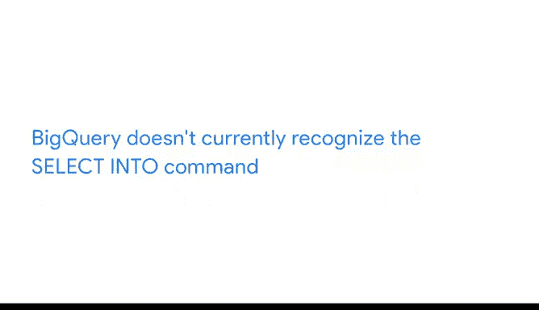
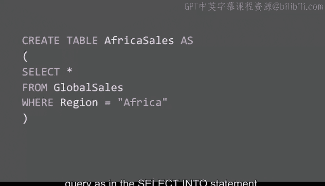
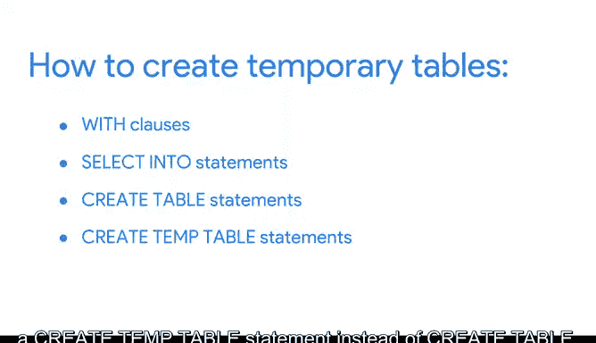

# 谷歌数据分析师第五课《通过数据分析回答问题》analyze-data（中英双字） - P39：39_04_02_多表变体.zh_en - GPT中英字幕课程资源 - BV1q14y1o7Yj

Hello there。 Earlier， we introduced you to temporary tables。

 They're a great resource to use during your analysis。

 because they help you keep your SQL code organized and efficient。😊。

Youll learn how to use a width clauses to create a type of temporary table。

 and now we'll get into some other ways you can create temp tables。

 along with the pros and cons they present。And that's one of the great things about data analytics。

 There's almost always more than one way to get your analysis done。

 The select into statement is a good example of how to get a temp table done。😊。

This statement copies data from one table into a new table。

 but it doesn't add the new table to the database。 It's useful if you want to make a copy of a table with a specific condition like a query with the wear clause。

 So far， we've been using Bigquery to show you how SQL works。

 But Bigquery doesn't currently recognize the select into command。 Instead。

 here's an example of how a select into statement might look in another R D B M S。 in the statement。

 a new table named Africa sales is created using the data from the global sales database about the African region。

 using select into is a good practice when you want to keep the database uncluttered。

 and you don't need other people using the table。 Now。

 if lots of people will be using the same table， then the create table statement might be the better option。

 This statement does add the table into the database。😊。

So if everyone needs access to the Africa sales table。

 your query would start with createate table followed by the same select from where query as in the select In statement。

In most relational database management systems， or R D， BMSs。

 you can add metadata to describe the data that's contained in the table you've created。

This could help make the table easier to understand for anyone using it。

The create table statement is also useful for tables that are more complex。 For example。

 if the codes difficult to replicate then making a temp table in this way means it'll be safe for you to access later。

The way you create a temporary table using the width clause or a select into or create table statement is usually up to you and your needs。

 The more you work in SQL， the more you might have preferences as well。

 especially since there is more than one way to create temporary tables。

You may also find that you're working in an RDBMS that uses a different syntax。For example。

 you might need to use a create T table statement instead of create table。

Here's some good news。 The syntaxt that you need for each unique R DB M S is usually pretty easy to find with a quick online search。

 But no matter how or where you create temporary tables， there isn't much downside to them。

 It's good to note， though， that sometimes building a temp table can interrupt your workflow。 Again。

 that'll depend on your objectives and your preferences， you can repeat your code over and over。

 instead of making a temp table， But that usually leaves your queries less readable and more vulnerable to typos。

😊，As you continue exploring the world of data analytics。

 you'll find that temporary tables are just one of the many resources you'll be able to use。

 And the more you use them， the easier it'll be to navigate that world。

