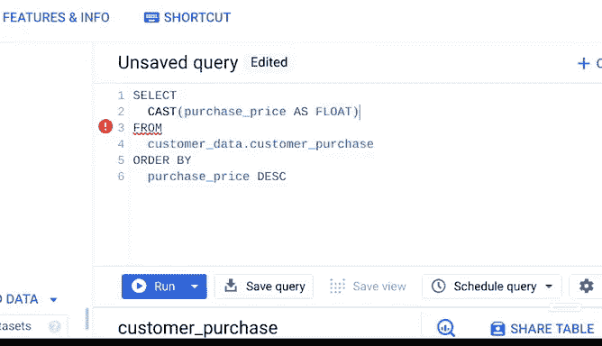

# 谷歌数据分析师第五课《通过数据分析回答问题》analyze-data（中英双字） - P4：04_01_03_组织整理永不过时.zh_en - GPT中英字幕课程资源 - BV1q14y1o7Yj

Hi again。 let's jump back in。Right now， we're in the analyzed phase of the data analysis process。

 And even though each phase is unique， data analysts make decisions about organization throughout all of them。

That's what we're talking about here。 organization。

 It's super important that you keep your data organized throughout your analysis。

 how your data is classified and structured will impact your findings。

 whether you're working in a spreadsheet or a database。 And once you know how your data is organized。

 you'll be able to capture or collect the information you need。

 Most of the data you'll use in your analysis will be organized in tables。

 Tables help you organize similar kinds of data into categories in subject areas that you can focus on as you analyze。

 For example， this basic database has tables for car dealerships。Product details and repair parts。

 Each table then has several fields of data， like branch owner and the cost of repair parts。

 You can use these tables and fields to help you decide how to move forward with your analysis。

 The structure of this database can help you decide which data you need to pull to meet your objectives。

 For example， the total number of a particular brand of cars sold or repair part for a specific make and model of a car at a certain branch。

Tables allow you to make decisions about data types。

They help you to figure out what variables you need and the data type those variables should have。

So you have a database where you need to convert a data type during your analysis。

 You can do that by using the Cas command in SQL or any other method that you learn on the job or from your own research。

 Like this example， where we converted a purchase price column to be af floatat instead of a string so that it was in a numerical form we could use for calculations。

If you're performing your analysis in a spreadsheet。

 you want to make sure that the columns and rows are effectively organized。

 You can even hide columns that you won't need for analysis or that show duplicate information。

 Once you have the data organized and formatted。 you'll be ready to sort and filter it to find the data you need。

 We'll cover sorting and filtering soon。 But for now。

 just know that both filters and sorts are affected by the type of data we're working with。

 The bottom line is that it's important to have your data in the right format。

 So always be prepared to adjust， no matter how far into your analysis you are。😊，That's all for now。

 Coming up， we'll show you what filters are all about， bye。

