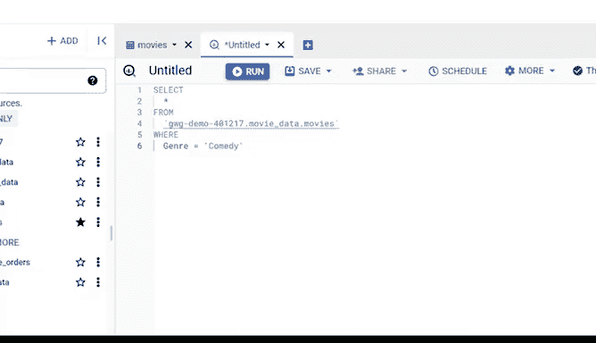

# 谷歌数据分析师第五课《通过数据分析回答问题》analyze-data（中英双字） - P5：05_01_10_使用SQL过滤数据.zh_en - GPT中英字幕课程资源 - BV1q14y1o7Yj

Hey， great to see you again。 Earlier， we talked about why you should organize your data no matter what part of the life cycle it's in。

 Just like any collection， it's easier to manage and care for a group of things when there're structured around them。

😊，Now we should keep in mind that organization isn't just about making things look orderly。

 it's also about making it easier to search and locate the data you need in a quick and easy way。

As a data analyst， you'll find yourself rearranging and si through databases pretty often。

 Two of the most common ways of doing this are with sorting and filtering。

 We briefly discussed sorting and filtering before。 And it's important。

 you know exactly what each one does。 Soting is when you arrange data into a meaningful order to make it easier to understand。

 analyze and visualize。 Soing ranks your data based on a specific metric that you can choose。

 You can sort data and spreadsheets and databases that use SQL。😊。

We'll get to all the cool functions you can use in both a little later on。

A common way to sort items when you're shopping on a website is from lowest to highest price。

 but you can also sort by alphabetical order， like books in a library。

Or you can sort from newest to oldest， like the order of text messages in a phone。

 or nearest to furthest away。 Like when you're searching for restaurants online。

 Another way to organize information is with a filter。

 Ftering is showing only the data that meets a specific criteria while hiding the rest。 Typically。

 you can use filters when you want to narrow down the amount of data you want to sift through。

 say yourre searching for green sneakers online to save time。

 you filter for green shoes only U a filter slims down larger data sets to smaller subsets that are relevant to what you need。

 Soing and filtering are two actions you probably perform a lot online。

 Whether your sorting movie show times from earliest to latest or filtering your search results to just images。

 You're probably already familiar with how helpful they can be for making sense of data。😊。

Now， let's take that knowledge and apply it when it comes to sifting through large。

 disorganized piles of data， filters are your friend。

You might remember from a previous video that you can use filters in spreadsheet programs like Excel and sheetets to only display data from rows that match the range or conditioned you set。

You can also filter data into SQL using the where clause。

 The where clause works similarly to filtering in a spreadsheet because it returns rows based on a condition you name。

 Let's learn how you can use a where clause in a database。

 We'll use Bigquery to access the database and run our query。If you're joining us。

 open up your tool of choice for using SQL and reference the earlier resource on how to access the data set。

 Otherwise， watch as the where clause does its thing。 Here's the database。

You might recognize it from past videos。Basically， it's a long list of movies。

 Each row includes an entry for the columns named。 Mo title， release date， genre， director。

 cast members， budget and total revenue。 It also includes a link to the film's Wikipedia page。

 If you scroll down the list， the list goes on for a long time。 Of course。

 we won't need to go through everything to find the data we want。 That's the beauty of a filter。

 In this case， we'll use the weare clauses to filter the database and narrow down the list to movies in the comedy genre。

😊，To start， we'll use the select command followed by an asterisk。In SQL。

 an asterisk selects all of the data on a new line。

 we'll type from in the name of the database movie underscore data dot movies to filter the movies by comedy。

 We're going to type where。 then list the condition， which is genre。

Gra is a column in the dataset set， and we only want to select rows where the cell in the genre column exactly matches comedy。

 Next， we'll type the equal sign and write the specific genre we're filtering for， which is comedy。

 Since the data in the genre column is a string format。

 we have to use single or double quotations when writing it。

 And keep in mind that capitalization matters here。

 So we have to make sure that the letter casing matches the column name exactly。😊。

And now we can click Run to check out the results。

What we're left with is a shorter list of comedy movies。 Pretty cool， right？

 Here's something else that you should know。 You can apply multiple filters to a database。

 You can even sort and filter data at the same time for even more precise results as a data analyst。

 knowing how to sort and filter data will make you a superstar。😊，That's all for now。 Coming up。

 we'll get down to the nitty gritty of sorting functions and spreadsheets。 See you there。

