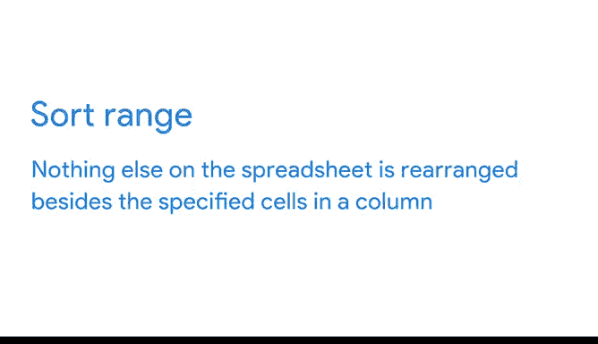

# 谷歌数据分析师第五课《通过数据分析回答问题》analyze-data（中英双字） - P6：06_01_02_在电子表格中排序数据.zh_en - GPT中英字幕课程资源 - BV1q14y1o7Yj

Hey there， Data pro。 H to see you back and ready to explore more of the organizational side of data analysis。

 In this video， we'll learn how to sort data in spreadsheets。

 We've done some sorting in spreadsheets earlier in the program。 Now。

 it's time to build on what we've covered and introduce some more advanced sorting techniques。

 Soing is amazing。 Not only does it add order and reading to your spreadsheets。

 it also gives you the power to reimagine data altogether。

 When you sort data based on a specific metric， you can uncover new patterns and relationships within data sets you might not have otherwise noticed。

😊，This is especially true for spreadsheets， which you'll use a lot in your work as a data analyst。

 knowinging how to sort data and spreadsheets can make you a stronger and more confident analyst。

 In many ways， sorting relies on your creativity to reimagine the information you have in front of you。

😊，In spreadsheets， you can sort data by ascending or descending order using numbers or letters。

 If cells are labeled with color， you can sort them by color， too。When sorting data in a spreadsheet。

 you can choose to sort sheet or sort range。 If sort sheet is applied。

 all the data in a spreadsheet is sorted by the conditions of a single column。

 but the related information across each row stays together。On the other hand。

 sort range doesn't keep the information across rows together。 When you sort a range。

 you're selecting a specific collection of cells or the range that you want the sorting limited to。

Nothing else on the spreadsheet gets rearranged， but the specified cells。

 There's two methods for sorting spreadsheet data。 One involves using the menu。

 The other involves writing out the sort function。 For now， we'll focus on sorting with the menu。

 We'll get to writing out functions later on。

Now， depending on the program you use， the process might seem slightly different。

 but the instructions and concepts we discuss will be basically the same。Okay。

 back to sorting with the data menu to give you an idea of how to do it。

 we'll use the movie spreadsheet。 Let's check it out。

 And this example will sort movies by release date。 So we'll head to column B。

 which is listed as release date。And click on the B button to highlight all the cells in the column from there。

 we'll head to the data tab in the menu。Now， you have two choices。 So does sheet。Or a range of data。

You'll notice that we've selected just the release date。

 but these release date are specifically related to the movies in their row。In this case。

 you want the release date and the movie title to stay in the same row as you sort because they're related。

To do this， you'll want to sort sheet。This will keep all the data together by row。

 no matter how you sort it。 depending on the order you want the release dates to be in。

 you can sort from a to Z， which also ranks the dates numerically， or you can sort from Z to A。

 which will sort data the opposite way。 Since we want the release dates to be in order。

 We'll click sort sheet by column B from a to Z。 And there you go。

You just sorted a sheet of data using the menu。 Now。

 the movies are arranged in chronological order based on release date。Okay。

 let's say you want to sort data in a specific column。

 but don't need the cells in that column tied to a specific row of information。 Instead。

 you want to isolate the columns data and sort it on its own without affecting how the rest of the sheets arranged for fun。

 We'll use the movie title column in this example。 First。

 we'll select the column we want to sort column A。 clicking on column A highlights all the cells in the column which contain the movie titles。

 Then we'll go to the menu and click data。 because we're isolating the column from the rest of the sheet when we sort this time。

 We'll click sort range by column a。 for this example。

 we'll sort the movie titles alphabetically from a to Z。 And that's it。

 You'll notice that sort range doesn't keep the rows together。 So the data is a bit jumbled。

 You'll probably end up using sort sheet more often。 But it's important to understand them both。

 so you don't accidentally get them mixed up。You've just sorted data in a spreadsheet using the menu。

 and you've learned how to sort data by an entire sheet or by a range of cells。

 That's something you'll be able to take with you wherever you go as a data analyst。Coming up。

 we'll learn about the second way to sort in the spreadsheet by writing out a function。

 We'll also take sorting to the next level by custom sorting your data。 See you there。

