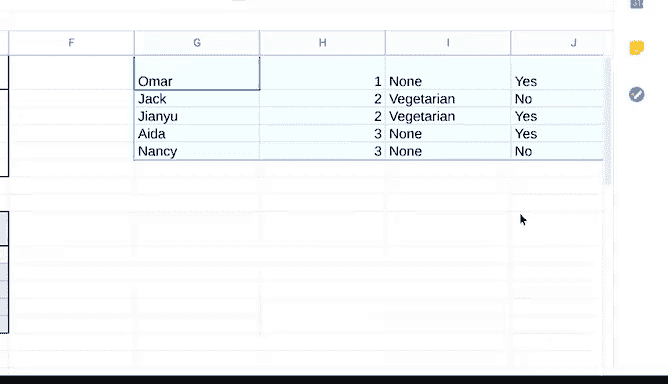
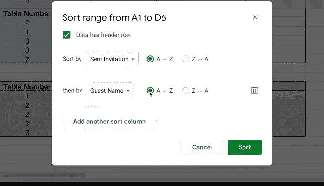

# 谷歌数据分析师第五课《通过数据分析回答问题》analyze-data（中英双字） - P7：07_01_04_在电子表格中使用排序功能.zh_en - GPT中英字幕课程资源 - BV1q14y1o7Yj

Happy to have you back Earl in the program， we covered some basics of sorting and spreadsheets。😊。

We learn the differences between sorting a range and an entire sheet and how to sort a spreadsheet using the menu。

 Now that we've laid the groundwork， it's time to move on to more advanced ways to sort information。

We've talked about how there's two methods of sorting data and spreadsheets。

 The first method uses the data tab in the menu of your spreadsheet program。

 The second way to sort information in a spreadsheet is by writing a sort function and spreadsheets functions are preset commands that perform a specific process。

 So in this case， the sort function， as you might be able to guess， sort your data。

Let's check out the spreadsheet of party plans to witness the sort function in action。

The first arranged set of data is our original data set of guests and some information about them。

So let's say you want to sort the party guess by table to get an idea of who will be sitting。

 where to do that， start by typing a function in an empty cell。 Just like any function。

 you do this by typing the equal sign and then write sort after it。After your first open parentheses。

 reference the first cell and which data is collected from。In this case， that's a2。

Then you'll include a colon and write the last cell you want included in the function， which is D 6。

A2， colon D 6 is the range for this function。 Next。

 write a comma to separate the range from what we're sorting by， which is column B。

You should keep in mind that this part of the function doesn't recognize column letters。

So in this case， we use the corresponding number instead， which is 2。

 since column B is the second column in our range。Now， add another comma。In this next part。

 you'll need to decide whether you want the data in this column to be in as sendingending or descendending order。

A true statement is an ascending order， and false is descending。

Because we want the tables to be listed， starting from table number one。

 we'll write true for ascending order and then in the function with a closed parentheses。Now。

 let's see our function play out。Our party guests are now sorted by which table they're seated。

Once you have an idea of the data you want to be sorted and how applying functions to your data is simple。

Now you have two different tools in your tool belt for sorting data。

After you've tackled writing sort functions， you'll want to customize sort orders too。

A customized sort order is when you sort data in a spreadsheet using multiple conditions。

 This means that sorting will be based on the order of the conditions you select。

 Let's go back to our party spreadsheet。 Imagine you want the guests to be sorted by whether or not they've been sent an invitation。

 And based on that， we want those guest names to be listed alphabetically。

 You can do that easily with the sort range option under data。

First， highlight all the data in the set from cells A1 to D6。Then under the data tab in the menu。

 click So range。In this case， check data has a header row。

 which makes sure that the title of the column isn't mixed into the sorting。

Then will' make sure it's being sorted by sent invitation。

Here we want the no responses first and the yes responses second。

 so we will make sure A to Z is clicked to sort the responses in that order。

Because we want to add an additional sorting condition， we'll now click on add another sort column。

The guest names should be in alphabetical order。 So let's select guest names and sort from A to Z。

Then we'll click sort。Andvoila， you've officially applied a custom sort order， like a champ。Okay。

 so you've tackled sorting and spreadsheets by sheet。

 by range through the menu and by using a function On top of all that。

 you've added to your organizational skills by learning how to create custom sort orders。Pretty soon。

 you'll learn another powerful tool， how to sort data using SQL。

Even though databases can sometimes be a lot to digest。

 learning these skills gives you the power to rearrange data in a way that makes sense to you。

 Once you've sorted data in a way that really clicks。

 you'll understand why it's so valuable to you as a data analyst。Bye， for now。

