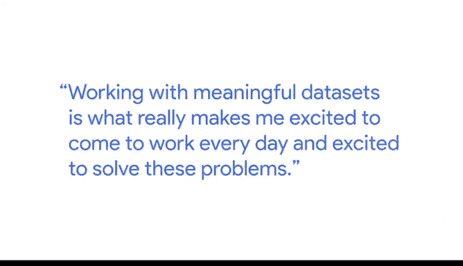
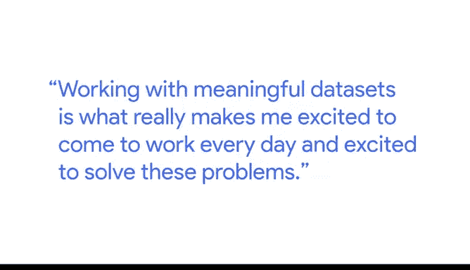

# 谷歌数据分析师第五课《通过数据分析回答问题》analyze-data（中英双字） - P8：08_01_06_艾玛：通往有意义职业的旅程.zh_en - GPT中英字幕课程资源 - BV1q14y1o7Yj

I'm Emma and I'm a product analyst on Google Health the product that I am helping analyze data for is a tool for clinicians and what this is going to allow clinicians to do is find their patients' health data just as easily as you can find data on Google search what I specifically focus on is standardizing healthcare data。

 analyzing it to find anomalies or data quality issues and talking to product managers about which features we should launch and why。

I've worked on problems from solving locomotive failures and predicting them before they happen。

To forecasting sales for handbags before the handbag is even launched。

 to now working with healthcare data to try to allow clinicians to easily have their patients' data at their fingertips。

 I was really interested in working in data analytics。

 But I was trying to figure out what type of data I wanted to work with or what fields within data analytics I wanted to focus on。

 because there are so many。 And I was ultimately drawn towards working with healthcare care data。

 And I just really fell in love with all of the problems that we have today in healthcare care and how just this vast amount of data that's available in the healthcare industry could be better utilized to help patients to help clinicians to improve population health。

 working with meaningful data sets is what really makes me excited to come to work every day and excited to solve these problems。

What I found in my career is that following the data sets that interested me。

 the types of problems that interested me always yielded better results。

 because I was just that much more driven to go to work every day to do my best to solve these interesting problems。

 because it's just what interested me。 The amazing thing is there's data everywhere。

 There are data problems at every company in every field。

 And you really get to just follow what you're passionate about。😊。

