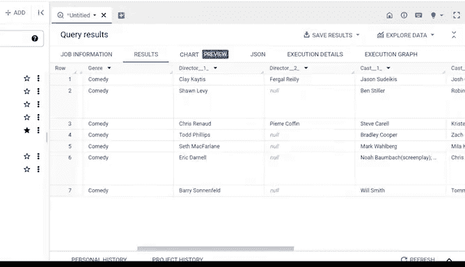

# 谷歌数据分析师第五课《通过数据分析回答问题》analyze-data（中英双字） - P9：09_01_02_使用SQL排序数据.zh_en - GPT中英字幕课程资源 - BV1q14y1o7Yj

Hello there。 If you're hoping to learn about sorting in SQL this time。

 you've definitely come to the right place。 So far。

 we've sorted spreadsheets through the menu and with a written function。

 which brings us to the next part of our learning， more sort functions。 But this time in SQL。😊。

Data analysts love playing with the way data is presented。

 Soing as a useful way to rearrange data because it can help you understand the data you have in a different light。

As you've probably already noticed， a lot of things you can do in spreadsheets can also be done in SQL。

 Soing is one of those things。 We've talked about using SQL with large data sets before。

 When a spreadsheet has too much data， you can get error messages or it can cause your program to crash。

That's definitely something we want to avoid。 SQL shortens processes that would otherwise take a very long time or be impossible to complete in a spreadsheet。

Personally， I use SQL to pull and combine different data tables。

 it's much quicker than a spreadsheet， and that usually comes in handy。

Here's something pretty helpful you can do with SQL。You can use the order by clause to sort results。

 return in a query。Let's go back to our movie spreadsheet to get a better idea of how this works。

 Feel free to follow along in a sequel tool of your choice as we go。😊，As a quick refresher。

 we have a database of movies listed with data like release date， director and more。

We can sort this table in lots of different ways using the order by function。For this example。

 let's sort by release date。 First， we have the select function and an asterisk。

Keep in mind that the asterisk means all columns are selected。

 then we have from and the name of the database and table we're in right now。Now。

 let's check out the next line。 It's empty， but that's what we will write our order by function。

 The order by command is usually the last clause in your query。 So back to the actual sorting。

We'll type order by with the space。With this clause。

 you can choose to order data by fields in a certain column。Because we want to sort by release date。

 we'll type release date。By default， the order by a clause sorts data and ascending order。

 If you run the query as it is right now， the movies will be sorted from oldest to the most recent release dates。

 Let's run the query and see what we've got。You can also sort the release dates in the reverse order from the most recent dates to the oldest to do this。

 Just specify descending order in the order by command written as De， D， E， S， C。

Let's run this query。As you'll notice， the most recently released films are now at the top of the database。

In spreadsheets， you can combine sorts and filters to display information differently。

You can do something similar in SQL 2。You might remember that while sorting puts data in a specific order。

 filters narrow down data。 So you only see data that fits the filter。 So， for example。

 let's say we want to filter movies by genre so that we're only working with comedies。

But we still want release dates to be sorted in descending order from most recent to oldest films。

 We can do this with the Ware clauses。Let's try that Now。 First。

 we'll check that the order by clause is always the last line。

 That makes sure that all the results of the query you're running are sorted by that clause。

Then we'll add a new line for the wear clauses after from and before order by。

Here's what we've got so far。 From there， we want to type the column we're filtering for。

 In this case， we want to filter the database for comedies。 So after the wear clause。

 we'll type the column list name as genre。Now， we'll add an equal sign after genre because we only want to include genres that match what we're filtering for。

 In this case， we are filtering for comedy。 so we'll type comedy between two apostropphhees。😊，Now。

 if you check out the entire query as a whole， you'll notice that we're selecting all columns。

 and we know it's all columns because that's what an asterisk means。

 The from clause specifies the name of the movie database we're using。

 and the wear clause filters the data to include entries whose genre is specified as comedy。

And then in the last line， we have the order by clause。

 which will sort the data we've chosen to filter by release dates in descendcending order。

 This means when we run the query， we'll only have comedy movies listed from newest releases to oldest releases。

 So let's run it and figure out if that's the case。😊，Cool。

 check out all those comedy movies and the way those dates are sorted。😊，Now。

 let's take this query a step further。 We'll filter for two conditions at once using the and filter。

 working off the query we've been using。 We'll add a second condition in the wear clause。

Willll keep the sorting the same。Let's say you wanted to filter by comedy movies and movies that earned over 300 million in the box office。

 In this case， after the and function， you add the revenue condition by typing revenue。From there。

 you'll specify that you only want to return films with revenues over $300 million to do that。

 type the greater than sign。 and then the complete number of 300 million without commas。Now。

 let's run the query。Here， the data only shows comedy movies with revenues of over $300 million。

And it sorted in descending order by release date。It looks really good。

 You just filtered and sorted a database like it's your job。 And with practice， one day it can be。😊。

And just like that， you finish another step and your data analyst journey。 By now。

 you really dug and learned about the analysis process with a special emphasis on how organization can change how you go through your data。

 You also learned about both spreadsheets and SQL and how to sort and filter data in both types of programs to help you get more comfortable using spreadsheet and SQL features。

 You'll be getting some materials you can use as a resource。😊，Coming up。

 we'll check out how an organizational mindset can take your analytical skills even further。

We'll also cover converting， formatting and adjusting data to combine information in a way that makes sense。

Learning those skills early on can make your work as a data analyst much more efficient and effective in the long run。

 See you soon。😊。

