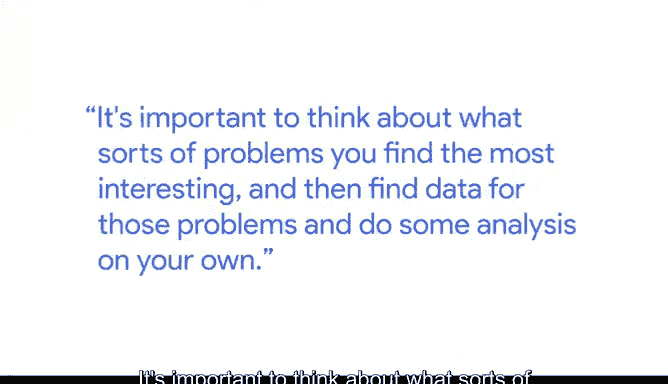

# 谷歌数据分析师第八课《Google数据分析综合项目：完成一个案例研究》（中英双字deepseek） - P12：12_03_03_Nathan：VetNet与给退伍军人的建议.zh_en - GPT中英字幕课程资源 - BV1bV4y187vY

Hey， I'm Nathan， I'm a principal data analyst in the trust and Safety organization at Google at Google I'm a member of an organization called Vetnet。

Which is an employee resource group for veterans and Googlers who want to support veterans。

And one of my favorite ways that we give back every year is through an annual resume review workshop in the resume workshop。

 either virtually or in person， we have veterans or veterans spouses， you know。

Come into the office or we meet via video chat and。

We go through their resume and really focus on impactful things they've done and how to make their accomplishments jump off the page and show really how awesome they are。

Vetans in particular can have some unique challenges when it comes to translating their military experience to a really effective civilian resume。

The first is removing military specific jargon。The second is being willing to claim correct credit for the accomplishments that you did because a lot of times veterans are going to always say that it was complete the team that did it and then third is coming up with really good measurement of the impact of the activities that they did that they're showcasing in the resume just as service members have to communicate really clearly work well as a team and really exercise really good attention to detail that's also the case when you're working as a data analyst you can't know everything so it's important to be able to work with crossfunction stakeholders。

In a very collaborative setting。And。The best analysis in the world is worthless if you can't clearly communicate the recommendations and influence the stakeholders to adopt those。

 and of course， if you overlook some important details。

 that could also derail your analysis and your credibility in the eyes of those stakeholders Po to detail is critical。

It's important to get some training， of course the data analyst certificate is a great set of training。

 but also just other courses either on tools that seem interesting to you。

 it's important to think about what sorts of problems you find the most interesting and then find data for those problems and do some analysis on your own。

That's a really high impact way of being able to get some great experience on your own that you can then talk about during interviews and even informal chats with people in your network why veterans should consider a career in data analysis is that they already have a strong foundation of being able to be really persistent while also remaining really humble and that's super important as a data analyst because if your egos out of control。

 you're going to have big blind spots that lead you to make mistakes in your analysis one of the best pieces of advice that I still think of to this day is that it's better to get speeding tickets than parking tickets。

So what this especially means as a data analyst is sometimes you have to jump into situations that you're naturally truly comfortable。

And you need to learn your way out of it and collaborate your way out of it。

