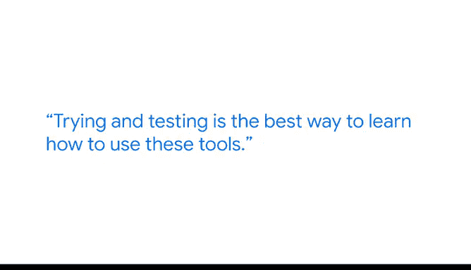

# 谷歌数据分析师第八课《Google数据分析综合项目：完成一个案例研究》（中英双字deepseek） - P13：13_04_02_Myles：利用人工智能在工作场所推动影响.zh_en - GPT中英字幕课程资源 - BV1bV4y187vY

Hey， I'm Miles I'm a data engineer here at Google。 I basically maintain large databases otherwise known as data lakes containing our vast financial information from Capex to Opex spend to revenue on providing that data to stakeholders So I love being a data analyst It's not always about crunching numbers but a lot of it is about storytelling as well being able to create appealing and visually grasping things to present to your business partners is a very。

 very unique thing that not a lot of other careers have experience with it's kind of the forgotten backbone of everything we do and without data we really wouldn't be able to make any decisions accurately know as we do now。

AI is a huge deal That's what we consider the next frontier If we have data analytics as step1 AI as step two In my role I use AI daily and makes me and all my colleagues more efficient and more productive。

 let alone kind of letting us automate remedial or tedious task that we don't enjoy a recent time I use AI in my role here at Google was when we had to create documentation around data access we essentially had to consolidate about 10 different access permissions for our business partners and create documentation for them to know where and when to request access。

 The reason we do this is because we maintain a lot of data around finances and as you know that's very confidential and need to know and so creating documentation that is very easy to read and very easy to apply is essential in being a data analyst here at Google I use this new tool or the summarization features gem and I has daily whether that's from emails or long forms or parsing through code it really kind of helps you get to the meet and bolts of what you want to find in a much faster way The advice I would give to someone starting data analytics and utilizing AI to get there would be trying and testing is the best way to learn how to。

These tools and understanding what you really need to provide it to get the output you want treat it like it's a playground。

 play around with it， mess things up， give it fake questions， give it real questions。

 do anything you can to really understand what the output it's gonna give you so you can utilize that better when you really need to do something productive A fun little tip is you can actually use AI to teach you AI you can even ask the chatbot to teach you how to use itself Basically AI gives you an output and you can ask how well does it think that output satisfied my input using these new technologies is extremely exciting It's almost like having a personal assistant right next to you as you're doing your work whether you're bouncing questions and idea is off the tool or feeding it data to help you do something faster and can really you know just not only save you time but teach you a whole bunch of things as well。

