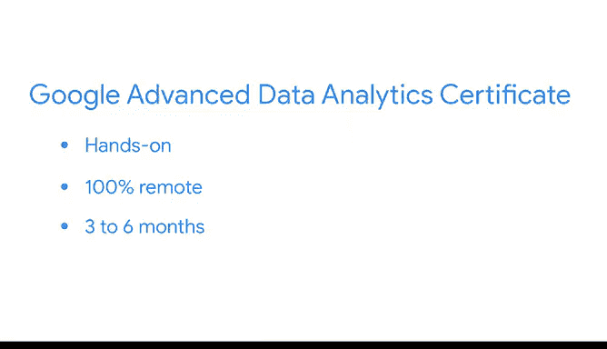

# 谷歌数据分析师第八课《Google数据分析综合项目：完成一个案例研究》（中英双字deepseek） - P23：23_04_05_探索职业机会.zh_en - GPT中英字幕课程资源 - BV1bV4y187vY

We hope you've enjoyed the certificate and that you're excited about all the growth you've experienced。

 congratulations。😊，Now it's time to take what you have learned and share it with the world。

Check out the career resources in the end of certificate checklist to get started。

 and you won't want to miss it。There you will find resources to help you discover and prepare for your next job opportunity。

Take the time to review the checklist and take advantage of these exclusive offers。

We especially recommend signing up for the job platform linked in the checklist and creating a profile。

 highlighting your new certificate and the skills you gained。Hi there。

 Congratulations on completing the Google data Analy certificate as a next step。

 Consider continuing your business intelligence journey by enrolling in the Google business intelligence certificate。

 I'm Anita， a senior business intelligence analyst here at Google and one of the instructors for the certificate。

 The Google business intelligence certificate teaches learners how to create processes and information channels that transform data into actionable insights to inform business decisions。

 For example， I regularly work with partners to create effective dashboards that help them stay on top of trends and anomalies in their business。

 I also spend a lot of time on designing pipelines that bring together disparate business data into one user friendlyri format。

 designed and taught by Googlers like me who are experts in the field。

 This advanced program builds on the foundations of the Google data Ana certificate that you just completed and helps enhance your technical skills with industry leading tools。

 including Big Que。😊，Tableau and SequL， the Google Business In certificate is hands on fully online and can be completed in one to two months of part time study。

 Ready to pursue a career in business intelligence。

 I'd be happy to help guide you on the next step of your journey when you're ready。

 congratulations again。😊，Hi there。 Congratulations on completing the Google Data Analytic certificate as a next step。

 Consider continuing your data analytics journey by enrolling in the Google Advanced data Analytic certificate。

 I'm Adrian， a customer engineer and data analytics here at Google and one of the instructors for the certificate。

 The Google advanced data analytics certificate will teach you how to use machine learning。

 predictive modeling and experimental design to collect and analyze large amounts of data。😊。

In my experience， I've used these skills to help predict daily stock prices。

 fraudulent credit card transactions， and even when an athlete will reach a point of exhaustion or injury in a sports game。

 designed and taught by Googlers like me who are experts in the field。

 This advanced program builds on the foundations of the Google data Ananalytic certificate and helps enhance your technical skills with industry leading tools including Jupiter notebook。

 Python and Tau， The Google Adv data Ananalytic certificate is handson fully online and can be completed in three to six months of parttime studying。

😊。

If you're ready to take the next step in your data analytics journey， I'd be happy to help guide you。

 Congratulations again。 Keep up the great work。😊，Also。

 be sure to keep a close eye on your inbox for future career resources and opportunities from Coursera and Google。

Best of luck ahead。 We're so excited for you。