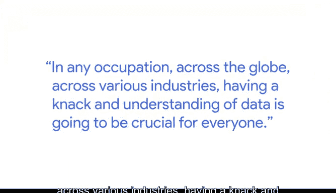
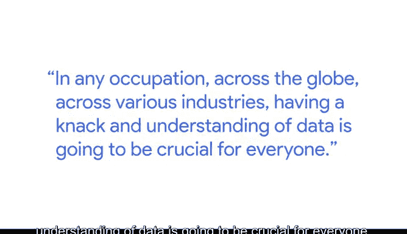
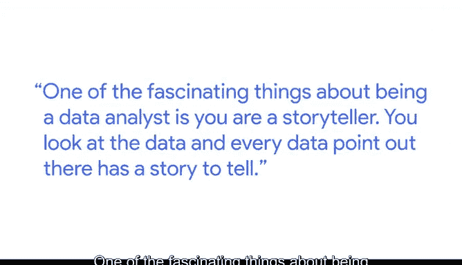

# 谷歌数据分析师第八课《Google数据分析综合项目：完成一个案例研究》（中英双字deepseek） - P2：02_01_05_Rishie：雇主在数据分析师中寻找什么.zh_en - GPT中英字幕课程资源 - BV1bV4y187vY

Google is a company that's built on data， it's all datadven。

 and the idea behind it is that every person， whether you're an engineer， whether you're a marketer。

 a seller， or even you're working in admin where you're handling logistics and paperwork and payrolls。

 everybody is dealing with data in some form or the other。

 we're trying to acknowledge the fact that in any occupation across the globe across various industries。

 having a knack and understanding of data is going to be crucial for everyone。

When youre in an interview， what I personally look for or what even my colleagues look for is the way they think about this creatively。

 when people hear the word data analysts， they think about engineers or someone who is extremely technical and it's all about working with data and numbers。

But I implore people to rethink about that perception that being a data analyst is not being a scientist。

 but but it's also being an artist。 The entire world is your canvas。

 the way that you approach it and even sometimes challenge the traditional norms of solving a problem。

 I think that seems to be very powerful and it actually puts you on the edge as compared to other people when you're interviewing for such role。

 There's a misconception or aidst that when you're applying for a job。

 you should know all the right answers， you should answer every question that they ask correctly。

 but that's false。 What every interviewer is looking for is how you think what's your thought process。

 what is your way of looking at a certain problem and how do you approach into solving those problems。

 when you express that， I mean you talk a little bit more about how you think about in a certain perspective。

 why you think about in a certain perspective it speaks a lot about you as a person and also what's your professional capability to be in that position。

 One of the fascinating things about being a data analyst。You are a storyteller。

 you look at the data and every data point out there has a story to tell if you are able to perfect that skill。

 you can tell some amazing stories what people will remember is not just the data。

 but how you tell those stories to the people or to your audience。

 If you talk about the core essence of the story that this is what the data is telling me or this is what the data tells you to do you become a lot more successful and I guarantee you that you will progress in being a data analyst and your career will prosper indefinitely My name is Rihi and I am the global analytics skills curriculum manager。

