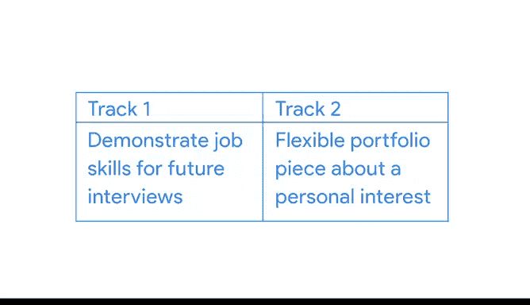

# 谷歌数据分析师第八课《Google数据分析综合项目：完成一个案例研究》（中英双字deepseek） - P4：04_02_02_开始您的案例研究.zh_en - GPT中英字幕课程资源 - BV1bV4y187vY

Hello， great to see you again。Now that we've checked out some example case studies and portfolios。

 it's time to start creating your own。Coming up， you'll do an activity that'll help you get started。

😡，But before that， I wanted to tell you a little bit about the different approaches you can use to start your project。

😡，There's two possible tracks you can use to frame out your case study and help you get started。

In track one， you'll be able to choose a business question similar to the kind that interviewers might ask。

😡，There are several different options for you to choose from with specific business tasks and different data sets for you to use In track2。

 you'll be asked to find a public data set to explore something you're personally interested in。😡。

This could be anything from analyzing a video game you like to a study on a wildlife population you care about。

This is the more flexible option， and you'll have more freedom to build something that's really personal to you。

😊，Depending on what you want to do with your case study， you might choose one over the other。

For example， if you want to create a case study that you can use to demonstrate your job skills for future interviews。

 then track one might be more useful for you。But if you have something you're personally interested in that you'd like to explore more。

 track2 can help you build a flexible portfolio piece。Or if you're interested in track one and two。

 you can do both。

Once you've decided on the track you're most interested in。

 youll use the case study outline to help you start your project。😡。

The outline follows the phases of the data analysis lifecycle that we've been using throughout this program。

You'll complete each phase from asking the right questions， through preparing， processing。

 and analyzing your data until you finally build your presentation and share it in your portfolio。😡。

Each phase will have key questions and activities to help guide you through the process。

And if you ever need to review something， you can always go back to any part of the program to help you。

As a quick reminder， the data you will be working with for this project will be public and open source。

😡，This data is great for demonstrating your skills as a data analyst。

But it's essential to avoid plagiarism by citing your sources。

Public open source data can be easily searched， and we don't want to pass it off as our own work。

Plagiarism can have serious negative consequences， legally and personally。

The beauty of our work as data analysts is that we can share and collaborate with each other。

 So let's remember to give credit to our sources。😊。

I hope you're excited about starting your case study。I'm really excited to see what you put together。

After this， you'll be able to start working on the outline。

 then we've got some other activities that'll help guide you。😡，After that。

 we'll talk about sharing your portfolio。Good luck。

