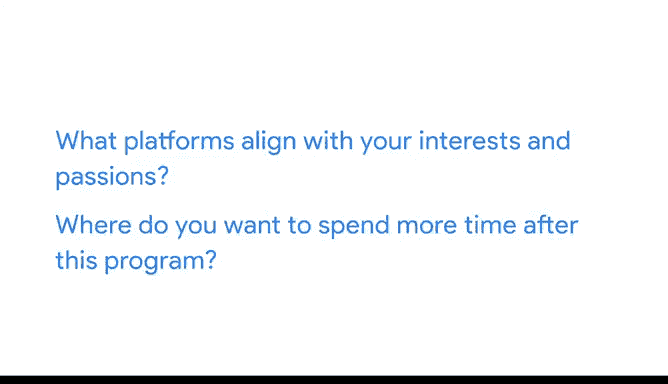

# 谷歌数据分析师第八课《Google数据分析综合项目：完成一个案例研究》（中英双字deepseek） - P6：06_02_02_分享您的作品集.zh_en - GPT中英字幕课程资源 - BV1bV4y187vY

Hi there， welcome back。Finishing the case study is a big step。

But we still need to create a portfolio and share our analysis online。

You have a lot of options when it comes to your own online portfolio。😡。

So let's talk about where you can post your case study and how to make that decision。

When you're thinking about where you want to share your portfolio。

 there's two questions that can help you decide。First。

What platforms align with their interests and passions？And second。

 where do you want to spend more time after this program？You have a few options， you could use Cale。

 GitHub， a blog or Tableau to share your work。😡，Now。

 let's talk about what each of these have to offer。

Kaggle has a broad data science community you could join。

It hosts a lot of competitions for users to join in and offers all kinds of learning opportunities。

This is a great option if you enjoy connecting with other data analysts。

GitHub is primarily used for programming languages like R or Python。

 It has a more technical setup than other platforms。

 but it's a great place to share your code and the how behind your analysis with other users。😊。

And if you want to learn from other data analysts work， GitHub's a great place to be。

Blolock platforms like Medi， WordPress and Google Sites are personalized and ownable。

Blogs aren't as code focused as Caggle and GitHub， so you'll have to store your code somewhere else。

 and there might be a few extra steps you'll have to take to display code on blogs。

But you can show off your expertise， write about your process in your own voice。

 and show thought leadership in your field。Finally， you might choose Tableau to host your work。

You've already got some experience with Tableau from our work here。

It's a great option if you're focused on the database side of things。Plus。

 you can create interactive dashboards using Tableau tools that are easily shareable。

Choosing where to host your portfolio is an important decision。

 but hopefully now you have some ideas about how each platform could be useful。

And you might end up using multiple platforms over time to fit your specific needs。

 The important thing is to remember the two questions we talked about earlier。

What platforms align with your interests and passion and where do you want to spend more time after this program。

 C your online platform to share is one of the final steps in this capstone project。😊。

Coming up， we've got a few activities to help walk you through that process。

 then we'll meet back here to start talking about your next steps。

