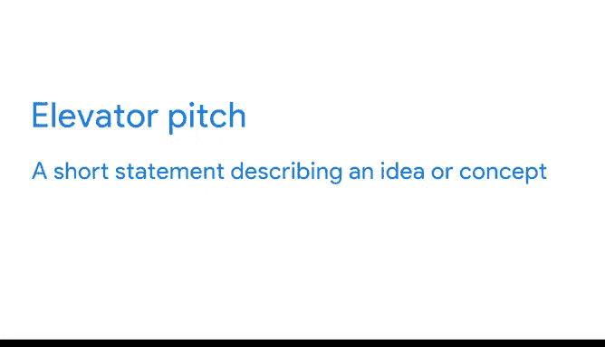
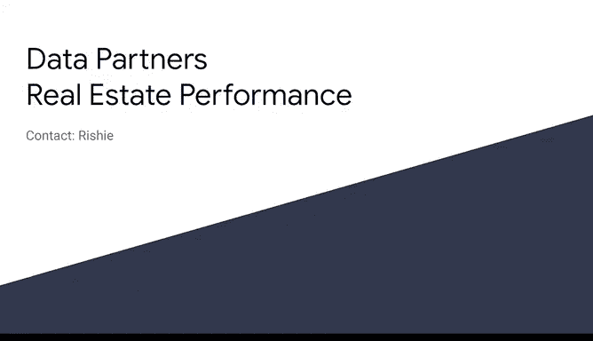

# 谷歌数据分析师第八课《Google数据分析综合项目：完成一个案例研究》（中英双字deepseek） - P7：07_03_02_讨论您的作品集.zh_en - GPT中英字幕课程资源 - BV1bV4y187vY

Welcome back。Now that you've successfully created your first case study and added it to your portfolio。

 it's time to talk about using that portfolio to wow potential employers during your next job search。

In this video， we'll learn about developing an elevator pitch。

Having the portfolio in your resume will help you stand out。

 but being able to use your portfolio to effectively highlight your skills will make it so much more powerful when you're discussing the case studies in your portfolio。

 you'll want to develop an elevator pitch to give interviewers a quick high levell understanding of your work。

😊，Basically， an elevator pitch is just a short statement describing an idea or concept。

It should be just a couple of sentences， short enough that you could explain it to someone in an elevator。

It's always a good idea to prep your elevator pitch beforehand。

Then once the interviewers have that high level understanding of your case study。

 you can give concrete examples of your process and have you solved problems in your data analysis before。

😊，For example， if an interviewer asks you to talk about how you approach data cleaning。

 you might highlight your case study to outline how you've cleaned data before。😡。

After giving them a quick explanation of the case study。

 you can describe your process and show them how you successfully completed the analysis Let's check out our example。

 data partners， real estate case study and brainstorm and elevator pitch for it。

Earlier， we talked about how the executive summary in this presentation focused on answering the business question。

This summary can help us develop our elevator pitch too。

 We just need to condense this into a couple of sentences。

You can also think back to the business tasks you based your case study on to help you decide what context most important。

For example， you could say in this case study， I used real estate company data to evaluate resale performance。

 determine trends， and theorize what was causing them I was then able to develop an action plan based on those findings。

Then if they're interested in discussing these findings in more detail， you can。

This is where you can share more about how you reach your conclusion and your recommendations for this company。

Or maybe the elevator pitch was all you needed to start explaining your process with the person conducting this interview。

The best way to showcase your skills effectively is to remember your audience and what they're interested in。

Potential employers and recruiters want to get to know your thought process and your approach to problem solving。

This means that when you're discussing the case studies in your portfolio。

 it' is useful to focus on your process and not just your results。Let's think back to our example。

 the interviewer asked us to talk about our approach to cleaning data。😡。

They probably don't need to know the exact functions we performed on our data。

 but they might be interested in knowing how we chose the right tools and what steps we took to make sure our data was clean and useful。

This gives them more insight to our cleaning process and how we think about data cleaning in general。

 your case studies are a powerful tool that you can use to enhance your resume。

But you can also draw on them to help you outline your thought process and how you perform your analysis。

Developing an elevator pitch and using case studies to highlight your skills as a data analyst to potential employers and recruiters can help you discuss your work more effectively with interviewers。

Just like everything else you've learned， this is something that gets easier。 the more you practice。

 It's a great idea to practice beforehand。 Try your elevator pitch out on a friend or practice talking through your process with a trusted colleague。

 You'll get it down Pat in no time。😊，Coming up， you'll have the chance to practice sharing your portfolio in interviews。

 See you soon。

