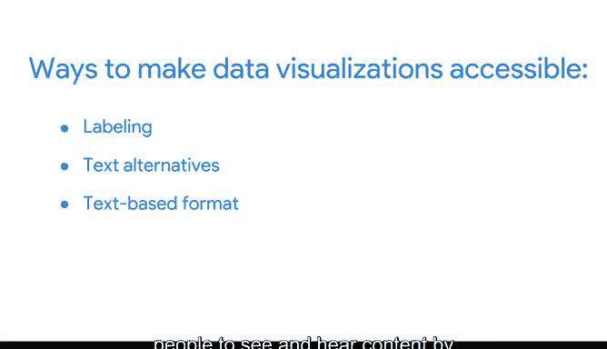
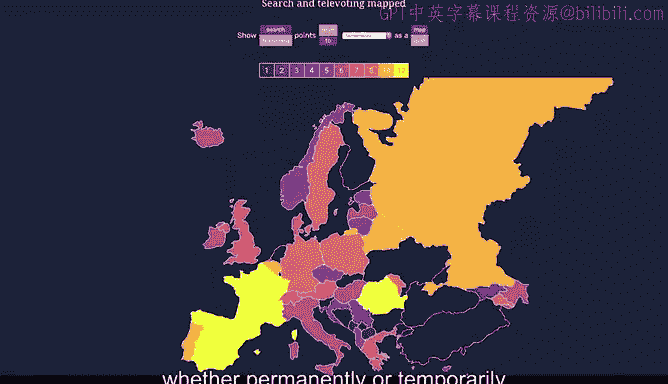
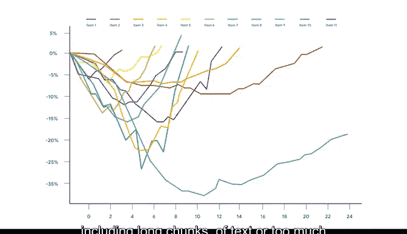

# 谷歌数据分析师第六课《通过数据可视化分享数据》visualize-data（中英双字） - P10：10_01_02_无障碍可视化.zh_en - GPT中英字幕课程资源 - BV1ik4y1K7PX

Hey， great to have you back。 Let's dive back in。Over 1 billion people in the world have a disability。

That's more than the populations of the United States， Canada， France， Italy， Japan。

 Mexico and Brazil combined before you design a date of biz。

 it's important to keep that fact in mind。Not everyone has the same abilities。

And people take in information in lots of different ways。

 You might have a viewer who's deaf or hard of hearing and relies on captions。

Or someone who's color blind might look to specific labeling for more description。

 We've covered a lot of ways to make a data visualization beautiful and informative。

 And now it's time to take that knowledge and make it accessible to everyone。

 including those with disabilities。😊，Accessibility can be defined a number of different ways。

 right from the start， theres a few ways you can incorporate accessibility in your data visualization。

 You just have to think a little differently。It helps to label data directly instead of relying exclusively on legends。

 which require color interpretation and more effort by the viewer to understand。

 This can also just make it a faster read for those with or without disabilities。

Check out this database is。 The colors make it challenging to read， and the legend is confusing。Now。

 if we just remove the legend and add in data labels， bam， you've got a clear presentation。

Another way to make your visualizations more accessible is to provide text alternatives so that it can be changed into other forms people need。

 such as large print， Braille or speech。 Alternative text provides a textual alternative to non text content。

 It allows the content and function of the image to be accessible to those with visual or certain cognitive disabilities。

 Here's an example that shows additional text describing the chart。And speaking of text。

 you can make data from charts and diagrams available in a text based format through an export to sheets or Excel。

 You can also make it easier for people to see and hear content by separating foreground from background。

 using bright colors that contrast against the background can help those with poor visibility。

 whether permanently or temporarily clearly see the information conveyed。

 Another option is to avoid relying solely on color to convey information。 And instead。

 distinguish with different textures and shapes。

Another general rule is to avoid over complicating data visualizations。

Overly complicated data visualizations turn off most audiences because they can't figure out where and what to focus on。

That's why breaking down data into simple visualizations is key。

A common mistake is including too much information in a single piece or including long chunks of text or too much information in graphs and charts。

 This can defeat the whole purpose of your visualization， making it impossible to understand。

 at first glance。

Ultimately， designing with an accessibility mindset means thinking about your audience ahead of time。

 focusing on simple， easy to understand visuals。 and most importantly。

 creating alternative ways for your audience to access and interact with your data。

 And when you pay attention to these details we can find solutions that make data visualizations more effective for everyone。

 So now you completed your first close up exploration of data visualization。

 you've discovered the importance of creating data viz that cater to your audience while keeping focus on the objective。

😊，You learn different ways to brainstorm and plan your visualizations and how to choose the best charts to meet that objective。

 And you also learned how to incorporate elements of science。

 art and even philosophy into your visualizations。Coming up。

 we'll check out how to take all these learnings and apply them in Tableau。

 You'll get to see how this data visualization tool makes your Data Viz work more efficient and effective。

😊，See you soon。