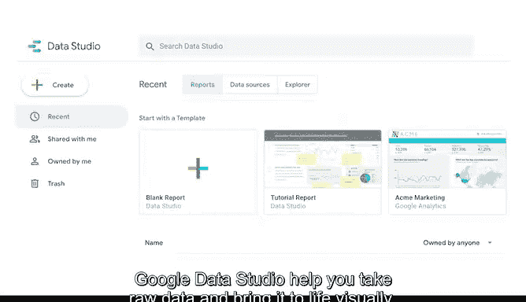

# 谷歌数据分析师第六课《通过数据可视化分享数据》visualize-data（中英双字） - P13：13_02_02_Tableau Public与其他在线工具.zh_en - GPT中英字幕课程资源 - BV1ik4y1K7PX

Welcome back。Mastering online tools like Tableau will make it easier for your audience to understand difficult concepts or identify new patterns in your data Need to help a news outlet showcase changing real estate prices in regional markets。

 check。Want to help a nonprofit use their data in better ways to streamline operations， check。

Need to explore what video game sales look like over the past few decades。 Double check。

Many different kinds of companies are using Tableau right now to do all of these things and more。

 This means there's a good chance you'll end up using it at some point in your career。

 But I'm getting ahead of myself。First， let's talk about what Tableau actually is。

You might remember learning that Tableau is a business intelligence and analytics platform that you can use online to help people see。

 understand and make decisions with data。 but it's not all business all the time。

Take this data of Viz， for example， created by Tableau enthusiast Eve Thomas to record big foot sightings across the US。

 It's available on Tableau Public， which we'll be using together in our activities in this course。

Tableau can help you make and easily share interactive dashboards， maps and graphs with your data。

 without any coding， you can connect to data in lots of formats like Excel， CSV and Google Sheets。

 You might also find yourself working with a company that uses another option like Looker or Google Data Studio。

 for example。😊，Like Tableau， Looker and Google Data Studio help you take raw data and bring it to life visually。

But each does this in different ways。 For example， while tableableau is offered in a variety of formats like browser and desktop。

Looker and Google data studio are completely browser based。 But here's the great news。

 Once you learn the fundamentals of tableableau， you'll find they easily transferred to other visualization tools。

 ready to get started using it。 Then without further ado， meet Tableau up next。😊。

