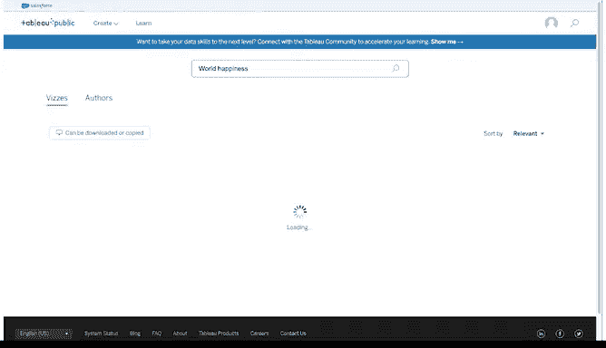

# 谷歌数据分析师第六课《通过数据可视化分享数据》visualize-data（中英双字） - P14：14_02_04_认识Tableau.zh_en - GPT中英字幕课程资源 - BV1ik4y1K7PX

Hello and welcome to the intersection of Analytics and Art。

The place where data analysts like me go to unleash the true potential of data with meaningful visuals。

And the place where future data analysts like you can also go to learn how to do this。

Welcome to Tableau。One of the many visualization platforms that helps you do more with your data。

When you turn data into a visualization， you get to watch it transform before your eyes into a meaningful story that people can connect to and care about。

Visualizations in Tableau are dynamic， not static。As a quick refresher。

 dynamic visualizations are interactive or changed with time。

 The interactive nature of these graphics means your audience has some control over what they see。

And you have incredible flexibility with how you create them。

So let's create our own visualization using a preloaded table on Tableau Public。

It's important to note that there's different ways to create visualizations in Tableau。

Tableau has a few different offerings， but for this course， we're using Tableau Public in browser。

 which is free。One cool thing about Tableau Public is the Public gallery with Data Viz examples from across the web。

😊，For now， you'll be working with one of these examples from the gallery。

You'll be copying over data workbooks to your own profile to start creating and publishing visualizations。

To get started， sign into your Tableau Public account。

You can check out an earlier reading for more details。Then to access the workbook。

 open the Google Career Certifics page on Tableau Public by clicking the link included in this video and the reading from earlier。

This opens a new tab that is still linked to your account。Here's what the page should look like。

There are a few workbooks loaded up with different data sets that you can save to your own profile。

These are a great starting point for creating your own visualizations。

There will also be a resource following this video that goes through how to download Tableau and load your own data。

But for now， let's use this gallery as a starting point。Now。

 click to view the workbook titled just the data， World happinessappiness。

This brings up the data table we use to help create the world happinessapp Data is that's in the gallery。

Next， go to the menu in the upper right corner and click make a copy。 At this point。

 Tableau will save a copy of this workbook to your own profile so you can create your own visualizations。

Now that you're working in your own copy， create a new worksheet so you can build a database biz from scratch。

You'll click on Workheet in the top menu and then new worksheet。To start building your database bi。

 add country as a detail in the marks shelf。You can do this by dragging the country table over to the detail icon。

This sets up your Viz as a world map to represent the data in the table。Next。

 add the happiness score to the color on the mark shelf。This applies a color scheme to the Viz。

 In this case， shades of blue。This range of colors doesn't offer a lot of contrast。

 especially for people with color vision deficiencies。So to adjust the colors。

 click the color menu and click Edit Colors。Then change the color scheme to green， blue， diverging。

And check the box for stepped colors， which shows a clearer difference between the highest and lowest happiness score。

 Darker blue means a higher happiness score， Where darker green relates to a lower happiness score。😊。

You can see this broken down in the scale。So with just a couple of steps。

 we have an interesting visualization that shows happiness data in a way that's easy to digest。

The countries and colors on the map are readable and offer some great insights。

But let's keep going so we can explore more tableableau features to refine your data viz。

Because there are three years of data in the table we're using。

 you can filter the data to only include 2016。Using multiple years can also be useful depending on your objective。

Regardless， you have lots of options for filtering。So we'll add here to the filter shelf。

Then we'll choose to filter by year。And we'll select 2016。

Let's focus our visualization on one region， the European region。To do this。

 move your cursor to find the view toolbar。Use the tools in this toolbar to pan to and zoom in on the European region。

This takes some time and practice。Once you have a pretty good view of Europe and its surrounding areas。

 use the shaped tools in the same tool bar to select as much of Europe as you can。

Since we're practicing， make your best guess if you're not sure which countries to include。

If you were working on a visualization that you were going to share with others。

 you'd want to double check that it was accurate。Hover your cursor over one of the countries。

 and it shows you data about that specific country。

 as well as all the countries you've selected in the region。

Then use the Lasso selection tool to select just a few countries like this。Keep only。

This applies another filter This time to the country you're including in your Viz。

You'll notice that the color scheme of these countries is updated。

This reflects that the range of colors is now only being applied to these countries。

Countries in this region might have been in the same part of the range when compared to the rest of the world。

But now they're in different parts because the data being measured is specific to this region。

To make your viz even better， add the happiness score as a label in the map。😊。

You can now see a happiness score for each country on the map。

This adds an extra layer of detail to the Viz to help make a connection to the actual data。

There is an option to change the data type of the happiness scores from decimals to whole numbers。

But when you do this， you lose the contrast that the values with the decimals offers。

So change it back to show the happiness score as a decimal。Now， to make it even more interactive。

 let's add a filter with a slider。 This will allow your audience to filter by happiness score so they can focus on fewer countries。

 But first， let's bring in more of the map we started with。😊，To do this。

 hover on the map and select the Zoom home icon in the toolbar to reveal more countries on the map。

Next， we're going to add happinessiness score to the filter shelf。

We'll select all values and click next。Then for the range of values。

 we'll click OK to accept the default settings。In the filter shelf。

 click the drop down to open the menu for the happiness score and select show filter。

If we select the drop down for the menu again， we can confirm that show filter has a check mark next to it。

You can toggle the check mark to display or not display the filter。When show filter is marked。

 a slider is displayed to the right of the map。Now， try filtering to show a happiness score of 6。

0 or below。And there you have it。 Our first visualization based on data。

 we brought in from an external source。 Pretty powerful， right。😊。

We'll save our viz so we can admire it any time we want to。

And maybe even practice using the tableau tools with it。 It's always important to save your work。

 but make sure not to include any personal information in your file name。

All of the data visualizations created in Tableau Public are visible to， well， the public。

You can also keep your visualizations hidden。 You'll see the eye with a slash through it on your Viz。

 and the viz will remain hidden。 It's up to you， but lots of data vids created by users like you。

 are viewable。In fact， you can easily check them out by searching on Tableau Public。

Then you can search for any kind of data Viz， including world happiness visualizations。

You'll come across all types of data Vis， many with advanced settings。

Some of the examples you'll find in the gallery are stronger than others。Coming up。

 we'll talk about effective data visualizations and some ways you can make your data vis work even stronger。

 See you soon。

