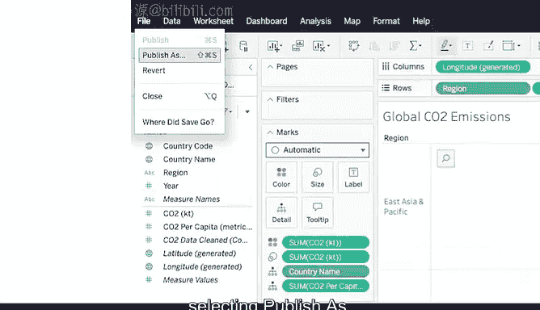

# 谷歌数据分析师第六课《通过数据可视化分享数据》visualize-data（中英双字） - P15：15_02_06_在Tableau中创建数据可视化.zh_en - GPT中英字幕课程资源 - BV1ik4y1K7PX

Hi and welcome back。In this video， we're going to use Tableau to create a data Viz。

 a great way to share insights with others。 To begin。

 you'll need to download the data set we'll use for this activity。😊。

Click the link to create a copy of the data， and download it。If you don't have a Google account。

 download the data directly from the attachment。As we go through the steps。

 you can put this video on one side of the screen and follow along in another window。

 You might notice your screen is slightly different from what you see here。

Tableau might have updated its interface， but the steps should be pretty much the same。 First。

 log in to Tableau public。If you haven't created an account。

 go back to the reading about logging into Tableau Public。Okay。

Now go to the circle and select my profile。From there， choose create a viz。

This will open the Tableau Public interface。From the connect to data window。

Go to the Fi tab and upload the CO2 data we downloaded earlier。

Or you can navigate to the data tab of the Tableau public interface。Under the drop down。

 click new Data source。Then open the CO2 data。After the data uploads。

 the screen will show the data source interface。Underneath connections， double click on the sheet。

 CO2 data cleaned to load that data into the main part of the screen。

You can also drag and drop the sheet into the area where it says， drag tables here。

Click update now to preview the data you opened in the bottom portion of the screen。

Each row corresponds to a single data point， and each column represents a different feature。

Tableau interprets the type of data in each column。Each icon represents a different type of data。

 For example， a number sign represents numerical data。While an ABC represents string data。

A globe represents geographic data and so on。 Tableau is interpreted the first two columns as geographic data。

 The third column is string data， and the last three columns as numeric data。All right。

 let's make a data is it demonstrates the amount of CO2 emissions that come from each country。

To do this， choose the sheet1 tab。On the far left of the screen is a banner with column names above a gray line。

In Tableau， these are called the dimensions of the data。

Below this line are the different measures that you can track for these dimensions。

To create a chart that displays the CO2 emissions per country。

 we're going to start by double clicking the country name dimension。

The main display will show a map of the countries on the planet with dots indicating which countries are represented in the data。

The dots are all the same size because with no measure selected。

Tableau defaults to scale each country equally。If you want to scale by CO2 emissions。

 we'll need to include a specific measure。Double click or drag and drop onto the sheet。

 The measure CO2 kilotons。This will change the size of the dots to be proportional to the amount of CO2 emitted。

Tableau has a wide selection of options for depicting the measures for a given dimension。

Most of these options are contained in the middle column between the main display and the columns with dimensions and measures。

Now， let's customize a look of our chart to better communicate trends in the data。

 If we drag and drop a measure on one of the marks such as color， size and label。

We can change that aspect of the measures visualization on the chart。For instance。

 say we want to change the color of the CO2 measure。

We would drag the measure CO2 kilotons to the box with the color label。

Then we can select this box to pull up a list of color options。

Feel free to pause this video and play around with the different options。 Get creative。😊。

And if you ever want to reverse a change that you make to a tableau sheet， just use the back arrow。

There it is。 We just created our first chart using Tableau。

But what if we wanted to change the dimensions or measures。

Instead of visualizing the CO2 per country， maybe we want to chart the CO2 per capita per region。

To do this， we could double click on the dimension region and then do the same for the measure CO2 per capita。

 This builds a new chart。We can edit the title by hovering the cursor over the title box and clicking on the arrow to bring up a drop down menu。

 Then we'll choose edit title。Let's give it the name。 Global CO2 emissions。

Or if we wanted to delete a chart， we could select the clear sheet button in the toolbar。

This will wipe out the chart and bring us back to an empty sheet。

Don't worry if you do this by accident or change your mind。

 The back button introduced earlier will bring the chart back。To delete a sheet entirely。

 right click on the sheets tab and select Delete。We won't be able to delete a sheet if it's the only sheet in our file。

But be careful， unlike clearing a sheet， deleting a sheet altogether cannot be undone。

Make sure to save your progress by hovering over the file tab and selecting publish as。

Congratulations。Now， you're ready to start visualizing your data。

This is far from the end of the story， though。 Soon。

 you will explore even more advanced tools in Tableau。

