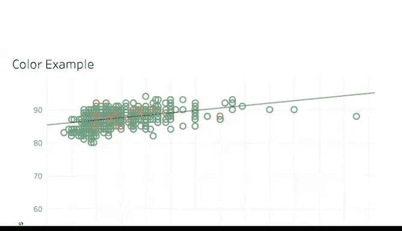

# 谷歌数据分析师第六课《通过数据可视化分享数据》visualize-data（中英双字） - P16：16_02_01_优化数据可视化调色板.zh_en - GPT中英字幕课程资源 - BV1ik4y1K7PX

艾ther。In this video， we'll take a closer look at effective and ineffective data visualizations using Tableau。

 That's right。 Even though this platform can help you create some really beautiful visuals。😊。

All those features and functions can lead to something that's just not very useful。 too。

 You might remember the5 second rule we spoke about earlier。

A sign of a good data visualization is that once you show it to an audience。

 they should understand what you're trying to convey within 5 seconds。 This means it's clear。

 effective and most importantly convincing。 if you keep that rule of thumb in mind before you begin any tableableau viz。

You'll be on the right path to creating good visuals。

Let's take a look at an example of a good use of a diverging color palette。

A diverging color palette displays two ranges of values using color intensity to show the magnitude of the number and the actual color to show which range the number is from。

It's a good way to show the difference between numbers。Here。

 green is associated with higher numbers and red with lower numbers。

 You may come across tables like this as it relates to business metrics and K Ps。

 The colors you choose should fit within the scope of the audience's expectations。

While this might not always be true globally， a lot of people associate green with positive and red with negative。

This makes things nice and clear。 Here's an ineffective data Viz example。

There's a lot about this Viz that isn't working well。But these colors are hard to read。

This graph uses green and orange， and the data points are really close together。

These colors don't clearly show the difference between low and high data points。

Data visualization allows us to share meaningful stories about data。

But we can't do it if it's too hard for the audience to understand the data vids we're sharing。

Using color pairings that don't fit your audience's expectations could add another layer of unnecessary complexity。

 Bra yourself。Because there is another way to make an ineffective data visualization even worse。

 If you add a few too many labels， you end up with a data visualization that's really hard to take in。

 Doing this makes the visualization too busy。 It takes up too much space。

 and it prevents the labels from being clearly shown。

 All of this is made worse by using different fonts across the labels。

 What we have here is good data turned bad because of the visuals。

 Having an interactive visualization can be useful for both your audience and for you as the analyst。

But just like anything else， the more power you have。

 the more responsibility you have lose sight on the qualities of a good viz。

 and you can lose control over the story you want the data to tell。

 Now that you learned how to use visual enhancements to your advantage。 Next up。

 We'll check out ways you can get even more creative with them。 Stay tuned。

