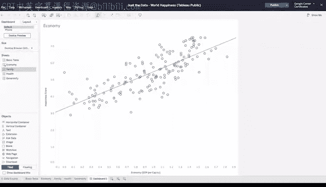
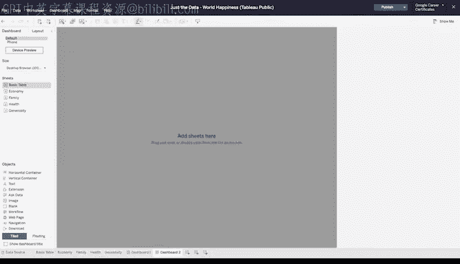
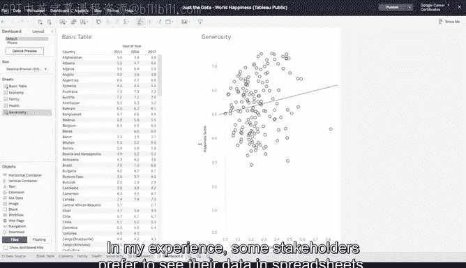

# 谷歌数据分析师第六课《通过数据可视化分享数据》visualize-data（中英双字） - P17：17_02_04_发挥创意.zh_en - GPT中英字幕课程资源 - BV1ik4y1K7PX

Hey， good to see you again。 One of my favorite aspects of data visualizations is how creative it lets me be。

😊，You might remember me saying earlier that Data Viz is the intersection of art and analytics。

 and it really is。I'm here to help you find your inner kid with a crayon。

From turning messy charts into effective ones to making your visuals more accessible to people who have color vision deficiencies。

It's time to explore how your creativity can help you get the most out of your data。

 Jump right in by signing into your tableableau account。😊。

We'll return to our world happiness data in the Google Career Cerifics page。

Click the link included in this video to open the gallery。 Now。

 click to view the workbook titled Just the data， World Happiness。

 We used the same workbook in the earlier video about getting started with Tableau。😊。

Let's click up here to get started。 Let's say we want to use this data in this table to figure out what the biggest contributors to a country's happiness score are。

 We'll start by digging into the relationship between happiness scores and the other country measures to see what we can find。

😊，To start， create a new worksheet to build your own Data vis from scratch。

You'll click on worksheet and then new worksheet。 Since our data has three years of values。

 let's filter to 2016。To do this， add year to the filter shelf and choose 2016。

Add happiness score to the Rose shelf。Then add economy GDP per capita to the column shelf。Next。

 drag and drop country to the details section。This creates a separate circle or data point for each country。

You might notice that where the economy scores is higher， the happiness score is also higher。

To make this trend easier to see， let's add a trend line。Now。

 duplicate this sheets that all of your formatting stays the same。In the duplicate sheet。

 replace economy GDP per capita with another measure such as family。

Drag the family table into the column shelf to replace economy。We'll rename our original tab economy。

And this new tab family。So that we can easily recognize what they show and find them when we need to。

 try doing this for more of the measures。Now let's show what multiple visualizations on a single dashboard look like。

So you can more easily see the relationship between them。Drag your visualizations。

 which are now listed in the left tables column one at a time to populate the dashboard。

They can be arranged in different ways。Take note of which trend lines have the steepest incline。

 Those are the ones with the strongest relationship to happiness score。

 Each chart should have an easily understood purpose that's immediately clear to your audience。

 And that's just what this does。 You can also add a companion table。

 which shows the same data in a different way。 in case people in your audience prefer tables。😊。

In my experience， some stakeholders prefer to see their data in spreadsheets。

 We've been spending a lot of time using one data source。

 but you'll likely end up juggling more than one data set at a time as an analyst。

Coming up， you'll have the option to learn more about combining multiple data sources in Tableau。

 Bye for now。

