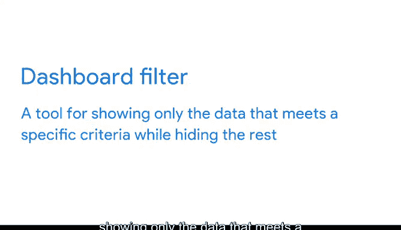

# 谷歌数据分析师第六课《通过数据可视化分享数据》visualize-data（中英双字） - P18：19_03_01_用数据讲述故事.zh_en - GPT中英字幕课程资源 - BV1ik4y1K7PX

Storytelling is the oldest form of teaching。Humans have been sharing knowledge through stories for tens of thousands of years。

Back when TVs and computer screens were the walls in a cave。In fact。

 scientists have confirmed that cave paintings were created by early humans who used their art to convey the stories of their imaginations Today。

 storytelling is still the most natural form of education。

🎼That's because stories make learning easier by helping us process and remember information。

 Everyone tells stories， even if we're just sharing how our day went with a friend。

Many experts believe that human brains automatically organize events with a beginning。

 a middle and an end。Thinking about things in this way， like stories。Helps us make sense of the past。

 the present and the future。On top of that， stories also help us relate to other people and create important human connections。

It's no wonder that people are so captivated by stories。Over the course of history。

 many important inventions have changed how stories are told。 For example。

 the invention of the printing press LED to newspapers， magazines and books。

The invention of motion picture camera made movies possible。And soon， we had TV videos。

 on demand and streaming services that let us enjoy all kinds of stories anywhere。 Any time。

 the invention of data visualization tools changed the way people tell stories once again。😊。

As you've learned， data visualization is the representation and presentation of data to help with understanding。

Coming up， you'll discover how to use data visualization to transform data into a meaningful story that people connect to and care about。

You'll also start working with dashboards and dashboard filters。

A dashboard is a tool that organizes information， typically from multiple data sets into one central location for tracking。

 analysis and simple visualization through charts， graphs and maps。

🎼And just like filters and spreadsheets and queries。

 a dashboard filter is a tool for showing only the data that meets a specific criteria while hiding the rest。

Soon， you'll know how to use these tools to tell stories that motivate and persuade people to take action based on the data you present。

Finally， you'll understand the key attributes of data driven stories and effective ways to communicate them in all sorts of business situations。

Ready to become an expert storyteller？Then let's turn to the next chapter of your data analyticstic story。

