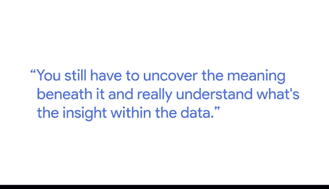
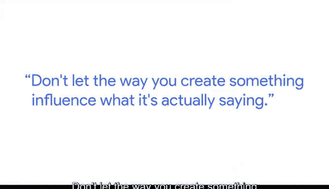

# 谷歌数据分析师第六课《通过数据可视化分享数据》visualize-data（中英双字） - P21：22_03_05_卡罗琳：数据新闻学.zh_en - GPT中英字幕课程资源 - BV1ik4y1K7PX

My name is Carolyn and I'm a measurement lead at Google and that means that I measure a client's advertising investment and figure out ways that it can perform better for them in the future Over the course of my career I've worked in four very different fields but the thing that links all of them together is my ability to understand data to get the information that I need out of it and to convey it in a simple and compelling way a really early example of this is from a man named John Snow。

 he was a doctor in London in the 1850s and he was living during a cholera outbreak and the theory at the time was cholera was spread through the air or you know illhus people didn't really know what was causing it but he thought that it was caused by drinking really contaminated in gross water from the Thames so he went out and interviewed people who were sick and asked them where they got their water and he found out through mapping the data that they got it。

All at the same pump。 So he went to the authorities and asked them to dismantle the pump。

 and they took the handle off and the outbreak ended。 This started a really robust。

Field of epidemiology， but it also is a great example of data journalism Most recently before Google。

 my job was as a data journalist and that was to use data to tell stories。

I worked at the Chicago Tribune for three years， I worked a lot around the election season and Olympics。

 big graphic moments where there's a lot of interesting data and a need to understand it。

 but field of data journalism has changed a lot over time， but not as much as you might think。

We have a lot more access to data and data that we've never really tracked before。

 but it's still the job of the data journalists to really understand what that data means。

As we have more and more data， it's not really helpful to a reader to just say here's a link to a database。

 you still have to uncover the meaning beneath it and really understand what's the insight within the data。

The tools that a journalist would use to understand something， which is consulting an expert。

 really diving into a story， are very similar to the tools I need at Google to really understand。

A media investment and make a really clear recommendation of what someone should do in the future。

 My advice is to understand the tools that are available to you and know how they work。

 but never to let those tools overwhelm your story so I never want to look at a piece and know oh this was created using data studio or using Microsoft Excel。

 I want to know what the data says and what a data journalist's point of view is behind that story。

Don't let the way you create something influence what it's actually saying。

People just want to know what you've distilled and what new information you've found in all the hard work you've done I love the field of data journalism because it's just how my brain works。

 I'm always the type of person who will doodle in the margins or make a quick chart to really understand the data beneath it and that forces me to find a point of view and to share that with other people I love that through data I can communicate with a large audience and really help them understand the world around them。

