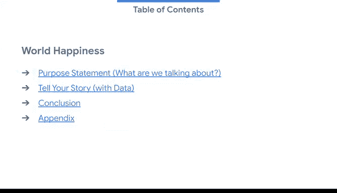
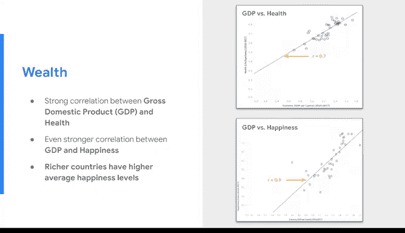
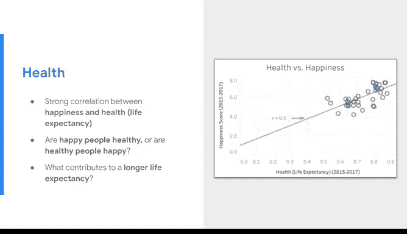

# 谷歌数据分析师第六课《通过数据可视化分享数据》visualize-data（中英双字） - P24：26_03_02_分享叙事.zh_en - GPT中英字幕课程资源 - BV1ik4y1K7PX

Welcome back。Now that you know how to prepare the key parts of your data story。

 the character setting， plot， big reveal and the aha moment iss time to think about the visuals and how your slidehow should look。

 It's always good。 remember that your presentation reflects on you。 If it's messy。

 disorganized or full of images that don't support your story。

 your audience could easily lose confidence in your results and recommendations。 On the other hand。

 If your slidehow looks professional and appealing。

 you've got a better chance to capture your audience's attention and keep them focused on your main points。

😊，Themes are a great tool for this。They control the color， font types and sizes。

 formatting and positioning of text and visuals。 Some themes are fun or creative。

 while others have a more professional look by choosing a theme that matches the tone and information you're communicating。

 Your presentation will have a consistent look and support the argument you are trying to make。

 Next comes a title。 It's good to include a title and subtitle that describe what you're about to present。

 You should include the date of your presentation， too。

 especially if you're including data that's likely to change over time。

 Specing a date such as a date created or date last updated。

 gives anyone viewing your presentation important context。

 A good slidehow guides the audience through your main communication points。

 but it doesn't repeat every word you say or give a lot of written information。😊。

Part of your job is to choose what information to include。

 This might be a description of what's being shown in a visual， The first step in a process。

 a set of directions or an important message that you want to be sure your audience understands and remembers。

 Also， be sure to adjust the font size so your audience can easily read what you've written。

 A good rules to keep text to less than 5 lines and 25 words per slide。 Basically。

 you want your audience focused on what you're saying， not busy reading the slides。Also。

 choose your words carefully。 It's always smart to avoid slang terms。

 abbreviations that people might not know and words or phrases that are specific to one particular region。

 Now， let's discuss visualuals。 Visuals help the audience quickly understand the content of each slide。

They can help you make a point in a way that words might not be able to alone。

 Great visuals don't leave room for interpretation because the meaning is instantly understood。

When you include visuals on a slide， try not to share too many details all at once。

 Choose just the data points that support your points， especially your key message。

I like to ask myself， what's the single most important thing I want my audience to learn from my analysis。

That helps me decide which visuals will be most likely to get the point across。

If you have several important things you need to include， don't cram them all on one slide。 Instead。

 create a new visual for each point。Then add an arrow。

 a call out or another clearly labeled element to direct your audience's attention toward what you want them to look at。

And finally， when you get to your big reveal and aha moment。

 your visuals must communicate these messages with clarity and excitement。

 These are the most powerful discoveries from your analysis。 Make it feel that way。😊。

Before you go， there's one last thing I'd like to share。

It's a quick tip for knowing when to copy and paste， link or embed a visual into a slidehow。

 This can be challenging for new data analysts， but there are some simple points to keep in mind。

 When you copy and paste a visual into your presentation。

 you can edit it directly within your slidehow。If your visual or its data points exist in other places。

 such as a Tableau dashboard。Any changes you make will not affect them there。 Now。

 this also means your visuals won't be updated if the original data set changes。

 This means your visual might not be reflecting the latest information。

 But if you link your visual within your presentation， the visual lives within its original file。

 and the slidehow connects to it with the visuals URL。Because the two files are now linked。

 when you make changes to the original file， say a spreadsheet。

 the changes will automatically appear in your presentation。

 This can be useful if the data is likely to change over time。

Your slidehow will always be up to date。 Finally， an embedded object also lives in the original source file。

 but the difference is that it doesn't get automatically updated if the source file changes。

 The embedded copy is completely independent。 Similarlyly。

 you can make changes to it in your presentation without affecting the visual or data points from the original source file。

 So the main difference between pasted， linked and embedded objects has to do with where you store them and how you update them after you place them in your slidehow。

 Now that you're beginning to understand how to make great slidehows。

Take a few minutes to practice what you've learned。

Create a new slideshow and select an appropriate theme。Add your text。

 visuals and an exciting reveal at the end。 Try pasting。

 linking and embedding visuals from different sources to see how they behave differently。😊。

You can design a presentation about any data set that interests you。

 It doesn't need to be long or have a ton of information。

 Just take the first steps and have fun telling your own data story。

