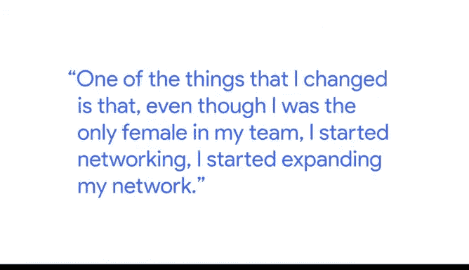

# 谷歌数据分析师第六课《通过数据可视化分享数据》visualize-data（中英双字） - P25：27_03_03_桑达斯：如何应对冒名顶替综合征.zh_en - GPT中英字幕课程资源 - BV1ik4y1K7PX

Hi， my name is Suns and I am an analytical lead at Google My role is turning data into powerful stories that influences business decisions I have an untraditional background where I have a six-year gap between my high school and my college career so for me when I was trying to start all over again so I started at a community college that was my first exposure to online learning and it was perfect because like I was managing kids at home so at Google we talk a lot about imposter syndrome and I personally relate to it quite a bit being the first female in my family to graduate university and also being an immigrant a lot of the times I'm surrounded by people who do not look like me。

For example， there was one time where I was presenting to senior leaders in my org and I was so nervous presenting to them I was like this I'm going to totally blow this up and they're going to figure out that I'm just totally fraud and fake。

 one of the things that I changed is that even though I was the only female in my team。

 I started networking， I started expanding my network。

And I met a lot of women who are from the country where I am from and they were also immigrant。

 they also struggled with English and they also look like me and they were doing very well in their career。

 they were being successful so when I looked at them as like okay if they can do it then so can I so that was for me was a very a big confidence boost to kind of like get over that impostor syndrome feeling but like I struggle from it day to day like I'm struggling with it right now standing in front of you like do I even deserve to be like talking about my journey and my skills so it's completely normal there are a few things that I like to do one is that I like to give myself a pep talk like pep talk definitely work like just saying like you're totally worth it you。

You deserve it it like does wonders for me personally the second thing I like to do is I like to keep a log of my success and failures so when I am at a down point when I'm feeling down or feeling like a。

Fee like I do not belong here I look at all the things that I have achieved from that log and that kind of helps me that's a good reminder of the hard work that I put in to kind of get here so I did not get here to because of luck I got here because I worked hard and I earned it my family is actually really really proud of me after seeing me go to school and graduate with two kids。

 my younger brother he actually went to school with two kids as well and he graduated he finished his master's program and my sister-in-law who also had two kids and she was managing and after seeing me that I could do it they had somebody to look up to and so my sister-in-l went back to school and she finish her degree as well so I think just being the first in my family was really hard because I didn't have anybody to look up to but now I am that person that people in my family can look up to specifically girls and they can pursue whatever they put their minds to。

