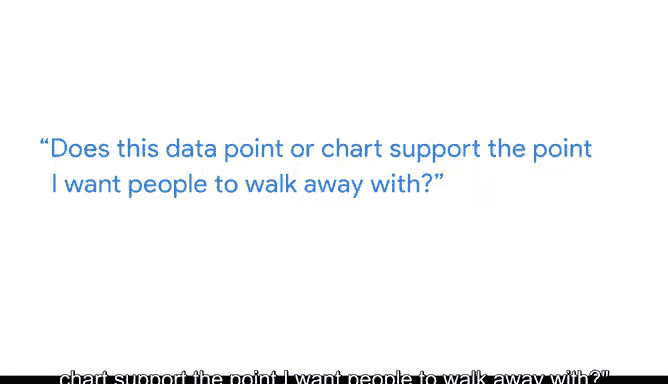

# 谷歌数据分析师第六课《通过数据可视化分享数据》visualize-data（中英双字） - P28：30_04_03_将数据融入演示.zh_en - GPT中英字幕课程资源 - BV1ik4y1K7PX

Hey， great to have you back。So we know how to use our business tasks and metrics to frame our data findings during a presentation。

Now let's talk about how you'll work data into your presentations to help your audience better understand and interpret your findings。

First， it's helpful for your audience to understand what data was available during data collection。

You can also tell them if any new relevant data has come up。

 or if you discovered that you need different data。For our analysis。

 we use data about online searches for avocados over several years。

The data we collected includes all searches with the word avocado。

 so it includes a lot of different kinds of searches。

This helps our audience understand what data they're actually looking at and what questions they can expect it to answer with the data we collect on searches containing the word avocado。

 we can answer questions about the general interests in avocados。

 But if we wanted to know more about something specific， like guacamole。

 we'd probably need to collect different data to better understand that part of our search data。

 Next， you'll want to establish the initial hypothesis。

Your initial hypothesis is the theory you're trying to prove or disprove with data。 In this example。

 our business task was to compile average monthly prices。

 Our hypothesis is that this will show clear trends that can help the grocery store chain plan for avocado demand in the coming year。

You want to establish your hypothesis early in the presentation。That way， when you present your data。

 your audience has the right context to put it in。Next。

 you'll want to explain the solution to your business task using examples and visualizations。

A good example is the graph we used last time that clearly visualize a search trend score for the word avocado from year to year。

 raw data can take time to sink in， but a good example or visualization can make it much easier for your audience to understand you during a presentation。

Keep in mind， presenting your visualizations effectively is just as important as a content。

 if not more。And that's where the Mcan method we learned about earlier can help。

 So let's talk through the steps of this method and then apply them to our own data visualizations。

The Mcchanus method moves from the general to the specific， like it' building a pyramid。

You start with the most basic information， introduce the graphic you're presenting by name。

This directs your audience's attention。Let's open the slide deck we were working on earlier。

We've got the framework we explored last time in our two data Viz examples。

 According to the Mcs method， we want to introduce our graphic by name。The name of this graph。

 yearly avocado search Trend， is clearly written here。When we present it。

 we'll be sure to share that title with our audience so they know where to focus and what the graphic is all about。

 Next， you'll want to answer the obvious questions your audience might have before they're asked。

 Start with the high level information and work your way into the lowest level of detail that's useful to your audience。

This way， your audience won't get distracted trying to understand something that could have easily been answered when the graphic was introduced。

We added in the information about when， where and how this data was gathered to frame this data bi。

But it also answers the first question many stakeholders will ask。

 Where's this data from and what does it cover。 So going back to the second graph in our presentation。

 let's think about some obvious questions our audience might have when they see this graph at first。

This date of isz is really interesting， but can be hard to understand at a glance。

So our audience might have questions about how to read it。Knowing that。

 we can add an explanation to our speaker notes to answer these questions as soon as this graph is introduced。

This shows time running in a circle with winter months on top and summer on bottom。

The farther elements are away from the center， The more queries happen around that time for avocado。

Now， some of the answers to these questions are built into our presentation。

 Once you've answered any potential questions your audience might have。

 you'll want to state the insight your data Viz provides。

 It's important to get everyone on the same page before you move into the supporting details。

 We can write in some key takeaways to this slide to help our audience understand the most important insights from the graphic here。

 we let the audience know that this data shows us the consistent seasonal trends year over year。

 We can also see that there's low online interest in avocados from October through December。

 This is an important insight that we definitely want to share。😊。

Even though avocados are a seasonal summer fruit， searches peak in January and February。

For a lot of people in the United States， watching the Super Bowl and eating chips with guacamole is popular this time of year。

Now， our audience knows what takeaways we want them to have before moving on。

The fourth step in the Mcanus method is calling out data to support that insight。

 This is your chance to really wow your audience。 So give as many examples as you can。

With our avocado graphs， it might be worth pointing to specific examples。In our monthly trends graph。

 we can point to specific weeks recorded here。During the week of November 25，2018。

 the search score was around 49。But the week of February 4， the search score was 90。

This shows the rise and fall of online search interests with the help of some of the very cool data in our graphs。

 Finally， it's time to tell your audience why it matters。 This is the So what moment。

 Why is this insight interesting or important to them。😊。

This is a good time to present the possible business impact of the solution and clear action stakeholders can take。

You might remember that we outlined this in our framework at the beginning of our presentation。

So let's explain what this data helps our grocery store stakeholder do。First。

 they can account for lower interest in avocados between the months of October and December。

They can also prepare for the Super Bowl surge and avocado interest in late January， early February。

And they'll be able to consider how to optimize stocking practices during summer and spring。

There's a little more detail under each of these points， but this is a basic breakdown of the impact。

 And that's how we use a Mcus method to introduce data visualizations during our presentations。

I have one more piece of advice。 Take a second to self check and ask yourself。

 does this data point or chart support the point I want people to walk away with。

It's a good reminder to think about your audience every time you add data to a presentation。

So now you know how to present data using a framework and weave data into your presentation for your audience。

 and you got to learn the Mcus method for data presentation。Coming up。

 we'll learn some best practices for actually creating presentations。 See you soon。😊。

