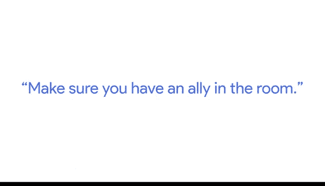

# 谷歌数据分析师第六课《通过数据可视化分享数据》visualize-data（中英双字） - P29：31_04_05_布列塔尼：新晋数据分析师的演示技巧.zh_en - GPT中英字幕课程资源 - BV1ik4y1K7PX

My name is Brittany Ben， I'm an analytical lead at Google one of the tips that I have is to try to keep things kindergarten simple and what that means is keep the concepts that you're presenting as simple and as straightforward as possible。

Whenever you enter a room there are going to be people within that room of varying interest levels。

 varying knowledge levels they have different levels of subject matter expertise nobody wants to present to a room whose eyes are glazing over my pet peeve about seeing certain presentations with data is that they often will include what I like to call eyesore charts and what an eyesore chart is it has way too much data has way too many colors it just looks busy and you just really can't figure out what the presenter is actually trying to say Another tip that I have is to make your presentation fun。

😊，So nobody wants to be in a room where you are talking for a full hour and the only voice that you're hearing is your own one of the things that I try to do to break it up is I try to think of little fun games or quizzes or I'll play a video or ask questions to the audience just to make sure that they're fully engaged and that they are talking back to me Another tip that I try to incorporate into my presentations is storytelling everybody loves a good story and when you do it right。

 you are able to connect and make your audience engage in a way that they probably wouldn't if you weren't telling that story The last tip that I have is make sure that you have an ally in the room。

Oftentimes before I'm giving a really big data presentation。

 I will find one or two people that I know are going to be in the room and present my content to them ahead of time and what that does is it allows me to not only get feedback but it also allows me to make sure that someone else is。

😊，Nodding their head and align to the numbers that I'm about to present and I can't even tell you how many times that I've been in presentations where those allies have really come to my rescue when the room asks a lot of questions or are potentially trying to poke holes in the analysis Those allies are there to speak up and they really are going to have your back and lend credibility to what it is that you're presenting the most challenging part of my job would be。

The fact that I am there to convince people to do something that they might not be fully confident that they should be doing and a lot of times it takes multiple conversations。

 multiple rounds of convincing for someone to actually come around to what I was trying to articulate or get them to do when you have spent maybe six months or a year building an analysis and building a story and building a narrative for someone to apply to their strategies and they actually come around and they actually do it that makes the challenges worth it。

