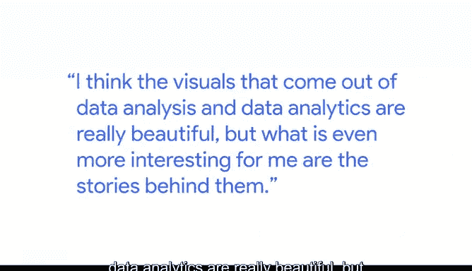

# 谷歌数据分析师第六课《通过数据可视化分享数据》visualize-data（中英双字） - P2：02_01_03_凯文：数据可视化中的力量.zh_en - GPT中英字幕课程资源 - BV1ik4y1K7PX

Data analytics is the collection and analysis and then use of data to tell stories using charts and visualizations so that businesses can make better decisions。

 So I've always loved numbers and have always enjoyed math and calculus in those sorts of things。

 So data came really easy to me。 I was working at a consultancy before and using lots of numbers。

 and I enjoyed it for sure。 But it wasn't until I worked at an advertising agency where I saw the creative expression of of numbers and how data could drive that creativity。

 that it really all fell into place for me。 And I realized that doing analytics in a marketing and an advertising setting was exactly what I wanted to do。

 And I found that I just really enjoyed when we put those two things together。

 I think the visuals that come out of data analysis and data analytics are really beautiful。😊。

But what is even more interesting for me are the stories behind them。

If you look at a big block of text or a big block of numbers， those stories are in there。

 but they really have to be found。And so it takes certain skill to pull those things out。

And I find that skill， that analysis really exciting and interesting。

But it ultimately then ends in a beautiful visualization， which I find very gratifying。 You know。

 there are great data visualization thinkers。 And you see these visuals all over the place。

 you can find inspiration from looking at news outlets today and seeing the visuals that they present and how they tell stories that way。

 visualizations have become so important that you can find them everywhere。

 and you can take great inspiration from that。 But I also take inspiration from unlikely sources like photography and art and others and seeing how composition is created。

 how color is used。 I think that's really important。

 And I try hard to bring those sorts of elements and those sorts of influences into the visualizations I create。

 So I know this course is pretty intense。 we are throwing a lot at you。

 Your brain is probably overloaded。 You're probably fried just stick with it。

 It is all going to start to piece together。😊，And makes sense。

The biggest thing that I think you can think of is just how important these skills really are。

 This is the new way of doing business， involving data。

 using the analytics tools and techniques that we're talking about to make decisions。

So there's a great big reward waiting for you at the end of this course。 I'm Kevin。

 I am director of analytics here at Google。😊。