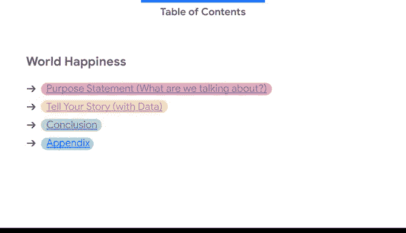
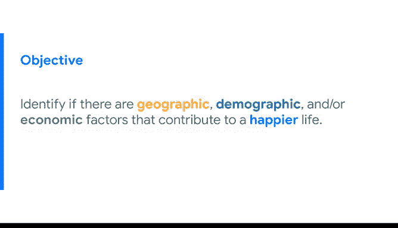
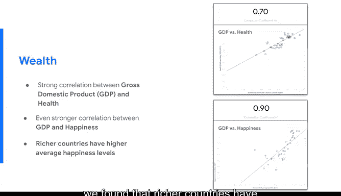
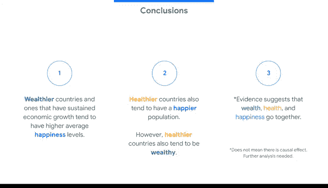

# 谷歌数据分析师第六课《通过数据可视化分享数据》visualize-data（中英双字） - P31：33_04_08_康纳：优秀的数据演示示例.zh_en - GPT中英字幕课程资源 - BV1ik4y1K7PX

So now that you know what not to do， I'm going to walk you through how I would tackle a presentation So to start。

 you can see the title slide is a lot simpler。 we have a title we have who is presenting and we have when it occurred Now I do want to talk a little bit about the date at the bottom。

 which is an important factor that you shouldn't forget to include。

You may come back to this presentation a few months later， even a year later。

 or this may be disseminated across your company。It's important to know that when this analysis took place。

And why and what were the circumstances of it。 And a big part of that is what were the circumstances of the company at the time that this was actually presented。

So the next slide is giving an idea of what you're going to be presenting to everyone and when So you start with your purpose statement you're going to be discussing what are we talking about。

The next aspect is。Where you actually tell your story。

 and that's an important concept is this overall presentation is a story with data。And finally。

 you have your conclusion slide。You're going to be very clear that this is the conclusion。

 this is where you're going to add recommendations if this is in a business context。

 and then you'll have。Here appendix where you can have an additional information on data visuals as well as overall context for the presentation that may not work within the overall flow itself。

So our transition slide， what are we talking about？

So this is where you let the audience know what we're talking about。 What are we trying to tell them。

 What are all the slides that are following this going to be driving towards。

So when we look at this slide。I am trying to identify if there are geographic， demographic。

 and or economic factors that contribute to a happier life。

That is the purpose of the overall presentation。So everybody now in the room knows this。

 and that is what they're going to be thinking about as you present all of the data to them。

Next section on our table of contents， present the data。

It is important to mention these will probably have different titles as you build them out。

 but this is the topic that we're moving into。 So you'll recognize this visual from the messy slide。

But it has a different color context。 That's not as important。

 But what is important is when you get here， you have a title on the slide。 you have a visual。

 but there is no text。 And this is an important aspect to it。 is what we're trying to do。Is walk。

And introduce the audience to the overall data that you're going to be using。

Now this is the first slide that has any form of content on it。

 so it's important that you introduce them to the underlying data。

And seeing as the data is all about geographic， demographic。

 and economic data points per each country。It's important that the visual represents that。

If I were to be the presenter on a slide like this， I would start by。

Getting to this slide and explaining the process and data that were looking at。

 so we analyzed data set consisting of data collected from residents of European countries between 2015 and 2017。

The data contained demographic and economic data for individuals within each country。

 including population。GDP or gross domestic product。And the happiness score per person。

So I've now introduced them to the data set。There's still no text。

 so they know that they should be looking at the visual and listening to me。Now， the next aspect。

 which is。Can be over utilizedil， but I've also seen underutilized as using animations in your presentation。

 Animations can be used as a way to direct your audience's attention as you speak， a way to say。

Look over here at this area of the slide as I'm talking。

It also allows them not to get too bogged down or distracted as you're introducing new concepts to them。

 because remember， as you're introducing data， that technical components may be new to a lot of people。

 And finally。Another way to do this is through annotations on top of visuals that can be used as another form of directing their gaze and their overall attention。

 So putting these together， we can have something like an annotation appear as you're discussing it。

 So if we were trying to explain what the visual is showing。

 we have an annotation that pops up that says happiness score and points to the score within the specific country and we can explain exactly what the visual is showing。

 So in this way， we could say something like we began by creating a heat map of the happiness score for each country。

 where the number within each country represents the overall score and the colors represents how high or how low the score is on a scale。

 So the darker blue the country is， the higher the numeric happiness score for that country。

 the deeper red that the country is the lower the happiness score and overall numeric value。😊。

So what we've done before any text has appeared on the screen is explain the visual。

 explain the overall data that they're going to be looking at throughout the presentation。

So that they now can understand when we dive into this specific analysis。

So it's important that you only use text on the screen。

In a short and concise manner to highlight the main points that you're discussing。

 So after I introduce the visual。I can now dive into the analysis。 So we have our first bullet point。

 Happiness levels vary widely by country。 So with this， as it appears。

 my speaker notes can be something along the lines of， However。

 as high and low scores are spread sporadically throughout the map。

 there is little correlation that we find between geographical location and happiness。 Finally。

 we concluded that the geographical location alone was not a strong indicator of happiness。

 So as you can see， as I'm discussing。 And as I'm explaining what we were looking at within the data。

 The overall text on the screen， only populated as I began to discuss it。

 So the audience knew exactly where to look and exactly what to be listening to when I'm talking。😊。

A very important aspect of the flow of the overall presentation is the transition from one slide to the next。

So as I'm discussing this， you can use a bullet point。

 you can use your speaker notes either way there should be some transition from one slide to the next so that you the audience knows that this part is over and they know what's coming next So for this slide。

I used my speaker note。 so I'm going to explain the transition。

 something like our next step was to identify the demographic and economic differences between the higher and lower countries to isolate the correlated features between them。

So we get to the next slide。Very common theme。 It may be a different visual。

 but the overall title and where the text is going to show up is going to be in the same place。

 So we familiarize them with the overall theme of the presentation within three slides。 Now。

 the title immediately tells what we're going to be discussing。 The previous one was geographic。

 This one is all based on population。As we move through this slide。

 and as you saw in the messy example， we use a lot of scatter plots。

 and scatter plots may not always be the best option because they are rather difficult for people to follow within presentations。

But if you explain it to them once so that they understand。

 you can use them throughout the presentation because you familiarize them with it。

 So because it's the first time it popped up， it's important that you explain the visual in depth and all the features of it that you will be talking about later throughout the presentation。

 We use animations again。 We talk about what are the axes on the scatter plot。

We created a scatter plot in which we plotted countries based on their happiness score and the population to see if there was a correlation between the two。

The higher up something is on the scatter plot， the happier the country is。

The further to the right that the country has plotted， the larger the population。

And the line that goes between the two is testing for correlation。

 or if these two different points are related to one another。

So these annotations and these animations are there to clarify what the chart is plotting。Now。

 the overall purpose is that we are attempting to identify if there is a relationship between the population size of the country and the overall happiness score。

So now that you have explained what this visual is， you can now dive into the results of it。Now。

 this slide itself has。One bullet point。It is the results of the overall analysis that you can find just based on the data visual。

We found that there was little to no correlation between happiness and population based on the analysis that we ran。

So all discussion and in depthep explanation of the visual。

Is kept in the speaking notes besides the overall annotations。And again。

 the transition is very important to the next slide。 So you can say something like。 So next。

 we dove into the specific demographics of each country to see if we can identify the features that separate or correlate with the overall happiness of the country。

 again， same thing。😊，We have the title， we know what we're going to be talking about now。

 this is now the health of each country and how it correlates with happiness。

We have a scatter plot again， except the good news is you've already introduced what the scatter plot is and what you are comparing on there。

 So now the audience has been familiarized with the data set。

 You don't have to go through and explain exactly what the visual is representing。

 You can dive into the overall differences or analysis that you're going to be presenting on this slide。

😊，You can have something explaining that we found a positive correlation between happiness and health。

Or overall， life expectancy of the country。Now， we found this because the correlation coefficient。

Between the two different factors being happiness and health was 。50。Now。

 you just introduced a new concept， this is where you have to now explain the new concept。

Because otherwise you may lose people in the room。This is a technical component to your overall analysis。

 and it is an important component， so it is critical that you do explain what it is。

 but in a simplified way so that everybody understands。

So you can say something along the lines of a correlation coefficient is a measure of strength and direction of the linear relationship between two variables。

 So in other words， the closer to one that the number is。The more positively correlated they are。

 meaning when one of the variables goes up， so does the other one。The closer to negative one。

That the number is。The more negatively correlated they are， meaning as one of the variables。

 such as happiness goes up。That the other variable， like health， would go down。

And the closer to 0 it is， it means they are not correlated at all。

 which is what we saw between population and happiness and means that they have no relationship together。

So we've now explained exactly what it is that we used as an analysis on this specific slide。

And it's important， again， that we discussed the transition to the next。

 So we did find that there was a positive correlation between happiness and health。

 but the question remains， are happy people healthy or are healthy people happy。

 We know that they are related， but we don't know what causes the other。And finally。

 what contributes to a longer life expectancy， if we know that。

Longer life expectancy is related to happiness， what is it that helps create longer life expectancy within a country？

Now， these are the two questions that we need to answer before the end of the presentation moving on from here。

 So again， we are creating a logical flow as we move through this presentation。

Now we are looking at a new concept， wealth within each country。

Now that you are using such as the scatter plot are familiar with the audience。

 it's okay now that you add in additional ones。 So you can say something along the lines of we then analyzed how GDP or the overall economic status of the country relates to the overall health of the country because if we know that GDP is related to health。

 and we know that health is related to happiness then we can infer additional information through that。

So we found that there is a strong correlation between gross domestic product and the overall health of a specific country with a 。

7 correlation coefficient so higher than the overall correlation coefficient for。

Health and happiness。Next， we found an even stronger correlation between GDP and happiness。

So whereas we first looked at health and happiness and then GDP and health。

 we're now looking at GDP and happiness and found that it has the highest correlation coefficient between all three of those comparisons。

So we have a conclusion within just this slide， which is we found that richer countries have a higher average happiness level。

This is a good transition to the overall conclusion of now your entire presentation。So again。

 you're directing your audience through just presenting the text that you want them to look at。

Your first conclusion from your overall presentation。

Wealthier countries and ones that have sustained economic growth。

Tend to have a higher average happiness level。Your second conclusion。

 healthier countries also tend to have a happier population。However。

 healthier countries also tend to be wealthy。And finally， this is where you take it home。

So our evidence suggests that wealth， health and happiness all go together。

 It's important to also discuss any caveats or future analysis that needs to be ran to answer the questions that may come up based on this analysis。

 So we have said that the evidence suggests that wealth， health and happiness all go together。

 But that does not mean that one causes the other。So there needs to be future analysis to understand any causal effects between them。

And then， you have。Your final slide。 and this is where questions would come in。

So it's important to remember that data storytelling is an art。

 What we've given you is some high level overview and examples of what not to do and an improved version。

 but don't be afraid to put yourself in there。 The overall presentation style is going to come from your personality and skill set within data analytics。

 You can use the tools that we use to help you build the layout of your presentation。

 But it's up to you to really put a lot of yourself into it。

 and a lot of your own skills to help people understand the overall analytics that you've run。

