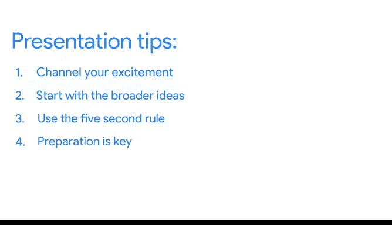

# 谷歌数据分析师第六课《通过数据可视化分享数据》visualize-data（中英双字） - P32：34_04_01_经证实的演示技巧.zh_en - GPT中英字幕课程资源 - BV1ik4y1K7PX

。Hey there。So far， we've learned about using a framework to guide your audience through your presentation and how to weave data in。

Now I want to talk about why these presentation skills are so important and give you some simple tips you can use during your own presentations。

As a data analyst， you have two key responsibilities。

Analyze data and present your findings effectively。Analyzing data seems pretty obvious。

 It's in the title data analystly， after all。But data analysis is all about turning raw information into knowledge。

If you can't actually communicate what you've learned during your analysis。

 then that knowledge can't help anyone。There's plenty of ways data analysts communicate emails。

 memos， dashboards， and， of course， presentations。 effective presentations start with the things we've already talked about。

 like creating effective visualizations and organizing your slides。

But how you deliver those things can make a big difference in how well your audience understands them。

And you want to make sure they leave your presentation empowered by the knowledge and ready to make decisions based on your analysis。

 That's why strong presentation skills are so important as a data analyst。

And if the idea of giving a presentation makes you nervous， don't worry。

A lot of people feel that way。But here's a secret。 It gets easier， the more you practice。

Now let's look at some tips and tricks you can use when giving your presentations。

We'll go over some more advanced ones later。 But let's start with the basics for now。

It's natural to feel your adrenaline levels rise before giving a presentation。

 That's just because you're excited to be there。😊，To help keep that excitement in check。

 try taking deep， controlled breaths to calm your body down。As a bonus。

 this will also help you channel all that excitement into a presentation style that shows your passion for the work you've done。

You might remember， we talked earlier about using the Mc method to present data visualizations。 Well。

 it's also a good rule of thumb for presentations in general。Start with the broader ideas。

 The obvious questions your audience might have and what they need to understand to put your findings in context。

Then you can get more specific about your analysis and the insights you've uncovered。

 Let's go back to our avocado example and imagine how we'd start that presentation。

After we introduce ourselves in the title of our presentation。

 we have a slide with our goals for the discussion。

 We start with the most general goals and then get more specific。

 We might say our goal for today day is to first provide you all with the state of the world on online avocado searches。

😊，Then we'll examine the opportunities and risks of seasonal trends in online avocado searches。

We'll move into actionable next steps that can help you start taking advantage of these opportunities as well as help to mitigate the risks。

And finally， we'd love to make the third part a discussion with you about what you think of these next steps。

😊，What you'll want to notice here is how our presentation focuses on the general interest in avocados online before getting into specifics about what that means for our stakeholders。

 We also learned about the5 second rule as a quick refresher whenever you introduce a data visualization。

 you should use the5 second rule and ask two questions。First。

 wait 5 seconds after showing a data visualization to let your audience process it。

Then ask if they understand it。 If not， take time to explain it。

Then give your audience another5 seconds to let that sink in before telling them the conclusion you want them to understand。

 Try not to rush through data visualizations。This will be the first time some of the people in your audience are encountering your data。

 and it's worth making time in your presentations for them。

 Here's our first data is in the avocado presentation。 When we get to this slide。

 we want to introduce our yearly avocado search trends。

 graphraph and explain the basic background we've included here。😊，After we wait 5 seconds。

 we can ask， are there any questions about this graph， Let's say one of our stakeholders asks。

 could you explain Google search trends， Great， After explaining that， we wait another 5 seconds。

 Then we can tell them our conclusion。😊，Searches for avocados have been increasing every year。

 You'll learn more about these concepts later on。 But these are some great tips for starting out。

 Finally， when it comes to presenting data， preparation is key。😊。

For some people， that means doing dress rehearsals。For others。

 it means writing out a script and repeating it in their head。Others find visualizing themselves。

 giving the presentation helps。Try to find a method that works for you。

 The most important thing to remember is that the more prepared you are。

 the better you'll perform and the lights are on。 And it's your turn to present。Coming up。

 we'll cover more best practices for presentations and also look at some examples。

 looking forward to it。