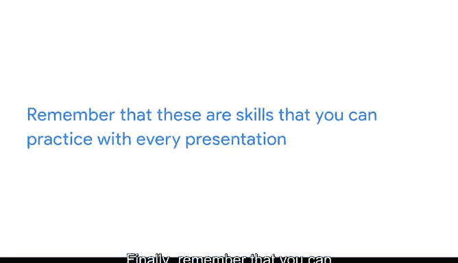

# 谷歌数据分析师第六课《通过数据可视化分享数据》visualize-data（中英双字） - P33：35_04_04_像专家一样演示.zh_en - GPT中英字幕课程资源 - BV1ik4y1K7PX

Hey， good to see you again。By now， you've learned some ways to organize and incorporate data into your presentations。

You've also covered why effective presentation skills are so important as a data analyst。 Now。

 you're ready to start presenting like a pro。Coming up。

 I'll share some pro tips and best practices with you。 Let's get started。

 We've talked about how important your audience is throughout this program。

 and is's especially important for presentations。It's also important to remember that not everyone can experience your presentations the same way。

Sharing your presentation via email and putting some forethought into how accessible your data v is before your presentation can help ensure your work is accessible and understandable。

But during the actual presentation， it can be tempting to focus on what's most interesting and exciting to us and not on what the audience actually needs to hear。

And sometimes， even the best audiences can lose focus and get distracted。

But here's a few things you can do during your final presentation to help you stay focused on your audience and keep them engaged。

First， try to keep in mind that your audience won't always get the steps you took to reach a conclusion。

Your work makes sense to you because you did it。This is called the curse of knowledge。Basically。

 it means that because you know something， it can be hard to imagine your audience not knowing it。

It's important to remember that your audience doesn't have the same context you do。

 So focus on what information they need to reach the same conclusion you did。 Earl。

 we covered some useful things you can add to your presentations to help with this。First。

 answer basic questions about where the data came from and what it covers。 How is it collected。

 Does it focus on a specific time or place。You can also include your guiding hypothesis and the goals that drove your analysis。

Adding any assumptions or methods you use to reach your conclusions can also be useful。 For example。

 in our avocado presentation， we grouped months by season and looked at overall trends。 And finally。

 explain your conclusion and how you reached it。 Your audience also has a line on their mind already。

😊，They might be thinking about their own work projects or what they want to have for lunch。

 They aren't trying to be rude， and it doesn't mean they aren't interested。

 They're just busy people with a lot going on。So try to keep your presentation focused and to the point to keep their minds from wandering。

Try not to tell stories that take your audience down an unrelated line of thinking。

And try not to go into too much detail about things that don't concern your audience。

You might have found a really exciting new SQL database。

 but unless your presentation is about databases， you can probably leave that out。

Your audience can also be easily distracted by information in your presentation。For example。

 the more you include in a chart， the more your audience will need to explore it。

So try to avoid including information in your presentations that you don't think will be productive to discussions with your audience。

Sharing the right amount of content to keep your audience focused and ready to take action。

It's also good to note that how you present information is just as important as what you present。

And I have some best practices for delivering presentations。 First， pay attention to how you speak。

 Keep your sentences short。Don't use long words where short words will work。

Build in intentional pauses to give your audience time to think about what you've just said。

 Try to keep the pitch of your sentences level so that your statements aren't confused for questions。

 Also， try to be mindful of any nervous habits you have。 Maybe you talk faster。

 Tap your toes or touch your hair when you're nervous。 That's totally normal。 Every one does。

But these habits can be distracting for your audience。When you're presenting。

 try to stay still and move with purpose。Practice good posture and make positive eye contact with the people in your audience。

Finally， remember that you can practice and improve these skills with every presentation。

Accept and seek out feedback from people you trust。 Fe is a gift and an opportunity to grow。

And with that， you've completed another module。The presentation skills you've learned here。

 like using frameworks， weaving data into your presentation and best practices you can apply during your actual presentations are going to help you communicate your findings with audiences effectively。

