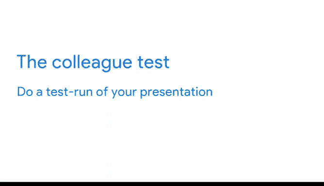
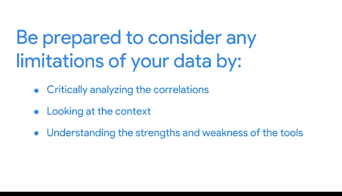

# 谷歌数据分析师第六课《通过数据可视化分享数据》visualize-data（中英双字） - P34：36_04_02_预见问题.zh_en - GPT中英字幕课程资源 - BV1ik4y1K7PX

Hello。So let's talk about how you can be sure you're prepared for a Q And A。For starters。

 knowing the questions ahead of time can make a big difference。You don't have to be a mind reader。

 but there's a few things you can do to prepare。 That'll help。For this example。

 we'll go back to the presentation we created about health and happiness around the world。

We put together these slides， cleaned them up a bit。

 And now we're getting ready for the actual presentation。😊。

Let's go over some ways we can anticipate possible questions before our Q And A to give us more time to think about the answers。

 Understanding your stakeholders expectations will help you predict the questions they might ask。

As we previously discussed， it's important to set stakeholder expectations early in the project。

 Keep their expectations in mind while you're planning presentations and Q And A sessions。

Make sure you have a clear understanding of the objective and what the stakeholders wanted when they asked you to take on this project。

For this project， our stakeholders were interested in what factors contributed to a happier life around the world。

😊，Our objective was to identify if there were geographic。

 demographic and or economic factors that contributed to a happier life。Knowing that。

 we can start thinking about the potential questions about that objective they might have。

At the end of the day， if you misunderstood your stakeholders expectations or the project objectives。

 you won't be able to correctly anticipate their questions。

So think about these things early and often when planning for a Q And A。

 Once you feel confident that you fully understand your stakeholders expectations and the project goals。

 you can start identifying possible questions。A great way to identify audience questions is to do a test run of your presentation。

 I like to call this the colleague test。😊。

Show your presentation or your date biz to a colleague who has no previous knowledge of your work and see what questions they ask you。

 They might have the same questions your real audience does。 We talked about feedback as a gift。

 So don't be afraid to seek it out and ask colleagues for their opinions。

Let's say we ran through our presentation with a colleague。 We showed them our data visualizations。

 then asked them what questions they had。They tell us they weren't sure how we were measuring health and happiness with our data in this slide。

That's a great question。 And we can absolutely work that information into our presentation。😊。

Sometimes the questions asked during our colleague test help us revise our presentation。Other times。

 they help us anticipate questions that might come up during the presentation。

 even if we didn't originally want to build that information into the presentation itself。

So it helps to be prepared to go into detail about your process， but only if someone asks。Either way。

 their feedback can help take your presentation to the next level。 Next。

 it's helpful to start with zero assumptions。 Don't assume that your audience is already familiar with jargon。

 acronyms， past events or other necessary background information。

Try to explain these things in the presentation and be ready to explain them further， if asked。

When we showed our presentation to our colleague， we accidentally assumed that they already knew how health and happiness were measured and left that out of our original presentation。

😊，Now， let's look at our second data is。 This graph is showing the relationship between health。

 wealth and happiness， but includes GDP to measure the economy。😊。

We don't want to assume that our audience knows what that means。 So during the presentation。

 we'll want to include a definition of GDP。In our speaker notes， we've added gross domestic product。

 total monetary or market value of all the finished goods and services produced within a country's borders in a specific period of time。

We'll fully explain what GDP means as soon as this graphic comes up。 That way。

 no one in our audience is confused by that acronym。

It helps to work with your team to anticipate questions and draft responses。Together。

 you'll be able to include their perspectives and coordinate answers so that everyone on your team is prepared and ready to share their unique insights with stakeholders。

😊，The team working on the World Happiness project with you probably have a lot of great insights about the data。

 like how it was gathered or what it might be missing。

Touch base with them So you don't miss out on their perspective。Finally。

 be prepared to consider and describe to your stakeholders any limitations in your data。

You can do this by critically analyzing the patterns you've discovered in your data for integrity。

 For example， could the correlations found be explained as coincidence。On top of that。

 use your understanding of the strengths and weaknesses of the tools you use in your analysis to pinpoint any limitationsations they may have introduced。

 While you probably don't have the power to predict the future。

 you can come pretty close to predicting stakeholder and audience questions by doing a few key things。

Remember to focus on stakeholder expectations and project goals。

Identify possible questions with your teams。 Review your presentation with zero assumptions and consider the limitations of your data。

 Sometimes， though， your audience might raise objections to the data before and after your presentation。

Coming up， we'll talk about the kind of objections they might have and how you can respond。

See you next time。

