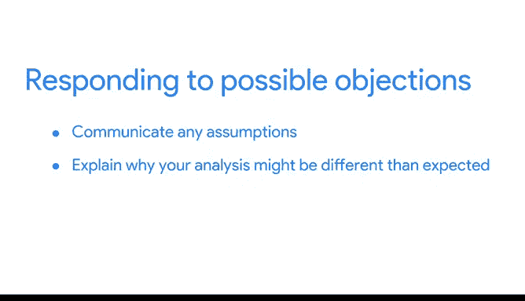

# 谷歌数据分析师第六课《通过数据可视化分享数据》visualize-data（中英双字） - P35：37_04_03_处理异议.zh_en - GPT中英字幕课程资源 - BV1ik4y1K7PX

Welcome back。In this video， we'll talk about how you can handle objections about the data you're presenting。

Stakeholders might raise objections during or after your presentation。

 Usually these objections are about the data， your analysis or your findings。

We'll start by discussing what questions these objections are asking and then talk about how to respond。

 Obs about the data could mean a few different things。

Sometimes stakeholders might be asking where you got the data and what systems it came from。

Or they might want to know what transformations happen to it before you worked with it or how fresh and accurate your data is。

You can include all this information in the beginning of your presentation to set up the data context。

You can add a more detailed breakdown in your appendix in case there are more questions when we are talking about cleaning data。

 you learn keeping a detailed log of data transformations is useful。

That log can help you answer the questions we're talking about here。

And if you keep it in your presentation's appendix。

 it'll be easy to reference if any of your stakeholders want more detail during a Q&A。Now。

 your audience might also have questions or objections about your analysis。

They might want to know if your analysis is reproducible。

 so it helps to keep a change log documenting the steps you took。This way。

 someone else could follow along and reproduce your process。

You can even create a slide in the appendix section of your presentation。

 explaining these steps if you think it'll be necessary。

And it can be useful to keep a clean version of your script if you're working with a programming language like SQL or R。

 which we'll learn all about later。Also， be prepared to answer questions like who did you get feedback from during this process。

This is especially important when your analysis reveals insights that are the opposite of your audience's gut feelings about the data。

Making sure to include lots of perspectives throughout your analysis process will help you back up your findings during your presentation。

Finally， you might be faced with objections to the findings themselves。A lot of the time。

 these will be questions like， do these findings exist in previous time periods or did you control for the differences in your data？

Your audience wants to be sure that your final results accounted for any possible inconsistencies and that they're accurate and useful。

 Now that， you know some of the possible kinds of objections your audience might raise。

 Let's talk about how you can think about responding。First。

 it can be useful to communicate any assumptions about the data， your analysis。

 or your findings that might help answer their questions。For example。

 did your team clean and format your data before analysis？

Telling your audience that can clear up any doubts they might have。 Second。

 explain why your analysis might be different than expected。

 Walk your audience through the variables that change the outcomes to help them understand how you got there。

And third， some objections have merit， especially if they bring up something you hadn't thought of before。

 If that's true， you can acknowledge that those objections are valid and take steps to investigate further。

Following up with more details afterwards is great， too。

And now you know some of the basic objections you might run into。

Understanding that your audience might have questions about your data。

 your analysis or your findings can help you prepare responses ahead of time。

And walking your audience through any assumptions about the data or unexpected results are great approaches to responding。

😊，Coming up， we'll go over even more best practices for responding to questions during a Q& A。

 Bye for now。