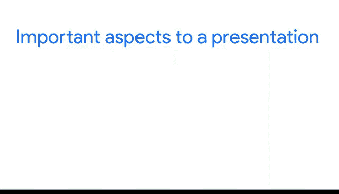
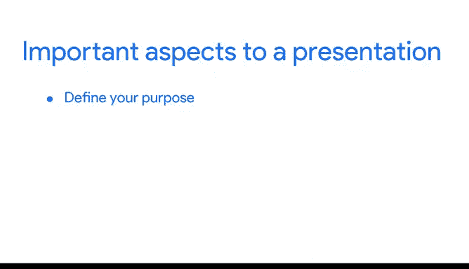
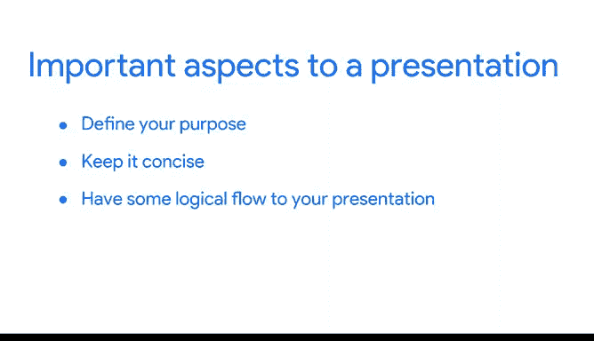
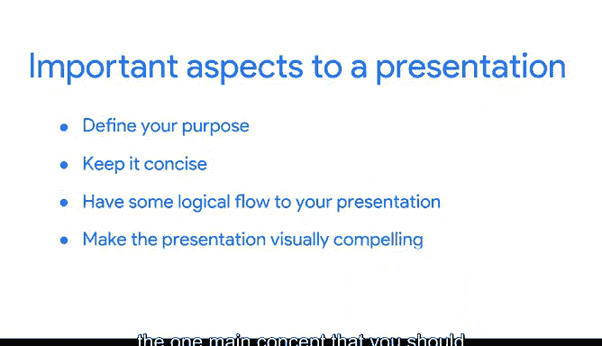
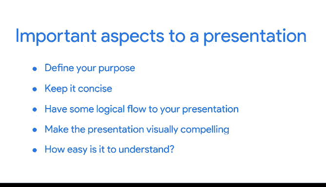

# 谷歌数据分析师第六课《通过数据可视化分享数据》visualize-data（中英双字） - P37：39_04_02_康纳：成为专业数据翻译者.zh_en - GPT中英字幕课程资源 - BV1ik4y1K7PX

Throughout my journey and something that you'll probably。U。Move through as you become。

Further and further along in your career in data analytics is。

 it's not the data itself that is really important to the company。

 It's the understanding of the data and the impact that it can take。

 But a lot of business leaders don't have the technical expertise。To。

Understand the data in its raw form。 So you， as the analyst are the translator。

 So the most important part of the data is B is the translator of the data for the business leaders。

 And I found throughout my career that。Presenting data is probably the most important aspect of being a data analyst。

 because it doesn't matter how compelling the analysis is or how accurate it is。

 If people don't understand it， then it doesn't offer value to the business。

 and it doesn't offer value to。Anyone， I've devoted a lot of my time and a big part of my current job is really to help business leaders understand their data and taking something that's very technical and simplifying it so that people understand what it means and how they can use it to impact the business and it's an art form。

 it's a skill to really be able to take something that's highly technical and simplify it down so that everybody in the room understands what it's saying and how to use it。

 So a lot of times when I'm looking at somebody's presentation or building one myself。

 a really important aspect to a presentation is to define your purpose。

Define exactly what it is that you are going to be talking about and why it's important。

 Why is everybody in the room there and what are they going to take away from this presentation。

The next aspect to a really good presentation is to keep it concise。

You don't want things to be too wordy。 You don't want a lot of text on the screen。

 and you don't want it to be too long。 It's not that everybody is too busy to be in the room， but。

You really want to make sure that you're making your point without losing everybody's focus。

 The next one is have some logical flow to your presentation。

You don't want everybody's focus bouncing around from different ideas as you're trying to make your point。

 You want a very concise and logical flow so that they know what's coming next and what you're talking about Currently。

 The next aspect to think about is making the presentation visually compelling。You want somebody to。

Know what they're looking at and understand it。 So the visuals that you choose。

 the theme that you have for your overall presentation should be appealing。

 and it should draw people in so that they know exactly what they're getting out of the presentation。

 and all of these things roll up to the one main concept that you should be thinking about when building a presentation。

 which is how easy is it to understand。

You are trying to make。Something that is very technical data analysis and simplify it down so that it doesn't matter what the technical background or even business background of the person。

 but they understand what it is that you are trying to explain to them。

