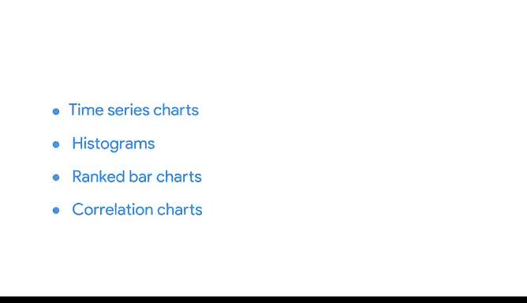

# 谷歌数据分析师第六课《通过数据可视化分享数据》visualize-data（中英双字） - P5：05_01_05_打造有力可视化的秘诀.zh_en - GPT中英字幕课程资源 - BV1ik4y1K7PX

Aith there。You're back and ready to learn how to create powerful data visualizations。 Coming up。

 we'll explore how to take our findings and turn them into compelling visuals。 Earl。

 we discussed the relationship between data and images。😊，Now。

 we'll build on that to explore what visualizations can reveal to your audience and how to make your graphics as effective as possible。

 One of your biggest considerations when creating a data visualization is where you'd like your audience to focus。

 showing too much can be distracting and leave your audience confused。 In some cases。

 restricting data can be a good thing。 On the other hand。

 showing too little can make your visualization unclear and less meaningful。 As a general rule。

 as long as it's not misleading。 you should visually represent only the data that your audience needs in order to understand your findings。

 O。Now， let's talk about what you can show with visualizations。 Change over time is a big one。

 If your analysis involves how the data is changed over a certain period could be days， weeks。

 months or years， you can set your visualization to show only the time period relevant to your objective。

This visualization shows the search interests in news story topics like environment and science and social issues。

The Viz is set up to show how the search entrance changes day to day。

The bubbles represent the most popular topic on each day in a given part of the US。

As news stories come up， the data changes to reflect the topic of those stories。

If we wanted the data for weekly or monthly news cycles。

 we' change the interactive feature to show changes by week or month。

Another situation is when you need to show how your data is distributed。

A histogram resembles a bar graph。But it's a chart that shows how often data values fall into certain ranges。

This histogram shows a lot of data and how it's distributed on a narrow range from negative one to positive one。

Each bin or bucket， as the bar is called， contains a certain number of values that fall into one small part of the range。

 If you don't need to show that much data， other histograms would be more effective like this one about the length of dinosaurs。

Here， the bends or buckets of data values are segmented。

 so you can show each value that falls in each part of the range。If your data needs to be ranked。

 like when ordering the number of responses to survey questions。

 you should first think about what you want to highlight in your visualization。

Bar charts with horizontal bars effectively show data that's ranked。

With bars arranged in ascending or descending order。

A bar chart should always be ranked by value unless there's a natural order to the data like age or time。

 for example。This simple bar chart shows metals like gold and platinum， ranked by density。

An audience would be able to clearly see the ranking and quickly determine which metals had the highest density。

 Even if this state of is included a lot more metals。😊。

Correlation charts can show relationships among data。

But they should be used with caution because they might lead viewers to think that the data shows causation。

 causation or a cause effect relationship occurs when an action directly leads to an outcome。

Correlation and causation are often mixed up because humans like to find patterns。

 even when they don't exist。 So if two variables look like they're associated in some way。

 we might assume that one's dependent on the other。That implies causation。

 even if the variables are completely independent。And if we put that data into a visualization。

 then it would be misleading。 but correlation charts that do show causation can be effective。

 For example， this correlation chart has one line of data showing the average traffic for Google searches on Tuesdays in Brazil。

The other lines for a specific date of search traffic， June 15。

So the data is automatically correlated because both lines are representing the same basic information。

 but the chart also shows one big difference when a football match or soccer match for Americans。

Began on June 15， The search traffic showed a significant drop。 This implies causation。

 Football is a very popular and important sport for Brazilians。

 and the data in this chart verifies that。 We've now talked about time series charts， histograms。

 ranked bar charts and correlation charts。 Each of these charts can visualize a different type of analysis。

 Your business objective。 and audience will help figure out which of these common visualizations to choose。

 Or you may want to check out some other kinds of visualizations out there。

 There's also a glossary of visualizations that you'll be able to reference later。

 So that wraps up our lesson on creating visualizations。

 Com up next will add some more layers to your planning and execution of visuals。 So hang on tight。😊。

