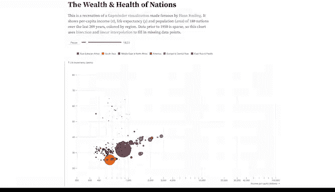
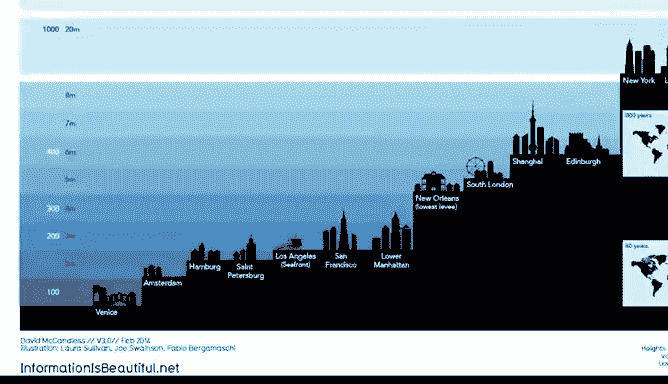
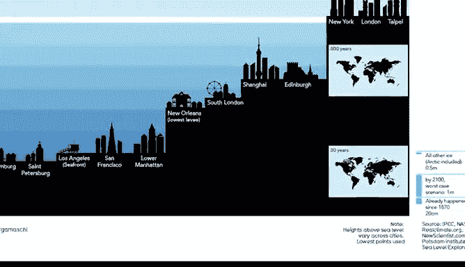

# 谷歌数据分析师第六课《通过数据可视化分享数据》visualize-data（中英双字） - P7：07_01_01_艺术元素.zh_en - GPT中英字幕课程资源 - BV1ik4y1K7PX

Hello and welcome back。You probably didn't think you'd be learning about art in a data analytics course。

 but that's exactly what we're going to do。 Both data analysts and artists use elements of art in their work。

We'll introduce those elements to you here and we'll show you how to apply them to visualizations later。

The elements we'll check out our line shape。Color， space and movement。Now。

 these aren't the only elements to consider， but these particular ones can add value to your data viz by making them more visually effective and compelling Lines and visualizations can be curved or straight。

 thick or thin， vertical， horizontal or diagonal。They can add visual form to your data and help build the structure for your visualization。

These charts show some of the variety that lines can bring to your database biz。

The combo chart shows two different types of lines， both providing a graphic for the data。

The line chart does the same， but uses curd lines instead。Shapees are also known for their variety。

 Shapes and visualization should always be two dimensional。

 This is because three dimensional objects in a visualization can complicate the visual and confuse the audience。

Shapees are also a great way to add eye catching contrast。

 especially size contrast to your data story。 This circle used for a pie chart。

 lets someone quickly understand the data in a familiar format。

Shapees with symmetry are usually more familiar to people。

 So there's less work for the audience to do when viewing symmetrical data bi。

But the asymmetrical shapes in this map are still instantly recognizable as countries。

It's good to note that the data you're sharing with your audience will usually inform the types of shapes you want to use in your database。

😊，Next， we have colors and colors are， well， colors。Of course， in the eyes of artists and analysts。

 Colors can be much more complex。 Colors can be described by their hue， intensity and value。

 The hue of a color is basically its name， red， green， blue and so on。

Intensity is how bright or dull a color is。And finally， there's value。

The value is how light or dark the colors are in a visualization。In more scientific terms。

 value indicates how much light is being reflected。

Dark values with some black added are called shades of color， like these shades of green。

Light values with white added are called tents， like these tents of blue。In this map。

 there are shades and tints of gray。 The value of these colors help us understand the population data in the map。

 and varying the colorss value can be a very effective way to draw our audience's attention to specific areas。

 Space is the area between around and in the objects。

 There should always be space and data visualizations， just not too much or too little。For example。

 the space between the bars of a bar graph like this one should be smaller than the width of the bars themselves。

 This will draw the viewer' attention to the bar and the data it represents instead of the empty space。

 Finally， there's movement。Movement is used to create a sense of flow or action and a visualization。

One of my favorite examples is the data Viz the wealth and health of nations。

This visitge showcases a correlation between the financial health and physical health of nations。

It traces these elements over time。 so you can see how the two correlated effects play out。

The movement pulls in data from the 1800s all the way up until recently。

The interactivity allows for a greater volume of data to be displayed。

And will reveal multiple stories from the same data visualization。Remember。

 this is something that should be used sparingly。 There's a fine line between attracting attention and distracting the audience。

A static image lets you control all elements of the story you want to tell。

When you start incorporating movement and interactivity。

 the story is controlled by whoever is controlling the interactivity。

 whether that's you or possibly your audience。 if you've turned control over to them。

We'll discuss this delicate bounce later on in the course。

When you bring many of these art elements together in a visualization like this one about sea levels。

It can be beautiful and provoking。It proves that there is a place for creative expression in data analytics。

Coming up， we'll continue exploring ways to add meaningful creative expression to your database biz。

 Bye for now。😊。

