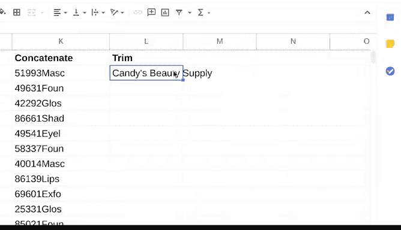

# 谷歌数据分析师第四课《从脏数据到干净数据的处理》process-data（中英字幕）deepseek翻译 - P16：16_02_04_优化数据清洗流程.zh_en - GPT中英字幕课程资源 - BV19m4y1J7dG

Welcome back。You've learned about some very useful data cleaning tools that are built right into spreadsheet applications。

Now we'll explore how functions can optimize your efforts to ensure data integrity。As a reminder。

 a function is a set of instructions that performs a specific calculation using the data in a spreadsheet。

The first function we'll discuss is called counts if。

Counts if is a function that returns the number of cells that match a specified value。Basically。

 it counts the number of times a value appears in a range of cells。

Let's go back to our professional association spreadsheet。In this example。

 we want to make sure the association membership prices are listed accurately。

We'll use counts if to check for some common problems。

 like negative numbers or a value that's much less or much greater than expected。To start。

 let's find the least expensive membership。100 for student associates。

So that'll be the lowest number that exists in this column。

If any cell has a value that's less than 100， count if will alert us。

We'll add a few more rows at the bottom of our spreadsheet。Then beneath column H type member dues。

Less than 100。 Next， type the function in the cell next to it。

 Every function has a certain syntax that needs to be followed for it to work。

Syntax is a predetermined structure that includes all required information and its proper placement。

The syntax of accounts if function should be like this。Equals counts if， open parentheses， range。

 comma， the specified value in quotation marks， and a closed parentheses。

So it will show up like this。Where I， too。Through I 72 is range。And the value is。Less than 100。

This tells the function to go through column I and return account of all cells that contain a number less than 100。

Turns out there is one。Scrolling through our data， we find that one piece of data was mistakenly keyed in as a negative number。

Let's fix that now。Now， we'll use countif to search for any values that are more than we would expect。

The most expensive membership type is $500 for corporate members。Type the function in the cell。

This time it'll appear like this。I， too。Through I72 is still the range。

But the value is greater than 500。There's one here too， check it out。This entry has an extra zero。

It should be $100。Okay。The next function we'll discuss is called L。

Len is a function that tells you the length of a text string by counting the number of characters it contains。

This is useful when cleaning data if you have a certain piece of information in your spreadsheet that you know must contain a certain link。

For example， this association uses six digit member identification codes。

So if we just import this data and wanted to be sure our codes are all the correct number of digits。

 we'd use L。The syntax of L is equals L， open parentheses， the range， and the closed parentheses。

So we'll insert a new column after member ID。Then type an equal sign and then。Added open parentheses。

The range is the first member ID number in A2。Finish the function by closing the parentheses。

It tells us that there are six characters in cell A2。

Let's continue the function through the entire column。And find out if any results are not6。

But instead of manually going through our spreadsheet to search for these instances。

 we'll use conditional formatting。We talked about conditional formatting earlier。

 it's a spreadsheet tool that changes how cells appear when values meet specific conditions。

 Let's practice that now。Select all of column B。Except for the header。Then go to format。

And choose conditional formatting。The format rule is to format cells， if not equal to 6。Click done。

And the cell with the7 inside is highlighted。All right， now we're going to talk about left and right。

Left is a function that gives you a set number of characters from the left side of a text string。

Right is a function that gives you a set number of characters from the right side of a text string。

As a quick reminder， a text string is a group of characters within a cell。

 commonly composed of letters， numbers， or both。To see these functions in action。

 let's go back to the spreadsheet from the cosmetictics maker from earlier。

This spreadsheet contains product codes。Each has a five digit numeric code。

And then a four character text identifier。But let's say we only want to work with one side or the other。

You can use left or right to give you the specific set of characters or numbers you need。

We'll practice cleaning up our data using the left function first。The syntax of left is equals left。

 open parentheses， the range， a comma， and the number of characters from the left side of the text string we want。

Then we finish it with the closed parentheses。Here。

 our project requires just the five digit numeric codes。So， in a separate column。Type equals left。

Open parentheses。Then add the range our range is a2。Then out of comma。

And the number five for our five digit product code。Finally。

 finish the function with the closed parentheses。Our function should show up like this。Press enter。

And now we have a substream， which is the number part of the product code only。

Click and drag this function through the entire column to separate out the rest of the product codes by number only。

Okay， now let's say your project only needs the four character text identifier。For that。

 we'll use the right function。And the next column will begin the function。The syntax is equals right。

Open parentheses， the range， a comma， and the number of characters we want。

Then we finish with the closed parentheses。Let's key that in now。Equals right。Open parentheses。

 and the range is still82。Add a comma， and this time we'll tell it that we want the first four characters from the right。

Close up the parentheses。And press enter。Then drag the function throughout the entire column。

Now we can analyze the products in our spreadsheet based on either substream。

 the five digit numeric code。Or the four character text identifier。

So hopefully that makes it clear how you can use left and right to extract substrs from the left and right sides of a string。

Now， let's learn how you can extract something in between。

Here's where we'll use something called mid。Mid is a function that gives you a segment from the middle of a text string。

This cosmetics company lists all of his client using a client code。

It's composed of the first three letters of the city where the client's located。

Its state abbreviation， and then a three digit identifier。

But let's say a data analyst needs to work with just the states in the middle。

The syntax for mid is equals mid。Open parentheses， the range， then a comma。When using MI。

 you always need to supply a reference point， in other words。

 you need to set where the functions should start。After that。

 place another comma and how many middle characters you want。In this case， our range is D2。

Let's start the function in a new column。Type equals mid。Open parentheses。D2。

Then the first three characters represent a city name。

 so that means the starting point is the fourth。Add a comma and4。

We also need to tell the function how many middle characters we want。Add one more comma。And2。

Because the state abbreviations are two characters long。Press enter and bam。

We just get the state abbreviation。Continue the bid function through the rest of the column。

So we've learned about a few functions that help separate out specific text strings。

 but what if we want to combine them instead？For that， willll use concateate。

Which is a function that joins together two or more text strings。The syntax is equals concatenate。

Then an open parentheses。Inside， indicate each text string you want to join separated by commas。

Then finish the function with the closed parentheses。So just for practice。

 let's say we needed to rejoin the left and right text strings back into complete product codes。

In a new column， let's begin our function。Type equals concanate。Then， an open parentheses。

The first texturing we want to join is in H2。Then add a comma。The second part is an I2。

Out of closed parentheses。And press， enter。Drag it down through the entire column。And just like that。

 all of our product codes are back together。ok。The last function we'll learn about here is trim。

TriIM is a function that removes leading， trailing， and repeated spaces and data。

Sometimes when you import data， your cells have extra spaces which can get in the way of your analysis。

For example， if this cosmetics maker wanted to look up a specific client name。

 it won't show up in the search if it has extra spaces。You can use trim to fix that problem。

The syntax for trim is equals trim。Open parentheses， your range and close parentheses。

So in a separate column。Type equals trim and an open parentheses。

The range is C2 as you want to check out the client names。Close the parentheses， and press enter。

Finally， continue the function down the column。

Trim， fix the extra spaces。So now we know some very useful functions that can make your data cleaning even more successful。

This was a lot of information， so as always， feel free to go back and review the video and then practice on your own。

We'll continue building on these tools soon， and you'll also have a chance to practice。 Pre soon。

 these data cleaning steps will become second nature， like brushing your teeth。😊。

