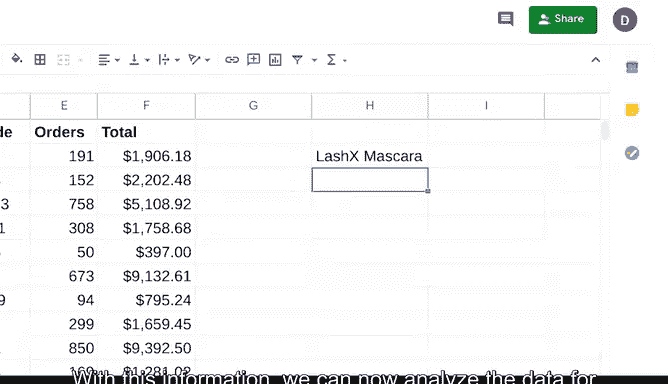

# 谷歌数据分析师第四课《从脏数据到干净数据的处理》process-data（中英字幕）deepseek翻译 - P17：17_02_07_不同数据视角.zh_en - GPT中英字幕课程资源 - BV19m4y1J7dG

Hi， let's get into it。Motivational speaker Wayne Dyer once said。

"If you change the way you look at things， the things you look at change。

This is so true in data analytics。 No two analytics projects are ever exactly the same。

 So it only makes sense that different projects require us to focus on different information differently。

In this video， we'll explore different methods that data analysts use to look at data differently and how that leads to more efficient and effective data cleaning。

Some of these methods include sorting and filtering。Pivt tables， a function called V lookup。

And plotloting to find outliers。Let's start with sorting and filtering。As you learned earlier。

 sorting and filtering data helps data analysts customize and organize the information the way they need for a particular project。

But these tools are also very useful for data cleaning。

You might remember that sorting involves arranging data into a meaningful order to make it easier to understand。

Analyze and visualize。For data cleaning， you can use sorting to put things in alphabetical or numeric or order so you can easily find a piece of data。

Sorting can also bring duplicate entries closer together for faster identification。Filterters。

 on the other hand， are very useful in data cleaning when you want to find a particular piece of information。

You learned earlier that filtering means showing only the data that meets a specific criteria while hiding the rest。

This lets you view only the information you need。When cleaning data。

 you might use a filter to only find values above a certain number or just even or odd values。Again。

 this helps you find what you need quickly and separates out the information you want from the rest。

That way， you can be more efficient when cleaning your data。

Another way to change the way you view data is by using pivot tables。

You've learned that a pivot table is a data summarization tool that is used in data processing。

Pivvoot tables sort， reorganize， group， count， total， or average data stored in a database。

In data cleaning。Pivt tables are used to give you a quick， clutter free view of your data。

You can choose to look at the specific parts of a data set you need and get a visual in the form of a pivot table。

Let's create one now using our cosmetic makers spreadsheet again。To start。

 select the data we want to use。Here we'll choose the entire spreadsheet。Select data。

Then pivot table。Choose new She。And create。Let's say we're working on a project that requires us to look at only the most profitable products。

Items that earn the cosmetics maker at least $10，000 in orders。

So the row we include is total for total profits。We'll sort a descending order to put the most profitable items at the top。

And we'll show totals。Next， we'll add another row for products。

So that we know what those numbers are about。We can clearly determine that the most profitable products have the product codes 1514。

3 E XFO。And。3，2，7，2，9， M A S C。We can ignore the rest for this particular project because they fall below 10。

000 in orders。Now， we might be able to use context clues that assume we're talking about exfoliions and mascaris。

But we don't know which ones or if that assumption is even correct。

So we need to confirm what the product codes correspond to。And this brings us to the next tool。

It's called V Lookup。V Lookup stands for Ver Lookup。

It's a function that searches for a certain value in a column to return a corresponding piece of information。

When data analysts look up information for a project。

 it's rare for all of the data they need to be in the same place。

Usually you'll have to search across multiple sheets or even different databases。

The syntax of V lookup is equals V lookup， open parentheses， then the data you want to look up。

Next is a comma。And where you want to look for that data。In our example。

 this will be the name of a spreadsheet followed by exclamation point。

The exclamation point indicates that we're referencing a cell in a different sheet from the one we're currently working in。

Again， that's very common in data analytics。Okay， next is the range in the place where you're looking for data。

Indicated using the first and last cell separated by a colon。

 after one more comma is the column in the range containing the value to return。Next。

 another comma and the word false。Which means that an exact match is what we're looking for。Finally。

 complete your function by closing the parentheses to put it simply。

 V lookup searches for the value in the first argument in the leftmost column of the specified location。

Then the value of the third argument tells v lookup to return the value in the same row from the specified column。

The false tells V lookup that we won an exact match。Soon。

 you'll learn the difference between exact and approximate matches。But for now。

 just know that V lookup takes a value in one cell and searches for a match in another place。

Let's begin。We'll type equals V lookup。Then add the data we want to look for。

 which is the product code。The dollar signs make sure that the corresponding part of the reference remains unchanged or locked。

You can lock just the column。Just the row。Or both at the same time。Next。

 we'll tell it to look at sheet 2 in both columns。We added two to represent the second column。

The last term， false。Says we want an exact match。With this information。

 we can now analyze the data for only the most profitable products。

Going back to the two most profitable products， we can search for 1，5，1，4，3 EXFO and 32，72，9 MAC。

Go to edit。And then， find。Type in the product codes。And search for them。

Now we can learn which products we'll be using for this particular project。

The final tool we'll talk about is something called plotting。When you plot data。

 you put it in a graph， chart， table， or other visual to help you quickly find what it looks like。

Plooting is very useful when trying to identify any skewed data or outliers。For example。

 if we wanted to make sure the price of each product is correct。We could create a chart。

This would give us a visual aid that helps us quickly figure out if anything looks like an error。

So let's select the column with our prices。Then we'll go to insertst and choose Char。

Pick a column chart as the type。One of these prices looks extremely low。If we look into it。

We discovered that this item has a decimal point in the wrong place。It should be $7。30， not 73。

That would have a big impact on our total profits， so it's a good thing we caught that during data cleaning。

Looking at data in new and creative ways helps data analysts identify all kinds of dirty data。

Coming up， you'll continue practicing these new concepts so you can get more comfortable with them。

 you'll also learn additional strategies for ensuring your data is clean and will provide you with effective insights。

Great work so far。