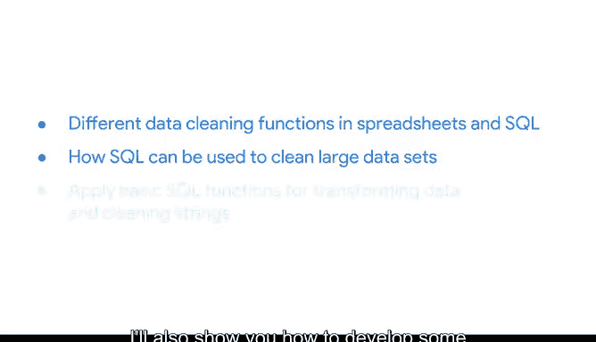

# 谷歌数据分析师第四课《从脏数据到干净数据的处理》process-data（中英字幕）deepseek翻译 - P19：19_03_01_使用SQL清洗数据.zh_en - GPT中英字幕课程资源 - BV19m4y1J7dG

Welcome back and great job on that last weekly challenge now that we know the difference between clean and dirty data and some general data cleaning techniques。

 let's focus on data cleaning using SQL Com up， we'll learn about the different data cleaning functions in spreadsheets and SQL and how SQL can be used to clean large datasets。

I'll also show you how to develop some basic search queries for databases and how to apply basic SQL functions for transforming data and cleaning strengths Cleaning your data is the last step in the data analysis process before you can move on to the actual analysis and SQL has a lot of great tools that can help you do that。

But before we start cleaning databases， we'll take a closer look at SQL and when to use it。

 I'll see you there。