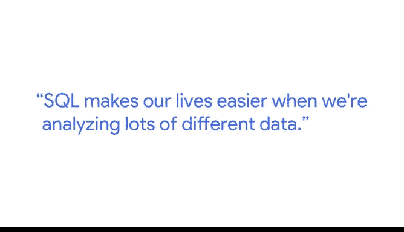
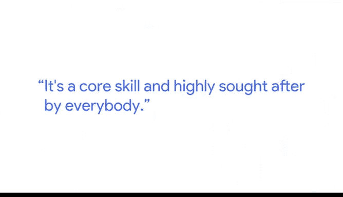

# 谷歌数据分析师第四课《从脏数据到干净数据的处理》process-data（中英字幕）deepseek翻译 - P20：20_03_02_萨莉：对SQL的热爱.zh_en - GPT中英字幕课程资源 - BV19m4y1J7dG

Advertising agencies get money from their clients to advertise their brand right and so these agencies use our products。

 use certain Google platforms， advertising platforms and I help them with how to best use those platforms。

 different strategies they can use to be best in class a lot of the folks at the advertising agencies have reports that they have to send out to their clients And so these reports take a lot of time to create and visualize And so what I do is I help the practitioners and analytics teams use a particular product that enables them to create those reports much faster and much easier if you're gonna start off as a data analyst。

 it opens tons of doors because everybody is tracking data is using data needs to use data regardless of industry So anywhere from healthcare to advertising to e-commerce to entertainment anything and everything everybody uses data so everybody。

Needs you as a data analyst。 SQL makes our lives easier when we're analyzing lots of different data。

 It's only somewhat recently that the SQL programs that we use now can give us instant results for analyzing millions or billions of data。

Years ago， maybe about like five years ago or so。Even though we could still analyze those millions of rows。

 we would end up having to wait 15 minutes，30 minutes for the queries to run。

 But now it's instantaneous。 And so that's really exciting。

 And we can do so much more with that power。 So SQL has helped a lot in my career because it's one of those fundamental things you have to know as a data analyst back in the day。

 not everyone use SQL。 So knowing SQL was definitely a competitive advantage。 Nowadays。

 I would say more and more people maybe most people know it。

 It's a core skill and highly sought after by everybody。😊。

So knowing SQL， becoming a data analyst makes you popular， quite popular from recruiters。

 So I think that's really fun。 I taught myself SQL。

 So my knowledge about SQL is something I hold dear， near and dear， close to my heart。

 since it's something that almost。😊，I've made for myself and I feel so much satisfaction from it。

 So that's why I really like SQL。 One of the fun things about SQL。

 Another reason why I really enjoy it using it is because when you type something in that query and you just hit control to enter or once you run the query。

 you get the results almost instantly depending on the platform you use but it's fascinating to see if you think conceptually how much analysis。

 the computer is doing for you based on that little bit of command code or little bit of code U。

 and it's just so powerful if you think about what's happening behind the scene。

 So I think that's kind of fun to look at。 we live in a world of big data and it keeps getting bigger the computing power is also increasing exponentially。

 So with all the data that we can track the more and more we can track that data。

 the more and more we need data analyst。 And so our career prospects are basically skyrocketing Im Sally。

 I'm a measurement。😊，AnAical lead at Google。