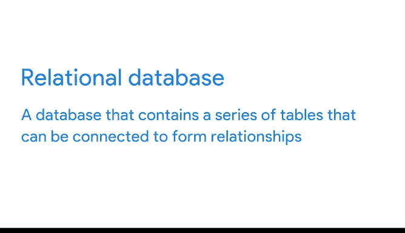

# 谷歌数据分析师第四课《从脏数据到干净数据的处理》process-data（中英字幕）deepseek翻译 - P21：21_03_03_理解SQL功能.zh_en - GPT中英字幕课程资源 - BV19m4y1J7dG

Hello again。 so before we go over all the ways data analysts use SQL to clean data。

 I want to formally introduce you to SQL。 We've talked about SQL a lot already。

 you've seen some databases and some basic functions in SQL。

 and you've even seen how SQL can be used to process data。

But now let's actually define SQL SQL is structured query language that analysts use to work with databases。

Data analysts usually use SQL to do with large data sets because it can handle huge amounts of data。

 and I mean trillions of rows。That's a lot of rows to wrap your head around。

 So let me give you an idea about how much data that really is。

Imagine a data set that contains the name of all 8 billion people in the world。

It would take the average person 101 years to read all 8 billion names。

 SQL can process this in seconds。Personally， I think that's pretty cool。

Other tools like spreadsheets might take a really long time to process that much data。

 which is one of the main reasons data analysts choose to use SQL when dealing with big datas。

Let me give you a short history on SQL。Development on SQL actually began in the early 70s。 In 1970。

 Edgar F。 Cod developed the theory about relational databases。

 You might remember learning about relational databases a while back。

This is a database that contains a series of tables that can be connected to form relationships。

 At the time， IBM was using a relational database management system called System R。

Well， IBM computer scientists were trying to figure out a way to manipulate and retrieve data from IBM system R。

 their first query language was hard to use， so they quickly moved on to the next version SQL。

In 1979， after extensive testing， SQL， now just spelled SQL， was released publicly。By 1986。

 SQL had become the standard language for a relational database communication， and it still is。

This is another reason why data analysts choose SQL。 It's a well known standard within the community。

 The first time I use SQL to pull data from a real database was for my first job as a data analyst。

 I didn't have any background knowledge about SQL before that。

 I only found out about it because it was a requirement for that job。

The recruiter for that position gave me a week to learn it。

 So I went online and researched it and ended up teaching myself SQL。

They actually gave me a written test as part of the job application process。

 I had to write SQL queries and functions on a whiteboard。But I've been using SQL ever since。

 and I really like it。 And just like I learned SQL on my own。

 I wanted to remind you that you can figure things out yourself too。

 There's tons of great online resources for learning。

 so don't let one job requirement stand in your way without doing some research first。😊。

Now that we know a little more about why analysts choose to work with SQL when they're handling a lot of data。

And a little bit about the history of SQL， We'll move on and learn some practical applications for it。

 Coming up next， we'll check out some of the tools we learned in spreadsheets and figure out if any of those apply to working in SQL。

 Sil alert。 They do。😊，See you soon。

