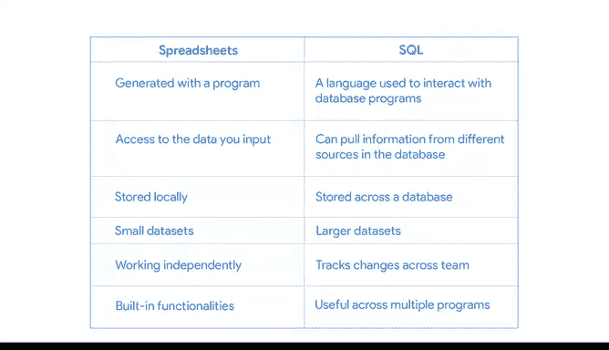

# 谷歌数据分析师第四课《从脏数据到干净数据的处理》process-data（中英字幕）deepseek翻译 - P22：22_03_05_电子表格与SQL对比.zh_en - GPT中英字幕课程资源 - BV19m4y1J7dG

Hey there。 So far， we've learned about both spreadsheets and SQL。

 While there's lots of differences between spreadsheets and SQL， you'll find some similarities， too。

 So let's check out what spreadsheets and SQL have in common， and how they're different。

 Spreadsheets in SQL actually have a lot in common。 Specifically。

 there's tools you can use in both spreadsheets and SQL to achieve similar results。

 We've already learned about some tools for cleaning data in spreadsheets。

 which means you already know some tools that you can use in SQL， For example。

 you can still perform arithmetic use formulas and join data when you're using SQL。😊。

So we'll build on the skills we've learned in spreadsheets and use them to do even more complex work in SQL。

Here's an example of what I mean by more complex work。

 If we were working with health data for a hospital。

 we' need to be able to access and process a lot of data。

 We might need demographic data like patients names， birthdays and addresses。

 information about their insurance or past visits。Public health data or even user generated data to add to their patient records。

All of this data is being stored in different places， maybe even in different formats。

 and each location might have millions of rows and hundreds of related tables this is way too much data to input manually。

Even for just one hospital。That's where SQL comes in handy instead of having to look at each individual data source and record it in our spreadsheet。

 we can use SQL to pull all this information from different locations in our database。Now。

 let's say we want to find something specific in all this data。

 like how many patients with a certain diagnosis came in today。In a spreadsheet。

 we can use the count if function to find that out。

Or we can combine the count and where queries in SQL to find out how many rows match our search criteria。

 This will give us similar results， but works with a much larger and more complex set of data。 Next。

 let's talk about how spreadsheets in SQL are different。First。

 it's important to understand that spreadsheets and SQL are different things。

 Spreadsheets are generated with a program like Excel or Google Sheets。

These programs are designed to execute certain built in functions。SQL， on the other hand。

 is a language that can be used to interact with database programs like Oracle MySQL or Microsoft SQL Server。

The differences between the two are mostly in how they're used。

If a data analyst was given data in the form of a spreadsheet。

 they'll probably do their data cleaning and analysis within that spreadsheet。

But if they're working with a large data with more than a million rows or multiple files within a database。

 it's easier， faster and more repeatable to use SQL。

 SQL can access and use a lot more data because it can pull information from different sources in the database automatically。

 unlike spreadsheets， which only have access to the data you input。

 This also means the data is stored in multiple places。

 A data analyst might use spreadsheets stored locally on their hard drive or their personal cloud when they're working alone。

😊，But if they're on a larger team with multiple analysts who need to access and use data sort across a database。

 SQL might be a more useful tool because of these differences。

 spreadsheets and SQL are used for different things。 As you already know。

 spreadsheets are good for smaller datas。 and when you're working independently plus spreadsheets have built in functionalities like spell check that can be really handy。

 SQL is great for working with larger datasets。 Even trillions of rows of data。

And because SQL has been the standard language for communicating with databases for so long。

 it can be adapted and used for multiple database programs。SQL also records changes in queries。

 which makes it easy to track changes across your team if you're working collaboratively。

Next， we'll learn more queries and functions in SQL that will give you some new tools to work with。

You might even learn how to use spreadsheet tools in brand new ways。 See you next time。

