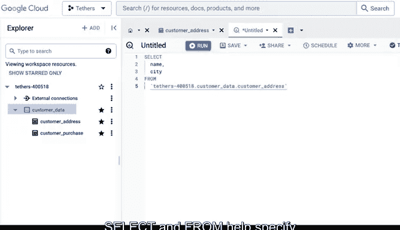
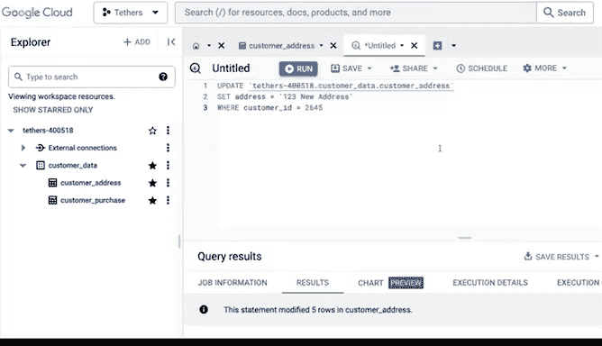

# 谷歌数据分析师第四课《从脏数据到干净数据的处理》process-data（中英字幕）deepseek翻译 - P23：23_03_02_广泛使用的SQL查询.zh_en - GPT中英字幕课程资源 - BV19m4y1J7dG

Hey， welcome back。So far， we've learned that SQL has some of the same tools as spreadsheets。

 but on a much larger scale。In this video， we'll learn some of the most widely used SQL queries that you can start using for your own data cleaning and eventual analysis。

 Let's get started。 We've talked about queries as requests you put into the database to ask it to do things for you。

Querries are a big part of using SQL。 It's structured query language。 After all。

 queries can help you do a lot of things， but there's some common ones that data analysts use all the time。

 So let's start there。First， I'll show you how to use the select query。

 I've called this one out before， but now I'll add some new things for us to try out。Right now。

 the table viewer is blank because we haven't pulled anything from the database yet。For this example。

 the store we're working with is hosting a giveaway for customers in certain cities。

 We have a database containing customer information that we can use to narrow down which customers are eligible for the giveaway。

So let's do that now。We can use select。To specify exactly what data we want to interact with in a table。

And if we combine select with from， we can pull data from any table in this database as long as we know what the columns and rows are named。

We might want to pull the data about customer names and cities from one of the tables to do that。

 we can input， select name， comma city。From customer underscore data dot customer underscore address。

To get this information from the customer underscore address table。

 which lives in the customer underscore data data set。

So select and from help specify what data we want to extract from the database and use。

 We can also insert new data into a database or update existing data。

For example， maybe we have a new customer that we want to insert into this table。

 We can use the insert into query to put that information in。

 So let's start with where we're trying to insert this data。 The customer underscore address table。

We also want to specify which columns we're adding this data to by typing their names in the parentheses。

That way， SQL can tell the database exactly where we're inputting new information。

Then we'll tell it what values we're putting in。Run the query。 And just like that。

 it added it to our table for us。Now let's say we just need to change the address of a customer。Well。

 we can tell the database to update it for us。To do that。

 we need to tell it we're trying to update the customer underscore address table。

Then we need to let it know what value we're trying to change。

But we also need to tell it where we're making that change specifically so that it doesn't change every address in the table。

There。Now， this one customer's address has been updated。

If we want to create a new table for this database， we can use the C table if not exists statement。

Keep in mind， just running a SQL query doesn't actually create a table for the data we extract。

It just stores it in our local memory。To save it， we'll need to download it as a spreadsheet or save the results into a new table。

As a data analyst， there is a few situation where you might need to do just that。

It really depends on what kind of data you're pulling and how often。

If you're only using a total number of customers， you probably don't need a CSV file or a new table in your database。

If you're using the total number of customers per day to do something like track a weekend promotion in a store。

You might download that data as a CSV file so you can visualize it in a spreadsheet。

But if you're being asked to pull this trend on a regular basis。

 you can create a table that will automatically refresh with the query you've written。That way。

 you can directly download the results whenever you need them for a report。

 Another good thing to keep in mind， if you're creating lots of tables within a database。

 you'll want to use the D table if exists statement to clean up after yourself。

It's good housekeeping。 You probably won't be deleting existing tables very often。 After all。

 that's the company's data。 And you don't want to delete important data from their database。

But you can make sure you're cleaning up the tables you've personally made so that there aren't old or unused table with redundant information cluttering the database。

There， now you've seen some of the most widely used SQL queries in action。

There is definitely more query keywords for you to learn and unique combinations that'll help you work within databases。

 but this is a great place to start。Coming up， we'll learn even more about queries in SQL and how to use them to clean our data。

 See you next time。😊。