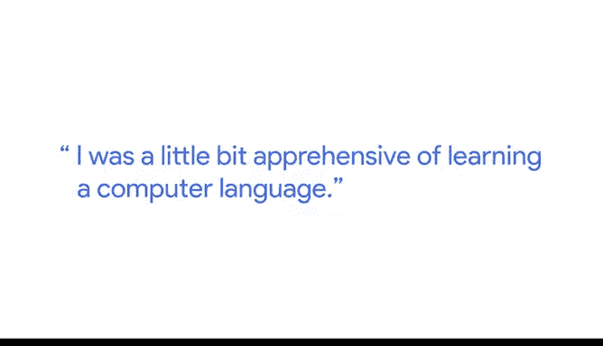

# 谷歌数据分析师第四课《从脏数据到干净数据的处理》process-data（中英字幕）deepseek翻译 - P24：24_03_03_埃文：SQL的乐趣.zh_en - GPT中英字幕课程资源 - BV19m4y1J7dG

Hi， I'm Evan。 and I'm a learning portfolio manager here at Google。

 I don't think I'm a computer science or super engineering type， but I really。

 really like working with numbers。 So naturally I went into accounting And about after two years of accounting。

 I said， wow， I really don't want to do all of this by hand。

 So I took my first information systems class where they taught me the language SQl or SQL and it completely opened up my mind between a working knowledge of spreadsheets where you change one cell and the whole spreadsheet changes because those amazing calculated fields and SQL。

 where I can query billions of rows of data in a matter of seconds。

 I was completely sold on my love for data and I've dedicated my life and my career to just communicating that passion in getting folks excited about the things that they could do with their data。

 Why is SQL such an amazing first language to pick up。 Well。

 there's so many things that you can do with it。 I will first caveat and say I am not a computer science major。

 I don't know deep down Java and Python。😊，And I was a little bit apprehensive of learning a computer language。

It's kind of like a pseudo programming language。 But in reality。

 you can write your first SQL statement， as you're gonna find out here in just five minutes or less。

 SQL。 honestly， it's one of those languages that's easy to learn and even more fun to master。

 I've been learning SQL for 15 years。 I've been teaching it for 10。

 As you're gonna to see in some of these handson labs you'd be working through is very easy to return data from within a database or a data just select whatever columns from whichever database that you're pulling from and immediately you get the data back。

 Now， the really fun part is actually teasing apart and saying， I wonder if I change my query。

 Add these more columns， filter this data set a different way。 share with my colleagues。

 It's meant to be an interactive querying language and query means asking a question。

 So if I could challenge you one thing， It's that the syntax for picking up SQL。

 much like the rules of a chess game are very， very easy to pick up。

 But the hard part is actually not the syntax writing。😊，Much like with any programming language。

 but the actual what question do you want to ask of your data。

 So what I would encourage you to do is be super curious about whatever data set that you're given。

Spend a lot of time even before you touch your keyboard in thinking about what data set or what insights you can get from your data。

 and then start having fun。 There's many different ways to write the same correct SQL statement。

 So try one out， share it with your friends and then start returning that data back for insights。

 Good luck。