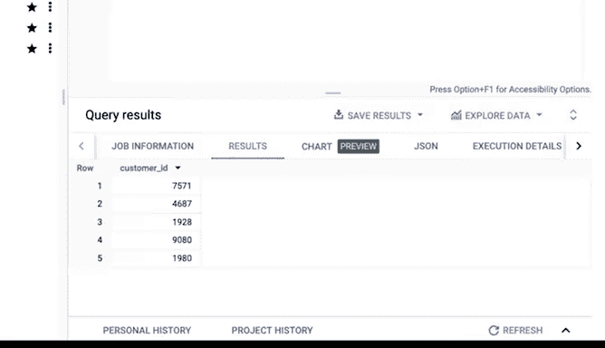

# 谷歌数据分析师第四课《从脏数据到干净数据的处理》process-data（中英字幕）deepseek翻译 - P25：25_03_04_使用SQL清洗字符串变量.zh_en - GPT中英字幕课程资源 - BV19m4y1J7dG

It's so great to have you back。Now that we know some basic SQL queries and spent some time working in a database。

 let's apply that knowledge to something else we've been talking about。Preparing and cleaning data。

 you already know that cleaning and completing your data before you analyze it is an important step。

So in this video， I'll show you some ways SQL can help you do just that。

Including how to remove duplicates as well as four functions to help you clean string variables。

Earlier， we covered how to remove duplicates and spreadsheets using the Reve Dlics tool。In SQL。

 we can do the same thing by including distinct in our select statement。 For example。

 let's say the company we work for has a special promotion for customers in Ohio。

We want to get the customer IDs of customers who live in Ohio。

 but some customer information has been entered multiple times。

We can get these customer Is by writing。Select。Customer underscore I D。From。Customer underscore data。

 thought customer underscore address。This query will give us duplicates if they exist in the table。

If customer I D 9，0，8，0。😮，Shows up three times in our table。

 Our results will have three of that customer I D。But we don't want that。

 We want a list of all unique customer I Ds。To do that。

 we add distinct to our select statement by writing select。Distinct。

Customer underscore ID from customer underscore data do customer underscore address。Now。

 the customer I D 90，8，0 will show up only once in our results。

You might remember we talked before about text strings as a group of characters within a cell。

 commonly composed of letters， numbers or both。These text strings need to be clean sometimes Maybe they've been entered differently in different places across your database。

 and now they don't match。In those cases， you'll need to clean them before you can analyze them。

 So here are some functions you can use in SQL to handle string variables。

You might recognize some of these functions from when we talked about spreadsheets。

Now it's time to see them work in a new way， pull up the data we shared right before this video。

And you can follow along step by step with me during the rest of this video。

The first function I want to show you is length， which we've encountered before。

If we already know the length our string variables are supposed to be。

 we can use length to double check that our string variables are consistent。For some databases。

 this query is written as L， but it does the same thing。

 Let's say we're working with the customer underscore address table from our earlier example。

We can make sure that all country codes have the same length by using length on each of these strings。

So to write our SQL query， let's first start with。Select and from。

We know our data comes from the customer underscore address table within the customer underscore data data set。

 So we add。Customer underscore data dot customer underscore address。After the from class。

Then under select。We'll write La。And then the column we want to check。Country。

To remind ourselves what this is， we can label this column in our results as letters underscore in underscore country。

So， we add。As letters underscore in underscore country。After length parentheses country。

The result we get is a list of the number of letters in each country listed for each of our customers。

 It seems that almost all of them are two， which means the country field contains only two letters。

But we notice one that has three。 That's not good。We want our data to be consistent。

So let's check out which countries were incorrectly listed in our table。

We can do that by putting the length parentheses country parentheses function that we created into the where clause。

 because we're telling SQL to filter the data to show only customers whose country contains more than two letters。

So now we'll write， select。Country from customer underscore data dot customer underscore address。

Were length parentheses， country parentheses。Greater than two。When we run this query。

 we now get the two countries where the number of letters is greater than the two we expect to find。

The incorrectly listed countries show up as USA instead of US。If we created this table。

 then we could update our table so that this entry shows up as US instead of USA。But in this case。

 we didn't create this table， so we shouldn't update it。

We still need to fix this problem so we can pull a list of all the customers in the US。

 including the two that have USA instead of US。The good news is that we can account for this error in our results by using the substr function in our SQL query。

To write our SQL query， let's start by writing the basic structure。Select。From。Where。

We know our data is coming from the customer underscore address table。

 from the customer underscore data data set。So we type in customer， underscore。

Data dot customer underscore address after from。Next， we tell SQL what data we want it to give us。

 We want all the customers in the US by their IDs， so we type in customer underscore ID after select。

Finally， we want SQL to filter out only American customers。

So we use the sub string function after the wear clause。

We're going to use the sub string function to pull the first two letters of each country so that all of them are consistent and only contain two letters to use the sub string function。

 We first need a tellsQL the column where we found this error， country。

Then we specify which letter to start with。We want SQL to pull the first two letters。

 so we're starting with the first letter。So we type in one。

 Then we need to tell SQL how many letters， including this first letter to pull。

Since we want the first two letters， we need SQL to pull two total letters。So we type in two。

This will give us the first two letters of each country。We want US only。

 so we'll set this function to equals。US。When we run this query。

 we get a list of all customer IDs of customers whose country is the US。

 including the customers that had USA instead of US going through our results。

 it seems like we have a couple duplicates where the customer ID is shown multiple times。

Remember how we get rid of duplicates？We add distinct before customer underscore ID。

So now when we run this query。We have our final list of customer Is of the customers who live in the US。

 Finally， let's check out the trim function， which you've come across before。

This is really useful if you find entries with extra spaces and need to eliminate those extra spaces for consistency。

For example， let's check out the state column in our customer underscore address table。

Just like we did for the country column， we want to make sure the state column has the consistent number of letters。

So let's use the length function again to learn if we have any state that has more than two letters。

Which is what we would expect to find in our data table。

We start writing our SQL query by typing the basic SQL structure of。Select。From。Where。

We're working with the customer underscore address table and the customer underscore data data set。

 so we type in。Customer underscore data dot。 customer underscore address。After from。Next。

 we tell SQL what we want it to pull。We wanted to give us any state that has more than two letters。

So we type in state after select， finally。We want SQL to filter for states that have more than two letters。

 This condition is written in the where clause。 So we type in。leength。Prenheses state， parentheses。

 and that it must be greater。Than two， because we want the states that have more than two letters。

We want to figure out what the incorrectly listed states look like。 if we have any。

 when we run this query， we get one result。We have one state that has more than two letters。

But hold on。How can this state that seems like it has two letters。

 O and H for Ohio have more than two letters。 We know that there are more than two characters because we use the length parenthees state parentheses greater than two statement in the where clauses when filtering our results。

So that means the extra characters that SequL is counting must then be a space。

 There must be a space after the age。 This is where we would use the trim function。

The trim function removes any spaces。 So let's write a SQL query that accounts for this error。

Let's say we want a list of all customer IDs of the customers who live in OH for Ohio。

We start with the basic SQL structure。Select。😊，From。Where。

We know the data comes from the customer underscore address table and the customer underscore data data set。

So we type in customer underscore data do customer underscore address after from。Next。

 we tell SQL what data we want。We want SQL to give us the customer Is of customers who live in Ohio。

So we type in customer underscore I D after select。

Since we know we have some duplicate customer entries。

 we'll go ahead and type in distinct before customer I D。

To remove any duplicate customer Is from appearing in our results。Finally。

 we want SQL to give us the customer IDs of the customers who live in Ohio。

We're asking SQL to filter the data。 So this belongs in the where clause。

 Here's where we'll use the trim function。To use the trim function。

 we tell SQL the column we want to remove spaces from， which is state in our case。

 and we want only Ohio customers。 so we type in equals0 H。That's it。

 We have all customer Is of the customers who live in Ohio。

 including that customer with the extra space after the age。

Making sure that your string variables are complete and consistent will save you a lot of time later by avoiding errors or miscalculations。

That's why we cleaned data in the first place。Hopefully functions like length。

 substring and trim will give you the tools you need to start working with string variables in your own data sets。

Next up， we'll check out some other ways you can work with strings and more advanced cleaning functions。

Then you'll be ready to start working in SQL on your own。 See you soon。😊。

