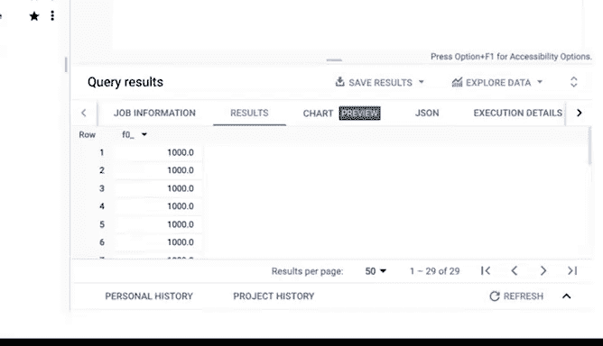

# 谷歌数据分析师第四课《从脏数据到干净数据的处理》process-data（中英字幕）deepseek翻译 - P26：26_03_02_高级数据清洗函数第一部分.zh_en - GPT中英字幕课程资源 - BV19m4y1J7dG

Hi there and welcome back。So far， we've gone over some basic SQL queries and functions that can help you clean your data。

We've also checked out some ways you can deal with string variables in SQL to make your job easier。

Get ready to learn more functions for dealing with strings in SQL Trust me。

 these functions will be really helpful in your work as a data analyst。In this video。

 we'll check out strings again and learn how to use the CA function to correctly format data。

When you import data that doesn't already exist in your SQL tables。

 the data types from the new data might not have been imported correctly。

This is where the cast function comes in handy。Basically。

 CAS can be used to convert anything from one data type to another。Let's check out an example。

Imagine we're working with Lauren's furniture store。

 The owner has been collecting transaction data for the past year。

But she just discovered that they can't actually organize their data because it hadn't been formatted correctly。

So we'll help her by converting her data to make it useful again。For example。

 let's say we want to sort all purchases by purchase， underscore price， and descending order。

That means we want the most expensive purchase to show up first in our results。

To write the SQL query， we start with the basic SQL structure， select。From。

Where we know the data is stored in the customer underscore purchase table in the customer underscore data data set。

 So we write customer underscore data thought customer underscore purchase after from。Next。

 we tell SQL what data to give us in the select clause。

 We want to see the purchase underscore price data， so we type。Purchase。

 underscore price after select。Next is the warehouseclo。

We are not filtering out any data since we want all purchase prices shown so we can take out the warehouse clause。

Finally， to sort the purchase underscore price in descendending order， we type。Order by。Purchase。

 underscore price。D， E， S C at the end of our query。Let's run this query。We see that， 89。85。

Shows up at the top with 799。99 below it。But we know that 799。99 is a bigger number than 89。85。

The database doesn't recognize that these are numbers， so it didn't sort them that way。

 If we go back to the customer underscore purchase table and take a look at its schema。

We can see what data type the database thinks purchasease underscore price is。 It says here。

 the database thinks purchase underscore price is a string。When， in fact， it is a float。

 which is a number that contains a decimal。 That is why89。85 shows up before 799。99。

When we sort letters， we start from the first letter before moving on to the second letter。

So if we want to assert the wordsapp and orange and descending order。

 we start with the first letters A and O。Since O comes after a， orange will show up first。

 then Apple the database did the same with 89。85 and 799。99。 It started with the first letter。

 which in this case was a 8 and 7， respectively。 Since 8 is bigger than 7。 The database sorted 89。

85 first， and then 799。99， because the database treated these as text strings。

The database doesn't recognize these strings as floats because they haven't been typecast to match that data type yet。

 Tycasting means converting data from one type to another。

Which is what we'll do with the cast function。 We use the cast function to replace purchase underscore price with a new purchase underscore price that the database recognizes as float instead of string。

 We start by replacing purchase underscore price with cast。😊。

Then we tell SQL the field we want to change， which is the purchase underscore price field。

Next is a data type we want to change purchase underscore price to， which is the float data type。

BigQu stores numbers in a 64 bit system， so the float data type is referenced as float 64 in our query。

This might be slightly different in others' SQL platforms。

 but basically the 64 and flow 64 just indicates that we're casting numbers in the 64 B system as floats。

We also need to sort this new field。 so we change purchase underscore price after order buy to cast purchase underscore price as float 64。

 This is how we use the cast function to allow SQL to recognize the purchase underscore price column as floats instead of text strings。

 Now， we can sort our purchases by purchase underscore price。 And just like that。

 Lauren's furnitureur store has data that can actually be used for analysis。😊。

As a data analyst， you'll be asked to locate and organize data a lot。

 which is why you want to make sure you convert between data types early on。

Businesses like our furniture store are interested in timely sales data。

 and you need to be able to account for that in your analysis。

The CAS function can be used to change strings into other data types too， like date and time。

As a data analyst， you might find yourself using data from various sources part of your job is making sure the data from those sources is recognizable and usable in your database so that you won't run into any issues with your analysis and now you know how to do that。

The CAS function is one great tool you can use when you're cleaning data and coming up we'll cover some other advanced functions that you can add to your toolbox。

 See you soon。😊。