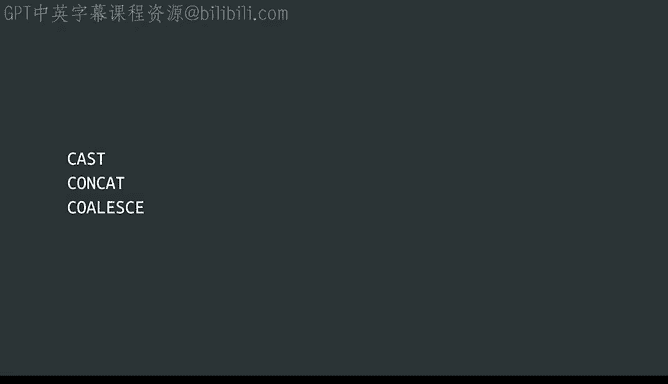
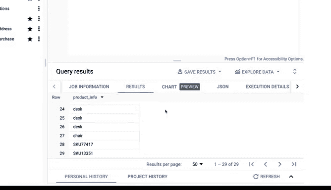

# 谷歌数据分析师第四课《从脏数据到干净数据的处理》process-data（中英字幕）deepseek翻译 - P27：27_03_03_高级数据清洗函数第二部分.zh_en - GPT中英字幕课程资源 - BV19m4y1J7dG

Hey there， great to see you again。So far， we've seen some SQL functions in action。In this video。

 we'll go over more uses for CA and then learn about Conca and Coes。

Let's get started。So earlier we talked about the CA function。

 which lets us type cast text strings into floats。I called out that the CAS function can be used to change into other data types too。

 so let's check out another example of how you can use CAS in your own data work。

We've got the transaction data we were working with from our Larence Furni store example。

But now we'll check out the purchase date field。The furniture store owner has asked us to look at purchases that occurred during their sales promotion period in December。

 let's write a SQL query that will pull date and purchase under price for all purchases that occurred between December 1。

 2020 and December 31s， 2020。We start by writing the basic SQL structure。Select from。Where。

We know the data comes from the customer underscore purchase table in the customer underscore data data set。

So we write customer underscore data do customer underscore purchase。After from。Next。

 we tell SQL what data to pull。Since we want date and purchase underscore price。

 we add them into the select statement。Finally， we want SQL to filter for purchases that occurred in December only。

 so we type date between 2020 1201 and 20201231。In the wearclo， let's run the query。

Four purchases occurred in December。But the date feel looks odd。

That's because the database recognizes the eight field as date time。

 which consists of the date and time。Our SQL query still works correctly。

 even if the date field is date， time instead of date。

But we can tell SQL to convert the date field into the date data type。

 so we see just the date and not the time。To do that， we use the cast function again。

So we'll use a CAS function to replace the date field in our select statement。

With the new date field that will show the date and not the time， we can do that by typing cast。

And adding the date。As the field we want to change， then we tell SQL the data type we want instead。

 which is the date data type。There。Now we can have cleaner results for purchases that occurred during the December sales period。

CaS is a super useful function for cleaning and sorting data。

 which is why I wanted you to see it in action one more time。 Next up。

 let's check out the Concat function。Concat lets you add strings together to create new text strings that can be used as unique keys。

Going back to our customer underscore purchase table。

 we see that the furniture store sells different colors of the same product。

The owner wants to know if customers prefer certain colors so the owner can manage store inventory accordingly。

The problem is the product underscore code is the same regardless of the product color。

 we need to find another way to separate products by color so we can tell if customers prefer one color over the others。

So we'll use Concat to produce a unique key that'll help us tell the products apart by color and count them more easily。

Let's write our SQL query by starting with the basic structure。Select。From。

Where we know our data comes from the customer underscore purchase table in the customer underscore data data set。

 so we type customer underscore data do customer_ purchasease。After from。Next。

 we tell SQL what data to pull。We use the concat function here to get that unique key of product and color。

So we type concat。The first column we want。Product underscore code。And the other column we want。

Product， underscore color。Finally， let's say we want to look at couches。

 So we filter for couches by typing。😊，Product equals。Couch。In the warehouse clause。

Now we can count how many times each couch was purchased and figure out if customers preferred one color over the others。

With concat， the furniture store can find out which color couches are the most popular and order more。

I've got one less advanced function to show you， coalesce。

Coaleesce can be used to return non null values in a list。Noll values are missing values。

If you have a field that's optional in your table， it'll have null in that field for rows that don't have appropriate values to put there。

Let's open the customer underscore purchase table so I can show you what I mean in the customer underscore purchase table。

 we can see a couple rows where product information is missing。 That is why we see nulls there。

But for the rows where product name is null， we see that there is product underscore code data that we can use instead。

We'd prefer SQL to show us the product name like bed or couch because it's easier for us to read。

But if the product name doesn't exist， we can tell SQL to give us the product underscore code instead。

That is where the coalescce function comes into play。

Let's say we wanted a list of all products that were sold。

We want to use the product name column to understand what kind of product was sold。

So we write our SQL query with the basic SQL structure， select。From。Where。

We know our data comes from customer underscore purchasease table in the customer underscore data data set。

 so we type customer_ data。 customer_ purchasease after from。Next， we tell SQL the data we want。

We want a list of product names， but if names aren't available， then give us the product code。

Here is where we type coalesce， Then we tell SQL which column to check first product and which column to check second if the first column is null。

 product underscore code。Will name this new field as product。Underscore info。Finally。

 we are not filtering out any data so we can take out the warehouse clauses。

This gives us product information for each purchase。Now。

 we have a list of all products that were sold for the owner to review。

Coaleesce can save you time when you're making calculations， too。

 by skipping any null values and keeping your math correct。

 Those were just some of the advanced functions you can use to clean your data and get it ready for the next step in the analysis process。

 You'll discover more as you continue working in SQL。😊，But that's the end of this video。

 And this module。 great work。 We've covered a lot of ground。

 You learn the different data cleaning functions in spreadsheets and SQL。😊。

And the benefits of using SQL to deal with large data sets。

We also added some SQL formulas and functions to your toolkit。And most importantly。

 we got to experience some of the ways that SQL can help you get data ready for your analysis After this。

 you'll get to spend some time learning how to verify and report your cleaning results so that your data is squeaky clean and your stakeholders know it。

😊，But before that， you've got another weekly challenge to tackle you've got this。

Some of these concepts might seem challenging at first。

 but they'll become second nature to you as you progress in your career。

 It just takes time and practice。 Speaking of practice。

 feel free to go back to any of these videos and rewatch or even try some of these commands on your own。

 Good luck。 And I'll see you again when you're ready。😊。

